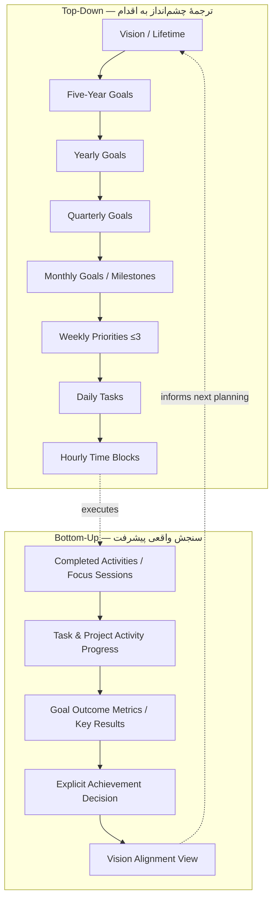
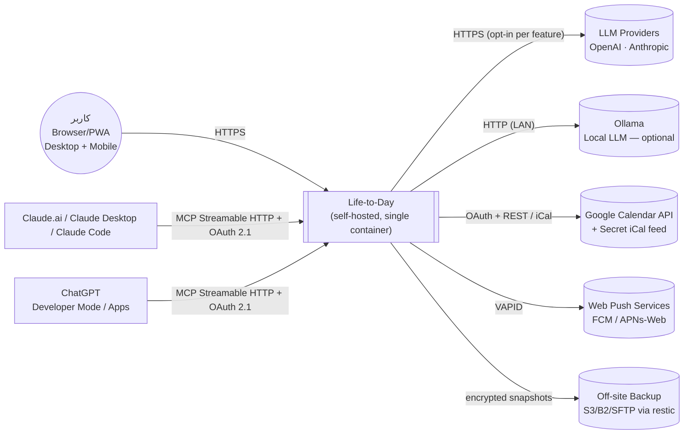
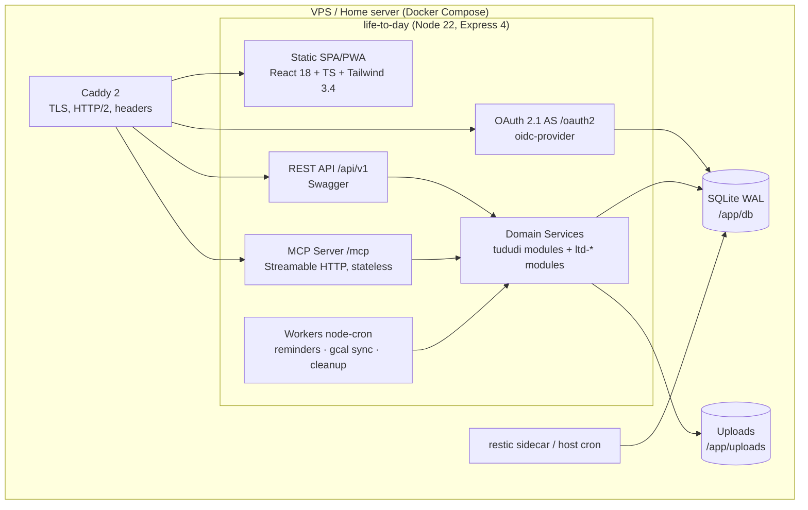
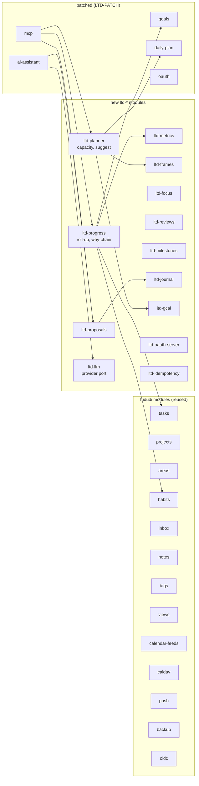
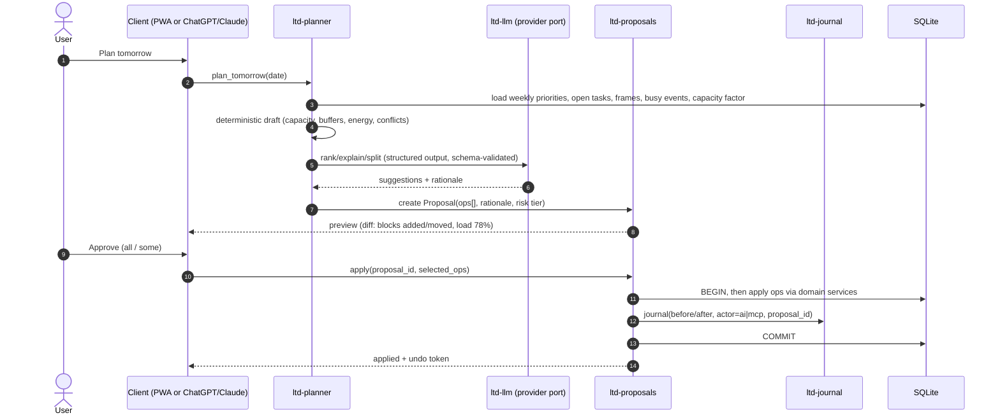
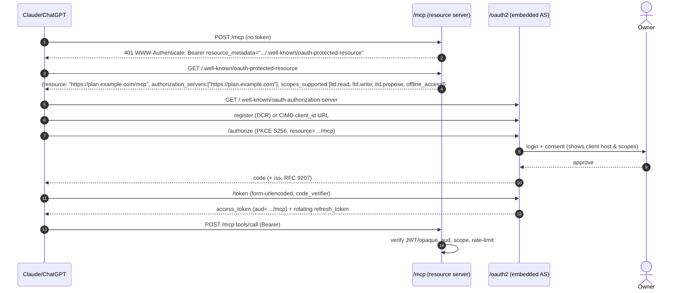
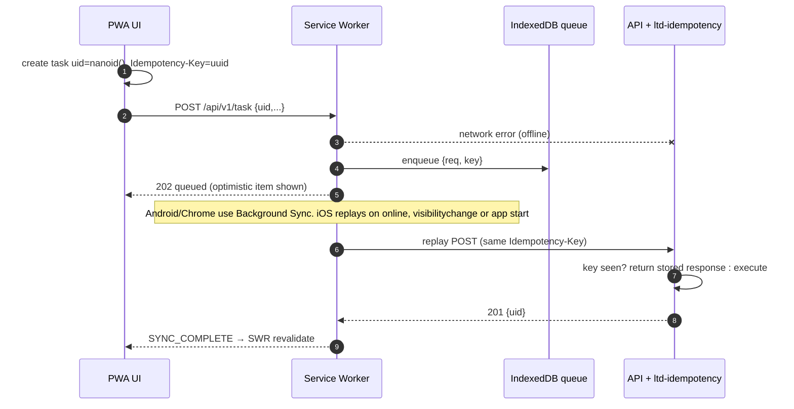
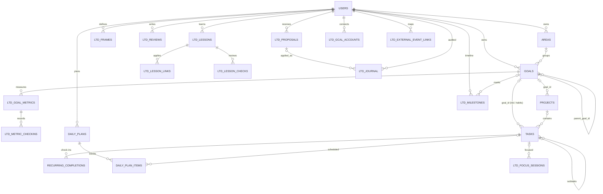
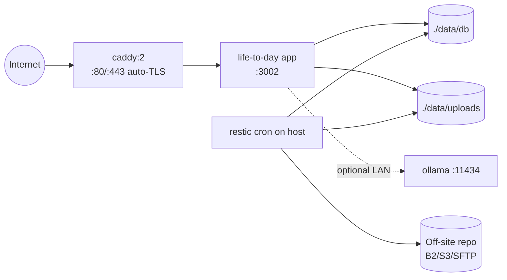
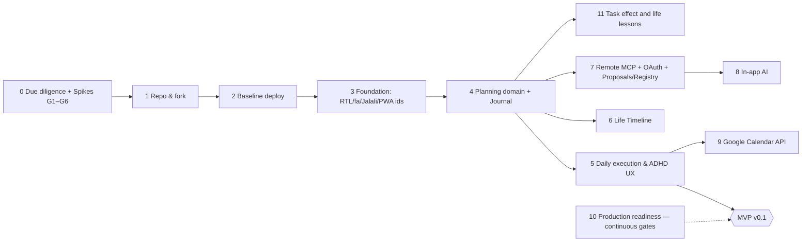

# PRODUCT_BLUEPRINT — Life-to-Day

**Life-to-Day — سیستم‌عامل شخصی زندگی با هوش مصنوعی**
**From Long-Term Vision to Daily Action — and Back.**

| مورد | مقدار |
|---|---|
| تاریخ پژوهش | **2026-10-10** (همهٔ بازیابی‌ها در همین روز انجام شده است) |
| وضعیت سند | v1.1 — فاز ۰ انجام شد؛ تصمیم: ادامه با fork tududi (`docs/ltd/spikes/DECISION.md`) |
| نوع اجرا | پژوهش فنی + طراحی محصول؛ هیچ کد محصولی نوشته یا fork واقعی ساخته نشده است |
| مخاطب | توسعه‌دهندهٔ تک‌نفره + Coding Agentها (Claude Code و مشابه) |
| زبان | فارسی، با اصطلاحات فنی انگلیسی |

### راهنمای برچسب‌های شواهد

| برچسب | معنا |
|---|---|
| ✅ **VERIFIED** | در سورس‌کد، مستندات یا API همان مخزن در تاریخ پژوهش بررسی شد (لینک در متن یا بخش ۳۱). |
| 🟡 **ASSUMPTION** | فرض مهندسی معقول که هنوز تأیید نشده؛ «ابطال‌گر» (falsifier) آن در بخش ۲۹ آمده است. |
| 🆕 **NEW** | قابلیت پیشنهادی که در هیچ پروژهٔ موجودی وجود ندارد و باید ساخته شود. |
| 🧪 **POC** | پیش از تعهد، نیاز به Proof of Concept دارد (دروازه‌های فاز ۰). |
| 🔁 **PORT** | مفهوم یا کد کوچک خالص (pure) از پروژهٔ MIT دیگر، با حفظ attribution منتقل می‌شود. |

### محدودیت‌های این پژوهش (صادقانه)

- مخازن با GitHub API بدون احراز هویت و `git clone` بررسی شدند. خود محصولات در مرورگر اجرا و پیمایش **نشدند**؛ ادعاهای UX از سورس، مستندات و README آمده‌اند.
- Docker روی دستگاه پژوهش نصب نبود؛ هیچ build یا اجرای محلی انجام نشد. اجرای واقعی، دروازهٔ G1 در فاز ۰ است.
- مستندات ChatGPT دربارهٔ احراز هویت MCP از `developers.openai.com` خوانده شد. این مستندات وضعیت «Developer Mode» و پلن‌های مجاز را مشخص نمی‌کرد، پس آن بخش 🟡 است.
- پروژه‌ای با نام دقیق «LifePlanner» به‌صورت متن‌باز معتبر پیدا نشد. نتایج جست‌وجو همه اپ تجاری یا قالب Notion بودند.

---

## فهرست

1. [Executive Summary — خلاصهٔ اجرایی](#1-executive-summary--خلاصهٔ-اجرایی)
2. [Product Vision and Philosophy](#2-product-vision-and-philosophy)
3. [Target Users and ADHD-Friendly Design Principles](#3-target-users-and-adhd-friendly-design-principles)
4. [Complete Feature Inventory](#4-complete-feature-inventory)
5. [Open-Source Research Findings](#5-open-source-research-findings)
6. [Repository Comparison Matrix](#6-repository-comparison-matrix)
7. [License and Reuse Assessment](#7-license-and-reuse-assessment)
8. [Recommended Foundation and Rationale](#8-recommended-foundation-and-rationale)
9. [Architecture Alternatives and Trade-offs](#9-architecture-alternatives-and-trade-offs)
10. [Final Recommended Architecture](#10-final-recommended-architecture)
11. [System Architecture Diagrams](#11-system-architecture-diagrams)
12. [Frontend and PWA Architecture](#12-frontend-and-pwa-architecture)
13. [Backend and Data Architecture](#13-backend-and-data-architecture)
14. [Goal-to-Action and Progress Model](#14-goal-to-action-and-progress-model)
15. [Synchronization and Offline Strategy](#15-synchronization-and-offline-strategy)
16. [AI Assistant Architecture](#16-ai-assistant-architecture)
17. [MCP Server Architecture](#17-mcp-server-architecture)
18. [Security and Privacy](#18-security-and-privacy)
19. [Self-Hosting and Deployment](#19-self-hosting-and-deployment)
20. [External Integrations](#20-external-integrations)
21. [UI/UX Information Architecture](#21-uiux-information-architecture)
22. [MVP Definition](#22-mvp-definition)
23. [Feature Prioritization](#23-feature-prioritization)
24. [Complete Phased Development Roadmap](#24-complete-phased-development-roadmap)
25. [Repository Forking and Setup Guide](#25-repository-forking-and-setup-guide)
26. [Testing and CI/CD Strategy](#26-testing-and-cicd-strategy)
27. [Risks, Dependencies, and Mitigation](#27-risks-dependencies-and-mitigation)
28. [Architecture Decision Records](#28-architecture-decision-records)
29. [Open Questions and Assumptions](#29-open-questions-and-assumptions)
30. [First Implementation Tasks + Task Backlog](#30-first-implementation-tasks--task-backlog)
31. [Research Sources and Verified References](#31-research-sources-and-verified-references)

---

## 1. Executive Summary — خلاصهٔ اجرایی

**تصمیم اصلی:** پایهٔ Life-to-Day را dayGLANCE قرار ندهید. **پروژهٔ [tududi](https://github.com/chrisvel/tududi) (MIT) را fork کنید** و آن را به‌شکل یک **Modular Monolith سرور-محور** (Server-canonical) گسترش دهید. از dayGLANCE و lifeGLANCE فقط **مفاهیم و توابع خالص کوچک** را با حفظ attribution منتقل کنید (🔁 PORT). glance-sync، glance-vault و glance-intents را **کنار بگذارید**.

### ۱.۱ چرا؟ پنج یافتهٔ تعیین‌کننده

1. **نیاز سخت، پایه را تعیین می‌کند.** MCP راه‌دور برای ChatGPT/Claude، AI سمت سرور، همگام‌سازی پس‌زمینهٔ Google Calendar و یادآوری‌های Push همه به **دسترسی سرور به دادهٔ plaintext** نیاز دارند.
2. **dayGLANCE عمداً این دسترسی را رد می‌کند.** ✅ دادهٔ اصلی در `localStorage` مرورگر است ([ARCHITECTURE.md](https://github.com/krelltunez/dayGLANCE/blob/02b6aecbf8ad7c5ec02c5daa55b46352dcf6a0ec/ARCHITECTURE.md)). مشخصات MCP خودش نسخهٔ headless/سروری را «**Resolved: no**» اعلام کرده و اجرای MCP روی GLANCEvault را «architecturally disqualified» دانسته است ([mcp-server-spec.md §4.4](https://github.com/krelltunez/dayGLANCE/blob/02b6aecbf8ad7c5ec02c5daa55b46352dcf6a0ec/docs/mcp-server-spec.md)). سرور MCP فعلی فقط داخل Electron و روی `127.0.0.1` اجرا می‌شود.
3. **GLANCEvault ذاتاً zero-knowledge است.** ✅ «Encryption is always on… There is no unencrypted self-host mode» ([GLANCEvault-server-spec.md](https://github.com/glance-apps/glance-vault/blob/412064a2d471a5bc09f4f4c5d56c6ded8cfdc8e4/docs/GLANCEvault-server-spec.md)). این برای حریم خصوصی عالی است، اما با AI و MCP سمت سرور ناسازگار است، مگر اینکه رمزنگاری را عمداً تضعیف کنید.
4. **tududi بیشترِ لایهٔ سرور را از قبل دارد.** ✅ Express + Sequelize + SQLite/PostgreSQL، **Goals** (با horizon فصل/سال)، Areas، Projects، Tasks، **Daily Plan** با جای‌گذاری زمانی، Habits، Pomodoro، **MCP روی Streamable HTTP** با Bearer token، **RFC 9728 Protected Resource Metadata**، AI Assistant با هر API سازگار با OpenAI (شامل Ollama)، PWA با صف آفلاین، CalDAV دوطرفه، فید iCal (حتی آدرس مخفی iCal گوگل)، OIDC SSO، Web Push، Swagger و CI سبز ([docs/](https://github.com/chrisvel/tududi/tree/4b50217599a5522291753781c52d1afba0b87b24/docs)).
5. **ریسک نگهداری fork در dayGLANCE بسیار بالاست.** ✅ ۶۱۴۶ commit در حدود ۹ ماه، یک نگهدارنده و `App.jsx` با ۱۰٬۱۸۸ خط. هر تغییر عمیق، merge با upstream را عملاً غیرممکن می‌کند. tududi دارای ۴۱ مشارکت‌کننده، ۱۵۹ migration، ۳۹۱ فایل تست و ساختار `backend/modules/*` است که افزودن ماژول جدید بدون دست‌زدن به هسته را ممکن می‌کند.

### ۱.۲ معماری توصیه‌شده (یک جمله)

یک کانتینر Node: tududi-fork شامل **SPA (PWA) + REST API + MCP Server + OAuth Authorization Server تعبیه‌شده + Workerهای زمان‌بندی** است. **SQLite (WAL) منبع واحد حقیقت (SSOT)** است. Caddy برای HTTPS و restic برای بکاپ رمزشده بیرون از سرور استفاده می‌شود. AI با یک لایهٔ Provider-agnostic پیاده می‌شود و **همهٔ نوشتن‌های AI و MCP از مکانیزم واحد ChangeSet/Journal با پیش‌نمایش و Undo** عبور می‌کنند.

### ۱.۳ MVP

یک PWA یکپارچه با درخت اهداف چندافقی (Vision → سال → فصل → ماه → هفته)، پیوند Task/Project/Habit به هدف، **سه سیگنال پیشرفت جدا** (فعالیت، پیامد، دستیابی)، برنامه‌ریزی روزانه و هفتگی با Time-blocking، Quick Capture، Focus Mode تک‌تسکی، حالت Overwhelmed/Recovery، فارسی RTL + تقویم جلالی، استقرار Docker روی سرور شخصی با بکاپ خودکار، و MCP موجود tududi برای Claude Code (Bearer). MCP راه‌دور با OAuth برای claude.ai و ChatGPT در فاز ۷ می‌آید و AI داخل اپ در فاز ۸.

### ۱.۴ پاسخ صریح به ۱۳ پرسش تصمیم نهایی

| # | پرسش | پاسخ |
|---|---|---|
| 1 | آیا dayGLANCE پایهٔ اصلی باشد؟ | **خیر.** معماری local-first و zero-knowledge آن با MCP راه‌دور و AI سمت سرور در تضاد است (طبق مستندات خودش). App.jsx یکپارچه و سرعت بسیار بالای upstream هم fork را شکننده می‌کند. بهترین UX روزانه را دارد، پس **مفاهیمش را PORT کنید، کدش را fork نکنید.** |
| 2 | lifeGLANCE را در dayGLANCE ادغام کنم؟ | **خیر.** lifeGLANCE یک تایم‌لاین milestone روی IndexedDB است و مدل Goal ندارد. فقط `src/utils/timeline.js` (۲۶۴ خط، خالص) و مفهوم Chapters/Milestones را در فاز ۶ به Life-to-Day منتقل کنید. |
| 3 | چه چیزهایی مستقیم قابل استفاده‌اند؟ | کل هستهٔ tududi (Auth، Tasks، Projects، Areas، Goals، Habits، Daily Plan، Inbox، Calendar feeds، CalDAV، MCP، AI module، PWA، Backup، i18n). از dayGLANCE: `frameScheduleTasks.js`، `energyAxis.js`، `originalPlan.js`، `deferrals.js`، `icsParser.js` و قرارداد ایمنی MCP (idempotency، rate-limit، journal). از lifeGLANCE: `timeline.js`. |
| 4 | چه چیزهایی بازآرایی جدی می‌خواهند؟ | مدل Goal (افزودن `parent_goal_id` و horizonهای جدید)، RTL در کل frontend (حدود ۵۹۶ کلاس جهت‌دار Tailwind)، شناسهٔ سمت‌کلاینت برای ایجاد آفلاین، احراز هویت MCP (افزودن OAuth AS)، و لایهٔ AI (Provider abstraction + Proposal). |
| 5 | ابزارهای همگام‌سازی GLANCE نیاز را برآورده می‌کنند؟ | **خیر.** آن‌ها برای sync بدون سرورِ دانا طراحی شده‌اند (WebDAV یا vault رمزشده). وقتی سرور canonical است لازم نیستند و جلوی AI و MCP سمت سرور را می‌گیرند. فقط اگر بخواهید دادهٔ موجود dayGLANCE را وارد کنید، یک Importer یک‌باره از فایل JSON بکاپ کافی است. |
| 6 | local-first بماند یا DB سمت سرور؟ | **DB سمت سرور canonical** (SQLite WAL) + کش و صف آفلاین در PWA. local-first کامل (CRDT یا replica) فعلاً YAGNI است و در بخش ۱۵ مسیر ارتقای آن ثبت شده است. |
| 7 | ساده‌ترین مسیر PWA یکپارچه؟ | یک SPA واحد (frontend خود tududi) با یک ناوبری. همهٔ افق‌ها صفحه‌های همین اپ هستند. **دو اپ پشت reverse proxy یکپارچگی نیست.** |
| 8 | AI Assistant چگونه پیاده شود؟ | ماژول `ai-planner` روی ماژول AI موجود tududi، با Provider port (Vercel AI SDK v7 برای OpenAI/Anthropic/Ollama)، الگوریتم قطعی برای ظرفیت و زمان‌بندی، و LLM فقط برای زبان، شکستن کار و پیشنهاد. هر نوشتن = ChangeSet با پیش‌نمایش، تأیید و Undo. Agent framework در MVP نیست. |
| 9 | MCP راه‌دور امن چگونه؟ | ماژول MCP موجود tududi + **OAuth 2.1 Authorization Server تعبیه‌شده** (کاندید اول `oidc-provider` با DCR، PKCE S256 و Resource Indicators؛ CIMD هدف بعدی) + scopeهای `ltd.read/ltd.write/ltd.propose` + محدودیت نرخ + Journal و Undo + بدون حذف سخت. سازگاری با claude.ai و ChatGPT در فاز ۷ آزموده می‌شود (🧪). |
| 10 | جایگزین متن‌باز بهتری هست؟ | **بله: tududi**، با امتیاز وزنی ۸۰/۱۰۰ در برابر ۵۹ برای dayGLANCE (بخش ۶). Super Productivity بلوغ بالایی دارد اما Angular است، هدف چندسطحی ندارد و self-host آن (SuperSync) نیازمند Postgres، SMTP و فقط amd64 است. open-sunsama لایسنس غیرتجاری دارد و کنار گذاشته شد. |
| 11 | بزرگ‌ترین ریسک فنی؟ | **هزینهٔ نگهداری fork در برابر upstream پرسرعت tududi** (۴۵۳ commit از ۲۰۲۶-۰۷-۱۰)، به‌ویژه هنگام تغییر RTL سراسری و مدل Goal. کاهش ریسک: upstream-first (ارائهٔ RTL و `parent_goal_id` به‌صورت PR به upstream)، کد جدید در ماژول‌های جدا، نشانه‌گذاری `LTD-PATCH` روی هر تغییر هسته، و merge ماهانه. ریسک دوم: سازگاری OAuth با ChatGPT و Claude (🧪 G4). |
| 12 | MVP پیشنهادی؟ | بخش ۱.۳ و ۲۲. |
| 13 | اول، دوم، سوم چه کنم؟ | **اول:** fork و اجرای tududi با Docker، بکاپ و بازیابی، و اتصال Claude Code به MCP موجود (G1). **دوم:** سه Spike یک‌روزه: مهاجرت `parent_goal_id` و roll-up (G2)، RTL+fa روی ۵ صفحهٔ اصلی (G3)، و OAuth AS آزمایشی با claude.ai (G4). **سوم:** اگر دروازه‌ها سبز بودند، ADRها را قفل کنید و فاز ۳ (Foundation: RTL، جلالی، ناوبری، شناسهٔ آفلاین) را شروع کنید. اگر قرمز بودند، به Fallback بروید. |

### ۱.۵ Fallback

اگر دروازه‌های فاز ۰ (G2 یا G3) نشان دهند tududi بدون تغییرات تهاجمی قابل گسترش نیست، یا upstream با PRهای پایه‌ای همکاری نکند و هزینهٔ merge بیش از ۱ روز در ماه شود: **معماری E، یعنی Custom Core کوچک** (Hono + Drizzle + SQLite + React/Vite PWA، RTL از روز اول). در این حالت کد MIT از tududi (الگوهای MCP و PWA queue)، dayGLANCE (توابع خالص زمان‌بندی) و lifeGLANCE (timeline) PORT می‌شود. هزینهٔ Fallback حدود ۲ تا ۳ برابر مسیر اصلی تخمین زده می‌شود (🟡).

---

## 2. Product Vision and Philosophy

### ۲.۱ بیانیهٔ چشم‌انداز

Life-to-Day یک «سیستم‌عامل زندگی» شخصی است. چشم‌انداز بلندمدت را به اقدام امروز ترجمه می‌کند و به شما نشان می‌دهد کار امروز دقیقاً به کدام بخش از زندگی‌ای که می‌خواهید کمک کرد. هم ابزار برنامه‌ریزی است و هم آینه‌ای صادق که فعالیت را با پیامد اشتباه نمی‌گیرد.

### ۲.۲ برنامه‌ریزی دوطرفه



### ۲.۳ اصل «فعالیت ≠ پیامد ≠ دستیابی»

| سیگنال | معنا | از کجا محاسبه می‌شود | خودکار؟ |
|---|---|---|---|
| **Activity progress** | چقدر کارِ برنامه‌ریزی‌شده انجام شد | Taskها و Projectهای پیوندخورده (وزن‌دهی بر اساس مدت، مثل dayGLANCE) | بله، محاسبه‌شده |
| **Outcome progress** | آیا نتیجهٔ قابل اندازه‌گیری حرکت کرد؟ | Metric/Key Result: مقدار فعلی نسبت به baseline و target | بله، از check-in |
| **Achievement** | آیا هدف واقعاً محقق شد؟ | **تصمیم صریح کاربر**؛ AI فقط پیشنهاد می‌دهد | **خیر، هرگز خودکار نیست** |

مثال: «۱۰۰٪ تسک‌های یادگیری اسپانیایی انجام شد» (Activity = 100%) اما «نمرهٔ آزمون B1 هنوز ۴۸ از ۷۰ است» (Outcome = 40%). سیستم هدف را «محقق» علامت نمی‌زند و این شکاف را در مرور هفتگی به کاربر نشان می‌دهد.

### ۲.۴ برنامه‌ریزی غلتان (Rolling-Wave): قرارداد افق‌ها

هرچه افق دورتر باشد، جزئیات کمتر است. هیچ‌وقت ساعت‌های پنج سال آینده برنامه‌ریزی نمی‌شوند.

| افق | چه چیزی وجود دارد | دانه‌بندی | زمان بازبینی | سقف پیشنهادی (نرم، ضدشلوغی) |
|---|---|---|---|---|
| Vision / Lifetime | جملهٔ کیفی + ارزش‌ها + حوزه‌های زندگی | کیفی | سالانه | ۱ چشم‌انداز، ۳ تا ۷ Area |
| ۵ ساله | ۳ تا ۵ هدف جهت‌دهنده | کیفی + یک Metric اختیاری | سالانه | ۵ |
| سالانه | اهداف با Metric | Metric | فصلی | ۳ در هر Area |
| فصلی | اهداف یا Objectiveهای فصل (در تقویم جلالی = فصل) | Key Result | ماهانه | ۳ تا ۵ کل |
| ماهانه | Milestone و Project فعال | Milestone | هفتگی | ۵ |
| هفتگی | **حداکثر ۳ اولویت هفته** | Task | روزانه یا هفتگی | ۳ |
| روزانه | Taskهای متعهد + بافر | Task | روزانه | ظرفیت ساعتی (بخش ۱۴) |
| ساعتی | Time block | ۱۵ دقیقه | لحظه‌ای | با بافر |

این سقف‌ها از الگوی «Scarcity Rule» tududi گرفته شده‌اند: هشدار نرم وقتی یک Area بیش از ۵ هدف فعال دارد ✅ ([12-goals-system.md](https://github.com/chrisvel/tududi/blob/4b50217599a5522291753781c52d1afba0b87b24/docs/12-goals-system.md)). در Life-to-Day به همهٔ افق‌ها تعمیم می‌یابند. هشدارها نرم‌اند و هیچ‌وقت مانع کار نمی‌شوند.

### ۲.۵ بیانیهٔ مطبوعاتی (Working Backwards)

> **Life-to-Day: برنامه‌ریزی که بالاخره «امروز» را به «زندگی» وصل می‌کند.**
> برای کسی که اهداف بزرگ دارد اما صبح‌ها نمی‌داند از کجا شروع کند. Life-to-Day روی سرور شخصی خودتان اجرا می‌شود. هر صبح در کمتر از ۳ دقیقه روزتان را می‌چیند، فقط **یک قدم بعدی** را نشان می‌دهد، و هر عصر می‌گوید کارهای امروز به کدام هدف فصل و کدام رؤیای پنج‌ساله کمک کرد، بدون تحقیر و بدون رکوردهای اجباری. از ChatGPT یا Claude بپرسید «فردا را برایم برنامه بریز» تا پیشنهاد امن و قابل بازگشت بدهد که فقط با تأیید شما اعمال می‌شود. فارسی و راست‌به‌چپ، با تقویم جلالی.

**FAQ کوتاه:** *آیا داده‌ام رمزنگاری سرتاسری است؟* خیر. سرور شخصی شما داده را می‌خواند تا AI و MCP کار کنند. در عوض TLS، دیسک رمزشده، بکاپ رمزشده و گزینهٔ مدل محلی (Ollama) دارید (بخش ۱۸). *اگر برنامه به هم بریزد؟* حالت Recovery روز را با یک کلیک دوباره و سبک‌تر می‌چیند.

---

## 3. Target Users and ADHD-Friendly Design Principles

### ۳.۱ کاربران

- **Persona اصلی (Proto-persona، بدون مصاحبه؛ 🟡):** توسعه‌دهنده یا متخصص فنی، فارسی‌زبان و دوزبانه، که سرور شخصی دارد و با چالش‌های عملکرد اجرایی روبه‌روست: شروع کار، تخمین زمان، خستگی از برنامه‌ریزی و بار شناختی. همزمان اهداف بلندمدت جدی دارد.
- **JTBD اصلی:** «وقتی صبح شروع می‌کنم، می‌خواهم بدون تصمیم‌گیری سنگین بدانم *یک* کار بعدی‌ام چیست و چرا مهم است، تا بدون اضطراب شروع کنم و آخر هفته ببینم واقعاً به اهدافم نزدیک‌تر شده‌ام.»
- **کاربران ثانویه:** بزرگسالان با ADHD (تشخیص‌داده‌شده یا نه) یا هر کسی که از ابزارهای پیچیدهٔ PM خسته است. اپ multi-user است (قابلیت tududi) اما برای MVP **تک‌کاربره** فرض می‌شود (🟡 A-01).

### ۳.۲ سلب مسئولیت

Life-to-Day ابزار درمانی یا پزشکی نیست و ادعای درمان، تشخیص یا بهبود علائم ADHD ندارد. اصول زیر **راهبردهای طراحی برگرفته از شواهد** هستند، نه مداخلهٔ بالینی.

### ۳.۳ پایهٔ شواهد (Evidence-informed)

| یافته | منبع | پیامد طراحی |
|---|---|---|
| کودکان و نوجوانان با ADHD زمان را با دقت و ثبات کمتری درک می‌کنند و تمایل به بیش‌برآورد دارند (متاآنالیز ۲۷ مطالعه، Hedges’ g > 0.40 برای دقت). شواهد بزرگسالان کمتر است. | Zheng et al., *J Atten Disord* (online 2020) — [CADDRA summary](https://www.caddra.ca/time-perception-deficits-in-children-and-adolescents-with-adhd-a-meta-analysis/) | **زمان را بیرونی و دیدنی کنید:** خط «اکنون»، شمارش معکوس بصری، دقیقه‌های باقی‌ماندهٔ بلوک، و تخمین واقع‌بینانه با ضریب اصلاح شخصی (بخش ۱۴). |
| برنامه‌های اگر-آنگاه (Implementation Intentions) عملکرد بازداری را در کودکان ADHD بهبود دادند. | Gawrilow & Gollwitzer (2008), *Cognitive Therapy and Research* 32 — [Uni Konstanz](https://www.socmot.uni-konstanz.de/publications/implementation-intentions-facilitate-response-inhibition-adhd-children) | **«قدم شروع» به‌شکل اگر-آنگاه:** «وقتی ساعت ۹ قهوه را گذاشتم، فایل گزارش را باز می‌کنم». فیلد `starter_step` + زمان‌بندی. |
| راهنمای NICE NG87 «اصلاحات محیطی» (مثل دوره‌های تمرکز کوتاه‌تر با استراحت حرکتی) را پیش از دارو برای بزرگسالان مطرح می‌کند (طبق راهنمای محلی NHS که NG87 را نقل کرده است). | [NICE NG87](https://www.nice.org.uk/guidance/ng87)؛ متن نقل‌شده در [BLMK ICB Adult ADHD SCG](https://medicines.bedfordshirelutonandmiltonkeynes.icb.nhs.uk/wp-content/uploads/2020/04/Adult-ADHD-SCG-Luton-Bedfordshire-2022_Final.pdf) | Focus sessions کوتاه و قابل‌تنظیم (پیش‌فرض ۲۵ دقیقه، امکان ۱۰ دقیقه)، استراحت پیشنهادی، و حالت کم‌حواس‌پرتی. |
| W3C COGA راهنمای قابلیت استفاده برای ناتوانی‌های شناختی است: زبان ساده، کاهش حافظهٔ کاری، پیشگیری از خطا، مسیرهای ثابت. | [W3C — Making Content Usable for People with Cognitive and Learning Disabilities](https://www.w3.org/TR/coga-usable/) | Progressive disclosure، یک اقدام اصلی در هر صفحه، Undo همه‌جا، و برچسب‌های صریح. |
| بازخورد تجربی جامعه: «time blindness» مسئلهٔ ادراک است، نه انگیزه. | [Habi — time blindness](https://habi.app/insights/time-blindness-adhd/) (منبع غیرپژوهشی؛ فقط زبان کاربر) | لحن غیرسرزنشی؛ نمایش «زمان گذشته» به‌جای «شکست خوردی». |

### ۳.۴ اصول طراحی (هر اصل به قابلیت مشخص نگاشت شده)

| کد | اصل | قابلیت مرتبط | اولویت |
|---|---|---|---|
| P1 | **ثبت در کمتر از ۳ ثانیه** از هر جا | Quick Capture (کلید `N` یا `C`، دکمهٔ شناور، Share Target در PWA، Telegram ✅) | Must |
| P2 | **فقط یک قدم بعدی** | کارت «Now» در Today ✅ (tududi NowCard) + «قدم ۵ دقیقه‌ای» 🆕 | Must |
| P3 | **کار بزرگ ⇒ قدم‌های کوچک** | Subtasks ✅، شکستن با AI در فاز ۸ (پیش از آن دستی با الگو) | Must (دستی) / Should (AI) |
| P4 | **زمان را ببین** | خط «اکنون»، شمارش معکوس بلوک، تایمر Focus بصری | Must |
| P5 | **بافر و ظرفیت واقع‌بینانه** | بافر بین بلوک‌ها (پیش‌فرض ۵ دقیقه، مثل dayGLANCE Frames 🔁)، سقف بار روزانه، هشدار برنامهٔ غیرواقعی | Must |
| P6 | **انرژی مهم است** | سطح انرژی روی Task و Frame (low/med/high) 🔁 | Should |
| P7 | **وقفه ≠ شکست** | ذخیرهٔ زمینه هنگام قطع Focus (یادداشت «کجا بودم؟») 🆕 | Must |
| P8 | **وقتی عقب افتادی، سبک شو** | Recovery Mode: انتقال خودکار تسک‌های ناتمام + پیشنهاد ۳ کار کوچک 🆕 | Must |
| P9 | **وقتی غرق شدی، همه‌چیز را پنهان کن** | Overwhelmed Mode: فقط یک تسک، بقیه پنهان، بدون اعلان 🆕 | Must |
| P10 | **تشویق ملایم، بدون شرم** | پیام‌های مثبت؛ streak اختیاری و غیرتنبیهی (tududi «strength» ✅)؛ هیچ قرمزی برای «شکست» | Must |
| P11 | **کمترین پیکربندی** | پیش‌فرض‌های معقول، Onboarding سه‌مرحله‌ای (Vision اختیاری، ۱ هدف فصل، اولین روز) | Must |
| P12 | **کیبورد و موبایل** | میانبرها ✅، اهداف لمسی ۴۴px، `prefers-reduced-motion` | Must |
| P13 | **کنترل صدا و اعلان** | اعلان‌ها پیش‌فرض خاموش، به‌جز یادآور شروع بلوک؛ صدای Focus اختیاری | Must |
| P14 | **گیمیفیکیشن اختیاری** | خاموش در پیش‌فرض؛ نشان‌های کوچک «قدم برداشته شد» | Could |

### ۳.۵ مسیر تخریب‌شده (Degraded Path) برای JTBD اصلی

- **Happy path:** صبح → «برنامهٔ امروز» (۳ اولویت هفته + تقویم + ظرفیت) → تأیید → کارت Now → Focus → Done → عصر: «امروز به این اهداف کمک کرد».
- **Degraded path:** ساعت ۱۴ و هیچ‌چیز انجام نشده → بنر ملایم «روز سنگینی بوده؟ بیایید سبکش کنیم» → Recovery Mode: باقی‌ماندهٔ روز با ظرفیت ۶۰٪ دوباره چیده می‌شود، ناتمام‌ها به Inbox فردا می‌روند (با سابقهٔ `deferrals` 🔁 dayGLANCE)، و فقط یک کار ۵ دقیقه‌ای نمایش داده می‌شود.

---

## 4. Complete Feature Inventory

راهنما: **منشأ** = ✅ موجود در tududi | 🔁 مفهوم یا کد از dayGLANCE یا lifeGLANCE | 🆕 جدید. **اولویت** = M (Must) / S (Should) / C (Could) / F (Future).

| # | قابلیت | دسته | منشأ | اولویت |
|---|---|---|---|---|
| F01 | Areas (حوزه‌های زندگی) | Domain | ✅ | M |
| F02 | Vision + درخت اهداف چندافقی (`parent_goal_id`، horizonها) | Domain | 🆕 (توسعهٔ Goal ✅) | M |
| F03 | Goal Metrics / Key Results + Check-in | Domain | 🆕 | M |
| F04 | سه سیگنال پیشرفت + Roll-up | Domain | 🆕 (وزن‌دهی مدت 🔁) | M |
| F05 | «زنجیرهٔ چرا» (Task → … → Vision) | Domain/UX | 🆕 | M |
| F06 | Projects با پیوند Goal | Domain | ✅ | M |
| F07 | Tasks، Subtasks، Recurring | Domain | ✅ | M |
| F08 | Habits (build/quit، check-in، strength) پیوندشده به Goal | Domain | ✅ (`habit_mode` روی Task) | M |
| F09 | Inbox + Quick Capture + زبان طبیعی | Capture | ✅ (QuickCaptureInput، chrono-node) | M |
| F10 | Daily Plan + DayTimeline (Time-blocking) | Execution | ✅ | M |
| F11 | Weekly Plan (۳ اولویت هفته + نمای هفته) | Planning | 🆕 | M |
| F12 | بافر بین بلوک‌ها + سقف بار روزانه + هشدار غیرواقعی | Execution | 🆕 (🔁 Frames buffer) | M |
| F13 | Focus Mode تک‌تسکی + Pomodoro + ذخیرهٔ زمینه | Execution | ✅ PomodoroTimer + 🆕 | M |
| F14 | Recovery Mode و Overwhelmed Mode | ADHD | 🆕 | M |
| F15 | قدم شروع ۵ دقیقه‌ای / اگر-آنگاه | ADHD | 🆕 | M |
| F16 | فارسی RTL + تقویم جلالی + فونت Vazirmatn | i18n | 🆕 | M |
| F17 | PWA نصب‌پذیر + کش آفلاین + صف نوشتن | Platform | ✅ (+ شناسهٔ آفلاین 🆕) | M |
| F18 | Self-host با Docker + Caddy + بکاپ خودکار | Ops | ✅ + 🆕 restic | M |
| F19 | فید iCal خواندنی (مثل آدرس مخفی گوگل) | Integration | ✅ | M |
| F20 | MCP محلی یا Bearer (Claude Code و Desktop) | AI/MCP | ✅ | M |
| F21 | Change Journal + Undo برای نوشتن‌های غیرانسانی | Safety | 🆕 (🔁 الگوی journal dayGLANCE) | M |
| F22 | مرور هفتگی هدایت‌شده | Review | 🆕 | S |
| F23 | Frames (پنجره‌های زمانی نوع‌کار + انرژی + tag affinity) | Execution | 🔁 | S |
| F24 | Plan vs Actual (`originalPlan`، deferrals) | Insight | 🔁 | S |
| F25 | Life Timeline (milestoneها و فصل‌های زندگی، zoom دهه تا هفته) | Long-term | 🔁 lifeGLANCE timeline | S |
| F26 | MCP راه‌دور با OAuth (claude.ai، ChatGPT) | AI/MCP | 🆕 (RFC 9728 ✅) | S |
| F27 | ابزارهای MCP برنامه‌ریزی (`plan_tomorrow`، `get_goal_progress`، …) | AI/MCP | 🆕 | S |
| F28 | AI: شکستن هدف یا Task | AI | 🆕 | S |
| F29 | AI: پیشنهاد برنامهٔ فردا (Proposal) | AI | 🆕 | S |
| F30 | AI: تشخیص برنامهٔ غیرواقعی (قطعی + توضیح LLM) | AI | 🆕 | S |
| F31 | Google Calendar API: free/busy و رویدادها | Integration | 🆕 | S |
| F32 | نوشتن Time block در تقویم اختصاصی «Life-to-Day» گوگل | Integration | 🆕 | C |
| F33 | Web Push یادآور شروع بلوک | Notification | ✅ (web-push، push_subscription) | S |
| F34 | AI: مرور روزانه و هفتگی | AI | 🆕 (توسعهٔ Daily Brief ✅) | C |
| F35 | Importer از بکاپ JSON dayGLANCE و lifeGLANCE | Migration | 🆕 | C |
| F36 | گیمیفیکیشن اختیاری | Motivation | 🆕 | C |
| F37 | ضبط صوتی و Voice capture | Capture | 🆕 (🔁 مفهوم dayGLANCE) | F |
| F38 | Goal contributions چندبه‌چند با وزن | Domain | 🆕 | F |
| F39 | CalDAV دوطرفه | Integration | ✅ | F (موجود، در MVP تست نمی‌شود) |
| F40 | Local-first replica (IndexedDB) | Platform | 🆕 | F |
| F41 | Body-doubling یا جلسهٔ تمرکز اشتراکی | ADHD | 🆕 | F |
| F42 | تحلیل الگوهای برنامه‌ریزی (دقت تخمین، ساعات پربازده) | Insight | 🆕 | C |
| F43 | Telegram capture | Capture | ✅ | C (موجود) |
| F44 | OIDC SSO | Auth | ✅ | C (موجود) |
| F45 | اثر تسک روی مسیر پنج‌ساله و Vision | Meaning | 🆕 روی whyChain و Metric | M |
| F46 | درس زندگی با اگر/آنگاه، وصل به هدف و تسک | Meaning | 🆕 | L |

---

## 5. Open-Source Research Findings

### ۵.۱ روش

- برای هر مخزن: متادیتای GitHub API (ستاره، تاریخ‌ها، لایسنس)، `git clone` و خواندن مستقیم سورس، مستندات، `package.json`، workflowهای CI و تعداد تست‌ها. همهٔ لینک‌های سورس به **commit دقیق بررسی‌شده** اشاره می‌کنند تا با تغییرات بعدی نامعتبر نشوند.
- Commitهای بررسی‌شده: dayGLANCE `02b6aec`، lifeGLANCE `cbc01c1`، glance-sync `4fbd72d`، glance-vault `412064a`، glance-intents `988e21e`، tududi `4b50217`.

### ۵.۲ dayGLANCE ✅

| جنبه | یافتهٔ تأییدشده | شاهد |
|---|---|---|
| لایسنس | MIT. نام، لوگو و آیکون dayGLANCE علامت تجاری‌اند و تحت MIT نیستند. | [LICENSE](https://github.com/krelltunez/dayGLANCE/blob/02b6aecbf8ad7c5ec02c5daa55b46352dcf6a0ec/LICENSE)، [README §License](https://github.com/krelltunez/dayGLANCE/blob/02b6aecbf8ad7c5ec02c5daa55b46352dcf6a0ec/README.md#license) |
| فعالیت | ساخته‌شده 2026-01-24؛ ۶۱۴۶ commit؛ آخرین push 2026-10-10؛ v5.6.0 (2026-10-04)؛ ۱۷۰ ستاره. بیشترین commitها با نویسندهٔ «Claude» (۳۶۹۲) و نگهدارنده (حدود ۲۳۵۰) ثبت شده‌اند. **عامل اتوبوس (bus factor) = ۱.** | `git shortlog`؛ [releases](https://github.com/krelltunez/dayGLANCE/releases) |
| Stack | React 18، Vite 5.4، Tailwind 3، vite-plugin-pwa، Vitest، i18next، Electron 43، Android WebView (Kotlin)، iOS. منطق اپ JS/JSX است و فقط Electron از TS استفاده می‌کند. | [package.json](https://github.com/krelltunez/dayGLANCE/blob/02b6aecbf8ad7c5ec02c5daa55b46352dcf6a0ec/package.json) |
| ساختار | `src/App.jsx` = **۱۰٬۱۸۸ خط** (پس از چهار دور refactor؛ CLAUDE.md می‌گوید از حدود ۳۰ هزار خط شروع شده). ۹۱۵ فایل در `src` و ۴۰۰ فایل تست. | [CLAUDE.md](https://github.com/krelltunez/dayGLANCE/blob/02b6aecbf8ad7c5ec02c5daa55b46352dcf6a0ec/CLAUDE.md) |
| ذخیره‌سازی | **`localStorage` منبع اصلی** است (حدود ۴۰ کلید `day-planner-*`). IndexedDB فقط برای keystore، بکاپ و وضعیت Obsidian استفاده می‌شود. | [ARCHITECTURE.md §Persistence](https://github.com/krelltunez/dayGLANCE/blob/02b6aecbf8ad7c5ec02c5daa55b46352dcf6a0ec/ARCHITECTURE.md) |
| Sync | فایل JSON کامل روی WebDAV با merge سمت کلاینت (LWW در سطح آیتم + tombstone)؛ iCloud و Direct Access؛ GLANCEvault ردیفی با `@glance-apps/sync`. افزودن یک فیلد به Task باید در **چهار زیرسیستم** اعلام شود، وگرنه حذف یا جعل ویرایش رخ می‌دهد. | [CLAUDE.md «Adding a field to a task»](https://github.com/krelltunez/dayGLANCE/blob/02b6aecbf8ad7c5ec02c5daa55b46352dcf6a0ec/CLAUDE.md)، [src/sync/dbAdapter.js](https://github.com/krelltunez/dayGLANCE/blob/02b6aecbf8ad7c5ec02c5daa55b46352dcf6a0ec/src/sync/dbAdapter.js) |
| Goals | Goals → Projects → Tasks + Areas؛ پیشرفت وزن‌دار بر اساس مدت؛ «Stalled» پس از ۷ روز بی‌فعالیتی؛ Roadmap تا ۲ سال؛ hyperGLANCE (جلسات تکرارشونده برای Project). **بدون سلسله‌مراتب افق** (هدف والد یا فرزند ندارد). در پیش‌فرض خاموش است. | [README §Goals](https://github.com/krelltunez/dayGLANCE/blob/02b6aecbf8ad7c5ec02c5daa55b46352dcf6a0ec/README.md#goals--projects)، [useGoalsProjects.js](https://github.com/krelltunez/dayGLANCE/blob/02b6aecbf8ad7c5ec02c5daa55b46352dcf6a0ec/src/hooks/useGoalsProjects.js) |
| اجرای روزانه | Time-blocking کشیدنی، Frames (پنجرهٔ نوع‌کار + انرژی + tag affinity + بافر ۵ دقیقه)، Focus (فقط وقتی ≥ ۴۵ دقیقه از بلوک جاری مانده)، Smart Inbox، Routines، Habits، Weekly Review، JOBO (Plan vs Actual). | [README](https://github.com/krelltunez/dayGLANCE/blob/02b6aecbf8ad7c5ec02c5daa55b46352dcf6a0ec/README.md)، [src/utils/frameScheduleTasks.js](https://github.com/krelltunez/dayGLANCE/blob/02b6aecbf8ad7c5ec02c5daa55b46352dcf6a0ec/src/utils/frameScheduleTasks.js) |
| AI | BYO-key سازگار با OpenAI (OpenAI، Ollama، OpenRouter)؛ مستقیم از مرورگر. قابلیت‌ها: voice، frame nudge، تخمین مدت، subtask، زمان‌بندی مجدد پایان روز، بازتاب عصر. | [README §AI Assistant](https://github.com/krelltunez/dayGLANCE/blob/02b6aecbf8ad7c5ec02c5daa55b46352dcf6a0ec/README.md#ai-assistant-byo-api-key)، `src/ai.js` |
| MCP | **فقط در Electron**، loopback `127.0.0.1`، ۲۰ tool و ۳ resource؛ سه رضایت جدا (خواندن، نوشتن، تقویم دستگاه)؛ journal قابل Undo؛ **بدون حذف**؛ ۳۰ نوشتن در دقیقه؛ `idempotency_key`. Claude Desktop و ChatGPT از طریق `@glance-apps/mcp-bridge` (stdio→HTTP محلی) وصل می‌شوند. **نسخهٔ headless یا سروری رد شده است.** | [mcp-server-spec.md](https://github.com/krelltunez/dayGLANCE/blob/02b6aecbf8ad7c5ec02c5daa55b46352dcf6a0ec/docs/mcp-server-spec.md)، [mcp-tools-reference.md](https://github.com/krelltunez/dayGLANCE/blob/02b6aecbf8ad7c5ec02c5daa55b46352dcf6a0ec/docs/mcp-tools-reference.md)، `electron/mcp*.ts` (۵۳۶۳ خط) |
| i18n / RTL | ۱۰ زبان (de, en, es, fr, it, pl, pt-BR, pt-PT, uk, zh-CN)؛ **فارسی ندارد؛ پشتیبانی RTL پیدا نشد**؛ حدود ۵۷۰ کلاس جهت‌دار Tailwind و ۴ کلاس منطقی. | `public/locales/`، grep |
| Billing | `@glance-apps/billing` روی Android، iOS و Electron. **Web/PWA گیت نشده است.** | [src/hooks/useSubscription.js](https://github.com/krelltunez/dayGLANCE/blob/02b6aecbf8ad7c5ec02c5daa55b46352dcf6a0ec/src/hooks/useSubscription.js) |
| Self-host | تصویر nginx + پراکسی Node (WebDAV و تقویم) برای amd64 و arm64. | [Dockerfile](https://github.com/krelltunez/dayGLANCE/blob/02b6aecbf8ad7c5ec02c5daa55b46352dcf6a0ec/Dockerfile) |
| CI | audit، lint، test و build روی هر PR. | [.github/workflows/ci.yml](https://github.com/krelltunez/dayGLANCE/blob/02b6aecbf8ad7c5ec02c5daa55b46352dcf6a0ec/.github/workflows/ci.yml) |

**توابع خالص قابل PORT ✅:** `frameScheduleTasks.js` (۵۴ خط)، `frameInstances.js` (۶۴)، `energyAxis.js` (۵۲)، `originalPlan.js` (۱۴۲)، `deferrals.js` (۱۲۲)، `dayOccupancy.js` (۲۷۱، یک وابستگی به `window`) و `icsParser.js` (۶۶۳). همه تست دارند.

### ۵.۳ lifeGLANCE ✅

| جنبه | یافته | شاهد |
|---|---|---|
| لایسنس / فعالیت | MIT؛ ساخته‌شده 2026-04-10؛ ۹۵۱ commit؛ v3.4.0؛ ۱۵۷ ستاره. | [repo](https://github.com/krelltunez/lifeGLANCE) |
| کارکرد | تایم‌لاین zoomپذیر **milestoneها** (گذشته و آینده، از هفته تا دهه)، Chapters (دوره‌های زندگی)، رسانه (عکس، صوت، ویدئو)، تکرار سالانه، «On this day»، خروجی PNG. **هیچ مدل Goal یا Task ندارد.** | [README](https://github.com/krelltunez/lifeGLANCE/blob/cbc01c1acd818236bfbb9a952092978fa7261def/README.md) |
| داده | IndexedDB (`milestones`، `chapters`، `media`؛ نسخهٔ DB = ۶). فیلدهای پیوند با dayGLANCE از طریق intents: `dayglance_task_id` و … | [src/data/db.js](https://github.com/krelltunez/lifeGLANCE/blob/cbc01c1acd818236bfbb9a952092978fa7261def/src/data/db.js)، [src/data/milestones.js](https://github.com/krelltunez/lifeGLANCE/blob/cbc01c1acd818236bfbb9a952092978fa7261def/src/data/milestones.js) |
| Stack | React 18، Vite، Capacitor 8، date-fns 3، i18next. ۱۰ زبان، بدون فارسی. | [package.json](https://github.com/krelltunez/lifeGLANCE/blob/cbc01c1acd818236bfbb9a952092978fa7261def/package.json) |
| کیفیت | ۴۸ فایل تست. **Workflow تست در CI پیدا نشد** (فقط android، docker، ios). | `.github/workflows/` |
| قابل PORT | `src/utils/timeline.js` (۲۶۴ خط، خالص: `dateToX`، `getTickMarks`، `assignLanes`، `computePinchZoom`) با تست. `Timeline.jsx` (۱۰۰۰ خط) و `TimelineView.jsx` (۲۴۰۷ خط) برای بازنویسی با Tailwind فقط مرجع‌اند. | [src/utils/timeline.js](https://github.com/krelltunez/lifeGLANCE/blob/cbc01c1acd818236bfbb9a952092978fa7261def/src/utils/timeline.js) |

### ۵.۴ زیرساخت GLANCE ✅

| بسته | واقعیت | مناسب Life-to-Day؟ |
|---|---|---|
| [glance-intents](https://github.com/glance-apps/glance-intents) (npm `@glance-apps/intents` 1.4.0، MIT) | Zod schema و helperهای envelope برای اکشن‌های `create`، `complete`، `open`، `query` و `notify` بین اپ‌های GLANCE روی WebDAV یا vault، با رمزنگاری اختیاری. HTTP client، polling و GC به عهدهٔ اپ است. | **خیر.** وقتی یک اپ واحد با REST و MCP داریم، پروتکل پیام بین‌اپی لازم نیست. |
| [glance-sync](https://github.com/glance-apps/glance-sync) (npm 2.0.0، 2026-08-30، MIT) | موتور sync: WebDAV، AES-256-GCM، merge، کلاینت vault و `createDbSyncEngine`. Changelog نسخهٔ 2.0.0 یک **تغییر رفتاری بی‌صدا** را هشدار می‌دهد که بدون یک خط config «permanent row loss» می‌دهد. | **خیر.** برای الگوی «سرورِ نادان» طراحی شده است. در ضمن، شکنندگی نسخه‌ها شاهد پیچیدگی ذاتی sync سمت‌کلاینت است. |
| [glance-vault](https://github.com/glance-apps/glance-vault) (v0.1.0، MIT) | Express + better-sqlite3؛ ردیف‌های رمزشدهٔ opaque؛ auth با device token (shared یا per-account)؛ SSE؛ blob store. «Encryption is always on». | **خیر.** zero-knowledge مانع AI و MCP سمت سرور است و انتخاب درستی برای خانوادهٔ GLANCE است، نه برای این محصول. |
| [mcp-bridge](https://github.com/glance-apps/mcp-bridge) (0.1.2، MIT) | پل stdio به HTTP برای MCP محلی dayGLANCE. | **خیر.** tududi خودش stdio و HTTP دارد. |
| `@glance-apps/billing` (0.2.2، npm: MIT) | **فیلد repository ندارد** و سورس عمومی پیدا نشد (🟡). | نامرتبط (Life-to-Day پرداخت ندارد). |

### ۵.۵ tududi ✅ (پایهٔ پیشنهادی)

| جنبه | یافته | شاهد |
|---|---|---|
| لایسنس / فعالیت | MIT (© 2024, 2025 Tududi Developers)؛ ساخته‌شده 2023-11-13؛ ۳٬۴۱۸ ستاره؛ **۴۱ مشارکت‌کننده**؛ v1.8.2؛ ۴۵۳ commit از 2026-07-10؛ CI سبز در 2026-10-10. | [LICENSE](https://github.com/chrisvel/tududi/blob/4b50217599a5522291753781c52d1afba0b87b24/LICENSE)، [Actions](https://github.com/chrisvel/tududi/actions) |
| Stack | Frontend: React 18.3، TypeScript 5.6، Webpack 5، Tailwind 3.4، Zustand، SWR، React Router 6، i18next (۲۶ زبان، شامل `ar`). Backend: Express 4.21، Sequelize 6.37، SQLite (WAL) یا PostgreSQL 14+، Jest + Supertest، Playwright. | [docs/architecture.md](https://github.com/chrisvel/tududi/blob/4b50217599a5522291753781c52d1afba0b87b24/docs/architecture.md) |
| معماری | Modular: `backend/modules/<name>/{routes,controller,service,repository}.js`؛ ۴۰+ ماژول (goals، daily-plan، habits، mcp، ai-assistant، caldav، calendar-feeds، oidc، oauth، push، backup، …)؛ ۱۵۹ migration (umzug)؛ ۳۹۱ فایل تست؛ CLAUDE.md و حدود ۴۰ سند رفتاری. | [backend/modules](https://github.com/chrisvel/tududi/tree/4b50217599a5522291753781c52d1afba0b87b24/backend/modules)، [CLAUDE.md](https://github.com/chrisvel/tududi/blob/4b50217599a5522291753781c52d1afba0b87b24/CLAUDE.md) |
| Goals | سطح بالا، **horizon: `season` یا `year`**، وضعیت `active/achieved/paused/dropped`، فیلد `why`، `target_date`؛ Project و Task می‌توانند `goal_id` داشته باشند؛ Scarcity Rule (هشدار بیش از ۵ هدف فعال). **هدف والد یا فرزند ندارد.** | [docs/12-goals-system.md](https://github.com/chrisvel/tududi/blob/4b50217599a5522291753781c52d1afba0b87b24/docs/12-goals-system.md) |
| Habits | Task با `habit_mode = true`، check-in در `recurring_completions`، build/quit، strength. **چون Task است، `goal_id` را از قبل دارد.** | [docs/21-habits.md](https://github.com/chrisvel/tududi/blob/4b50217599a5522291753781c52d1afba0b87b24/docs/21-habits.md) |
| Daily Plan | دو حالت Planning و Doing؛ `DayTimeline`؛ جای‌گذاری در زمان آزاد اطراف جلسه‌ها؛ کارت Now؛ «Push to later»؛ ranking قابل تنظیم؛ **فید iCal خواندنی شامل «Secret address in iCal format» گوگل**. | [docs/20-daily-plan.md](https://github.com/chrisvel/tududi/blob/4b50217599a5522291753781c52d1afba0b87b24/docs/20-daily-plan.md) |
| AI | Daily Brief، Task Insights و Project Insights؛ هر API سازگار با OpenAI (Ollama، LM Studio، Groq، …)؛ کلید per-user رمزشده در DB؛ SSRF guard برای base URL. | [docs/13-ai-assistant.md](https://github.com/chrisvel/tududi/blob/4b50217599a5522291753781c52d1afba0b87b24/docs/13-ai-assistant.md) |
| MCP | stdio (محلی) و **Streamable HTTP بی‌حالت**؛ Bearer API token با جداسازی کاربر؛ toolهای Tasks (۱۲)، Comments، Projects، Inbox، Goals، Habits، Notes، Areas، Tags و Views؛ SDK `@modelcontextprotocol/sdk ^1.29`. **RFC 9728** در `/.well-known/oauth-protected-resource` وقتی OIDC فعال باشد (به issuer بیرونی اشاره می‌کند). | [docs/14-mcp-integration.md](https://github.com/chrisvel/tududi/blob/4b50217599a5522291753781c52d1afba0b87b24/docs/14-mcp-integration.md)، [backend/modules/oauth/protectedResource.js](https://github.com/chrisvel/tududi/blob/4b50217599a5522291753781c52d1afba0b87b24/backend/modules/oauth/protectedResource.js) |
| PWA | Manifest، Share Target، `public/sw.js`؛ GET به‌صورت network-first با کش؛ **صف mutation آفلاین در IndexedDB** با Background Sync. محدودیت ثبت‌شده: ID عددی سرور برای ایجاد آفلاین. | [docs/15-pwa.md](https://github.com/chrisvel/tududi/blob/4b50217599a5522291753781c52d1afba0b87b24/docs/15-pwa.md) |
| Backup | بکاپ خودکار فایل SQLite در startup و پیش از migration؛ snapshot `VACUUM INTO`؛ export/import JSON per-user. | [docs/backups.md](https://github.com/chrisvel/tududi/blob/4b50217599a5522291753781c52d1afba0b87b24/docs/backups.md) |
| دیگر | CalDAV دوطرفه، OIDC SSO، Web Push، Telegram، Swagger در `/api-docs`، health در `/api/health` و `/health/ready`؛ Dark mode (حدود ۴٬۶۶۸ کلاس `dark:`)؛ Pomodoro (`PomodoroTimer.tsx`). | `backend/app.js`، `frontend/components/Shared/PomodoroTimer.tsx` |
| کمبودها | **RTL ندارد** (۵۹۶ کلاس جهت‌دار، ۰ کلاس منطقی)؛ فارسی ندارد؛ هدف چندسطحی ندارد؛ Key Result ندارد؛ OAuth AS داخلی ندارد؛ Google Calendar API ندارد (فقط iCal و CalDAV). کد Hosted mode و Stripe در مخزن هست اما در self-host خاموش است. | grep، `.env.example` |

### ۵.۶ Super Productivity ✅

MIT؛ ۲۲٬۷۱۰ ستاره؛ v19.1.0 (2026-09-19)؛ **Angular 21**؛ Timeboxing، Focus Mode، Time tracking، Planner، Boards، Plugin API و REST محلی. **ترجمهٔ `fa.json` دارد** ✅ (`src/assets/i18n/fa.json`). Sync از طریق [SuperSync](https://github.com/super-productivity/super-productivity/blob/master/packages/super-sync-server/README.md) انجام می‌شود: op-log روی PostgreSQL با E2E اختیاری. SuperSync «beta» است و self-host آن به **amd64، دامنه، پورت 80/443 و SMTP** نیاز دارد و پشتیبانی آن «limited» است. Dropbox و WebDAV هم پشتیبانی می‌شوند. **هدف چندسطحی ندارد و MCP در هسته نیست.** نتیجه: بالغ است، اما stack (Angular/NgRx)، مدل داده و self-host آن برای این محصول هزینهٔ بیشتری دارد.

### ۵.۷ سایر پروژه‌ها

| پروژه | لایسنس | خلاصه | تصمیم |
|---|---|---|---|
| [Vikunja](https://github.com/go-vikunja/vikunja) | AGPL-3.0 | Go + Vue؛ تسک، پروژه، کانبان؛ OpenAPI؛ نسخهٔ Pro تجاری. | رد: هدف، time-block و ADHD ندارد. |
| [Leantime](https://github.com/Leantime/leantime) | AGPL-3.0 | PHP؛ «Built with ADHD, dyslexia and autism in mind»؛ Goal و Metric؛ تیمی (Sprint، Timesheet، Client). | رد: PHP و تیم‌محور. **الهام:** Goal canvas و metrics. |
| [Plane](https://github.com/makeplane/plane) | AGPL-3.0 | PM تیمی (جایگزین Jira)؛ چندسرویسی. | رد. |
| [AppFlowy](https://github.com/AppFlowy-IO/AppFlowy) | AGPL-3.0 | Flutter + Rust، شبیه Notion. | رد. |
| [open-sunsama](https://github.com/ShadowWalker2014/open-sunsama) | **Non-Commercial License** | React 19، Hono، Drizzle، Postgres، OAuth 2.1 AS و `/mcp`. | **رد برای کد** (متن‌باز OSI نیست). فقط مرجع طراحی MCP و OAuth. |
| [danielmiessler/LifeOS](https://github.com/danielmiessler/LifeOS) | MIT | ۱۹٬۳۷۷ ستاره؛ «AI harness» روی Claude Code (Current → Ideal). اپ نیست. | الهام مفهومی برای Vision. |
| [edrisranjbar/lifeos](https://github.com/edrisranjbar/lifeos) | MIT | PHP و MySQL؛ MCP با ۱۵ tool؛ ساخته‌شده 2026-09-05؛ ۶۳ ستاره. | رد: نابالغ. |
| [quanru/obsidian-lifeos](https://github.com/quanru/obsidian-lifeos) | MIT | PARA + Periodic Notes در Obsidian. | الهام: یادداشت‌ها و مرورهای دوره‌ای. |
| [Illyism/sidejot](https://github.com/Illyism/sidejot) | MIT | AI task planner و Pomodoro؛ کوچک. | رد. |
| LifePlanner | — | مخزن متن‌باز معتبر پیدا نشد. | — |

### ۵.۸ بینش کلیدی

انتخاب پایه به یک سؤال برمی‌گردد: **آیا سرور باید دادهٔ plaintext را ببیند؟** نیازهای شما (MCP راه‌دور برای ChatGPT و Claude، AI سمت سرور، sync پس‌زمینهٔ تقویم، Push زمان‌بندی‌شده) پاسخ را «بله» می‌کنند. همین یک پاسخ خانوادهٔ GLANCE را از جایگاه پایه خارج می‌کند، با وجود اینکه بهترین UX روزانه را دارد.

---

## 6. Repository Comparison Matrix

### ۶.۱ معیارها و وزن‌ها (مجموع = ۱۰۰)

| کد | معیار | وزن | دلیل وزن |
|---|---|---|---|
| C1 | پوشش کارکردی (Goal، Project، Task، Daily plan، Habit، Calendar) | 15 | کمترین بازنویسی |
| C2 | دسترسی سمت سرور به داده برای AI، MCP و Calendar | 15 | نیاز سخت |
| C3 | UX اجرای روزانه و ADHD (time-block، focus، capture) | 12 | هستهٔ تجربهٔ روزانه |
| C4 | AI و MCP موجود | 8 | — |
| C5 | سلامت کد (تست، CI، مستندات، ماژولار بودن) | 10 | Agent-friendly |
| C6 | قابلیت fork و هزینهٔ merge با upstream | 10 | نگهداری بلندمدت |
| C7 | سادگی self-host | 8 | — |
| C8 | PWA و آفلاین | 6 | — |
| C9 | آمادگی i18n و RTL | 4 | فارسی |
| C10 | تناسب لایسنس | 4 | — |
| C11 | جامعه و bus factor | 4 | — |
| C12 | تناسب stack (TS، React، Node) | 4 | اکوسیستم شما |

### ۶.۲ امتیازها (۱ تا ۵) و مجموع وزنی

| معیار (وزن) | tududi | dayGLANCE + lifeGLANCE | Super Productivity | Vikunja | Leantime | Plane | AppFlowy | Custom core (E) |
|---|---|---|---|---|---|---|---|---|
| C1 (15) | 4 | 3 | 3 | 2 | 3 | 2 | 2 | 1 |
| C2 (15) | 5 | 1 | 2 | 5 | 5 | 5 | 3 | 5 |
| C3 (12) | 3 | 5 | 4 | 1 | 2 | 1 | 1 | 2 |
| C4 (8) | 4 | 3 | 1 | 1 | 2 | 2 | 2 | 1 |
| C5 (10) | 4 | 3 | 5 | 4 | 3 | 4 | 4 | 3 |
| C6 (10) | 4 | 1 | 2 | 3 | 2 | 1 | 1 | 5 |
| C7 (8) | 5 | 4 | 2 | 5 | 4 | 2 | 2 | 5 |
| C8 (6) | 3 | 5 | 4 | 2 | 2 | 2 | 1 | 3 |
| C9 (4) | 2 | 2 | 3 | 3 | 3 | 3 | 3 | 5 |
| C10 (4) | 5 | 5 | 5 | 3 | 3 | 3 | 3 | 5 |
| C11 (4) | 4 | 2 | 5 | 4 | 4 | 5 | 5 | 1 |
| C12 (4) | 4 | 3 | 2 | 2 | 1 | 3 | 1 | 5 |
| **مجموع از ۱۰۰** | **80.2** | 58.8 | 60.2 | 59.0 | 59.6 | 53.4 | 44.6 | 64.8 |

فرمول: `Σ(وزن × امتیاز) / 5`. هر امتیاز به شواهد بخش ۵ برمی‌گردد. امتیازهای Vikunja، Leantime، Plane و AppFlowy در C4، C8 و C9 فقط از README آمده‌اند و از سورس بررسی نشده‌اند (🟡). اشتباه در آن‌ها رتبهٔ نخست را تغییر نمی‌دهد.

**تحلیل حساسیت:** اگر C2 را کاملاً حذف کنیم (وزن صفر) و نرمال کنیم، tududi = 76.7٪ و dayGLANCE = 65.6٪ می‌شود و tududi همچنان اول است. dayGLANCE فقط در دو حالت اول می‌شود: وزن C2 صفر شود و وزن C3 از حدود ۳۶ بیشتر شود، یا C2 و C6 هر دو صفر شوند و وزن C3 از حدود ۲۱ بیشتر شود (بقیهٔ وزن‌ها ثابت). هر دو حالت یعنی نادیده‌گرفتن MCP راه‌دور یا هزینهٔ نگهداری fork، که با صورت مسئله تناقض دارد.

### ۶.۳ سه رویکرد عملی برتر

1. **D/C-Hybrid — fork tududi + PORT انتخابی از GLANCE** (توصیه‌شده).
2. **E — Custom Core** (Fallback): کنترل کامل و RTL از روز اول، اما ۲ تا ۳ برابر هزینه.
3. **C1 — dayGLANCE دست‌نخورده + «Trusted Peer» سمت سرور** که کلید sync را نگه می‌دارد، ردیف‌های vault را رمزگشایی می‌کند و MCP و AI ارائه می‌دهد. وفاداری به upstream بالاست، اما به internals مستندنشده (shape ردیف‌ها، کلیدها، LWW کل‌موجودیتی) وابسته است، دو UI جدا می‌سازد و E2EE را عملاً کنار می‌گذارد. رد شد، اما در بخش ۹ ثبت شده است.

---

## 7. License and Reuse Assessment

| پروژه | لایسنس | استفادهٔ تجاری | تعهدات | تصمیم استفادهٔ مجدد |
|---|---|---|---|---|
| tududi | MIT ✅ | مجاز | حفظ copyright و متن لایسنس | **Fork کامل** (پایه) |
| dayGLANCE | MIT ✅ + **علامت تجاری روی نام و لوگو** | کد مجاز؛ برند ممنوع | حفظ copyright؛ استفاده نکردن از نام، لوگو و آیکون dayGLANCE | **PORT** توابع خالص و مفاهیم |
| lifeGLANCE | MIT ✅ (فونت Lora: OFL در dayGLANCE) | مجاز | همان | **PORT** `timeline.js` |
| glance-sync / vault / intents / mcp-bridge | MIT ✅ | مجاز | — | استفاده نمی‌شود |
| `@glance-apps/billing` | MIT روی npm؛ سورس عمومی پیدا نشد 🟡 | — | — | استفاده نمی‌شود |
| Super Productivity | MIT ✅ | مجاز | — | فقط الهام (Focus، Timeboxing) |
| Vikunja، Leantime، Plane، AppFlowy | AGPL-3.0 | مجاز، با copyleft شبکه‌ای | ترکیب کد آن‌ها کل اثر مشتق را AGPL می‌کند | **کپی کد ممنوع**؛ فقط الهام |
| open-sunsama | Non-Commercial | **محدود** | — | **هیچ کدی کپی نشود** |
| Vazirmatn (فونت فارسی) | OFL-1.1 ✅ | مجاز | حفظ لایسنس فونت | استفاده (self-host فونت) |
| oidc-provider (panva) | MIT ✅ | مجاز | — | کاندید OAuth AS |
| Vercel AI SDK (`ai` 7.0.137) | Apache-2.0 ✅ | مجاز | NOTICE | کاندید Provider abstraction |
| MCP SDKها | `@modelcontextprotocol/sdk` 1.32.1 = MIT؛ `@modelcontextprotocol/server` 2.3.1 = Apache-2.0 ✅ | مجاز | — | SDK فعلی tududi حفظ می‌شود |

**قواعد اجرایی لایسنس:**
1. فایل `THIRD_PARTY_NOTICES.md` در ریشه، با متن کامل لایسنس MIT dayGLANCE و lifeGLANCE برای هر فایل PORT‌شده.
2. هر فایل PORT‌شده یک هدر داشته باشد: `// Ported from krelltunez/dayGLANCE@02b6aec src/utils/energyAxis.js (MIT). Modified.`
3. نام محصول «Life-to-Day» است. هیچ رشته، آیکون یا asset برندِ GLANCE یا tududi در UI استفاده نمی‌شود (README tududi دربارهٔ علامت تجاری چیزی نمی‌گوید، اما احتیاط ارزان است؛ 🟡 A-07).
4. کد AGPL و غیرتجاری هرگز کپی نشود. CI با `license-checker` روی وابستگی‌ها، لایسنس‌های AGPL و SSPL را رد می‌کند.

---

## 8. Recommended Foundation and Rationale

### ۸.۱ تصمیم

**Fork tududi** به‌عنوان مخزن محصول، با استراتژی **«upstream-first، ماژول‌های جدا»**.

### ۸.۲ چرا tududi

| نیاز Life-to-Day | tududi امروز | فاصله |
|---|---|---|
| SSOT سمت سرور | SQLite (WAL) یا Postgres ✅ | ۰ |
| Area → Goal → Project → Task | ✅ (Goal سطح بالا) | افزودن `parent_goal_id`، horizonها و Metric |
| Daily time-blocking | `DayTimeline` و Planner ✅ | بافر، سقف بار، Frames و انرژی |
| Habits پیوندشده به هدف | ✅ (`habit_mode` + `goal_id`) | نمایش در roll-up |
| Focus | PomodoroTimer ✅ | حالت تک‌تسکی تمام‌صفحه + ذخیرهٔ زمینه |
| Capture | QuickCaptureInput ✅ (۲٬۹۳۸ خط) + Share Target + Telegram | اتصال به میانبر سراسری |
| AI | ماژول ✅ (OpenAI-compatible) | Provider port + Proposal |
| MCP | ✅ (stdio و HTTP، Bearer، RFC 9728) | OAuth AS + toolهای برنامه‌ریزی + journal |
| PWA | ✅ (کش، صف، Push) | uid سمت‌کلاینت، fallback iOS |
| Calendar | iCal ✅، CalDAV ✅ | Google API (فاز ۹) |
| Self-host | یک کانتینر + volume ✅ | Caddy و restic |
| i18n | ۲۶ زبان ✅ | **fa + RTL + جلالی** |

### ۸.۳ چه چیزی از دست می‌رود و جبران آن

- **UX صیقل‌خوردهٔ روزانهٔ dayGLANCE** (Glance panel، Day Dial، Frames، JOBO). جبران: PORT مفهوم Frames و انرژی (فاز ۵) و Plan-vs-Actual (Should)، و الگوگیری بصری از اسکرین‌شات‌ها. کد UI کپی نمی‌شود.
- **آفلاین کامل dayGLANCE.** جبران: tududi کش خواندن و صف نوشتن دارد و شناسهٔ آفلاین اضافه می‌شود. برای یک فرد با سرور همیشه‌روشن، این کافی است (🟡 A-03).
- **حریم خصوصی zero-knowledge.** آگاهانه کنار گذاشته می‌شود (ADR-003).

### ۸.۴ استراتژی upstream

1. **upstream-first:** تغییرات عمومی (RTL و logical classes، locale فارسی، `parent_goal_id` اختیاری، رفع شناسهٔ آفلاین) ابتدا به‌صورت PR به `chrisvel/tududi` ارائه شوند. اگر پذیرفته شوند، بار fork کم می‌شود. اگر نه، در fork می‌مانند.
2. **ماژول‌های جدا:** کد اختصاصی در `backend/modules/ltd-*` و `frontend/features/ltd/*`.
3. **هر تغییر در فایل هسته** با کامنت `// LTD-PATCH(<id>): <why>` علامت بخورد. `scripts/ltd-patches.sh` همه را فهرست می‌کند تا هنگام merge بررسی شوند.
4. **Merge ماهانه** از `upstream/main` در شاخهٔ `sync/upstream-YYYY-MM`، با CI کامل، سپس PR به `main`.

---

## 9. Architecture Alternatives and Trade-offs

| معیار | A: دو اپ GLANCE + sync مشترک | B: fork dayGLANCE + ماژول‌های lifeGLANCE | C1: dayGLANCE + Trusted Peer | **D/C-Hybrid: fork tududi + PORT** | E: Custom core |
|---|---|---|---|---|---|
| پوشش کارکردی | متوسط (بدون افق‌ها) | متوسط‌رو‌به‌بالا | متوسط‌رو‌به‌بالا | **بالا** | پایین در شروع |
| پیچیدگی فنی | پایین | **بسیار بالا** (بازنویسی persistence) | بالا (رمزگشایی و LWW) | **متوسط** | متوسط (اما حجم زیاد) |
| نگهداری بلندمدت | بالا (بدون fork) | **بسیار پایین** | متوسط | **متوسط‌رو‌به‌بالا** | بالا |
| لایسنس | MIT | MIT | MIT | MIT | — |
| توسعه‌پذیری AI و MCP | **پایین** (zero-knowledge) | پایین مگر با بازنویسی | متوسط | **بالا** | بالا |
| Self-host | آسان | آسان | متوسط (دو سرویس + کلید) | **آسان** | آسان |
| کیفیت PWA | بالا | بالا | بالا | متوسط‌رو‌به‌بالا | به ساخت بستگی دارد |
| یکپارچگی داده | خوب، اما دو SSOT | ریسک بالای sync | **دو مسیر نوشتن** | **SSOT واحد** | SSOT واحد |
| کارایی | خوب | خوب | خوب | خوب (تک‌کاربره) | خوب |
| سهولت ارتقا | ✅ | ❌ | ⚠️ وابسته به internals | ⚠️ merge ماهانه | ✅ |
| تجربهٔ توسعه | خوب | بد (App.jsx) | متوسط | **خوب** (CLAUDE.md، ماژول‌ها) | خوب |
| تلاش تا MVP (🟡) | — (نیاز را برآورده نمی‌کند) | XL | L–XL | **L** | XL |
| Lock-in | پایین | پایین | پایین | پایین (MIT، SQLite) | پایین |
| **«یک اپ یکپارچه»؟** | ❌ (دو اپ پشت proxy یکپارچگی نیست) | ✅ | ❌ تا ادغام frontend | ✅ | ✅ |

**نتیجه:** A نیاز «یک اپ» و MCP راه‌دور را برآورده نمی‌کند. B کار سنگین را به بدترین جای ممکن (App.jsx و sync) می‌برد. C1 هوشمندانه اما شکننده است و دو UI می‌سازد. **D/C-Hybrid کمترین کد جدید را برای بیشترین پوشش می‌خواهد.** E فقط Fallback است.

---

## 10. Final Recommended Architecture

### ۱۰.۱ شکل کلی

- **Modular Monolith در یک فرایند Node** (tududi-fork). یک تصویر Docker اجرا می‌کند:
  - SPA/PWA (build ایستای Webpack)،
  - REST API (`/api/v1/*`)،
  - MCP (`/mcp`، Streamable HTTP + stdio برای محلی)،
  - OAuth 2.1 Authorization Server تعبیه‌شده (`/oauth2/*` + `/.well-known/*`)،
  - Workerهای زمان‌بندی (node-cron ✅): یادآورها، sync تقویم، پاک‌سازی، بکاپ داخلی.
- **SQLite (WAL)** روی volume = SSOT. PostgreSQL فقط وقتی لازم است که چندکاربره یا همزمانی بالا داشته باشید (tududi از آن پشتیبانی می‌کند ✅).
- **Caddy** برای HTTPS خودکار و reverse proxy. **restic** برای بکاپ رمزشده بیرون از سرور. **Ollama اختیاری** روی همان سرور یا ماشین GPU.
- **میکروسرویس، Kubernetes، صف پیام و Redis: هیچ‌کدام.** در یک سرویس تک‌کاربره تنها اثرشان افزودن قطعات متحرک است.

### ۱۰.۲ طبقه‌بندی ماژول‌ها

| دسته | اجزا |
|---|---|
| **بدون تغییر استفاده می‌شوند** | Auth، session و CSRF؛ Users و Settings؛ Areas؛ Projects؛ Tasks و Subtasks و Recurring؛ Habits؛ Inbox؛ Notes؛ Tags؛ Views؛ Calendar feeds (iCal)؛ CalDAV؛ Push؛ Backup و export؛ Swagger؛ Telegram؛ OIDC login؛ Health؛ CI پایه |
| **Fork و سفارشی می‌شوند** (با `LTD-PATCH`) | `goals` (والد، horizonها، دوره)؛ `daily-plan` (بافر، سقف بار، Frames، انرژی)؛ `mcp` (toolهای جدید، journal، scope)؛ `ai-assistant` (Provider port، Proposal)؛ `oauth` (از RFC 9728 فقط-پوینتر به AS داخلی)؛ frontend: Layout و ناوبری، i18n (fa، dir)، DailyPlan و Today، Goal UI، `public/sw.js` (uid و replay برای iOS) |
| **به‌صورت پکیج جدا استخراج می‌شوند** | **هیچ‌کدام در MVP** (YAGNI). توابع PORT‌شده در `backend/modules/ltd-planning/lib/` می‌مانند و frontend از API استفاده می‌کند. اگر روزی منطق باید سمت کلاینت آفلاین اجرا شود، به `shared/` منتقل می‌شود. |
| **از طریق Adapter یکپارچه می‌شوند** | LLM providers (OpenAI، Anthropic، Ollama از طریق AI SDK)؛ Google Calendar API؛ فید iCal گوگل (موجود)؛ OAuth AS (`oidc-provider` با adapter Sequelize)؛ Importer بکاپ JSON dayGLANCE و lifeGLANCE |
| **فقط در صورت لزوم بازپیاده‌سازی می‌شوند** | Frames و انرژی (PORT منطق dayGLANCE، UI جدید)؛ Life Timeline (PORT `timeline.js`، کامپوننت جدید TSX + Tailwind)؛ Focus Mode تمام‌صفحه |
| **کنار گذاشته می‌شوند** | glance-sync، glance-vault، glance-intents، mcp-bridge، `@glance-apps/billing`؛ Electron، Android و iOS wrapperهای GLANCE؛ Stripe، Billing و Hosted mode در tududi (خاموش می‌مانند و حذف نمی‌شوند تا merge ساده بماند)؛ Obsidian، TRMNL و Stream Deck |

### ۱۰.۳ اصول لایه‌بندی داخلی

1. **یک لایهٔ Domain Service** برای همهٔ ورودی‌ها: UI، REST، MCP، AI و Workerها همه از `service.js` ماژول‌ها عبور می‌کنند. هیچ مسیری مستقیم به Sequelize نمی‌رود. این همان درس dayGLANCE است: «writes must route through the same store layer».
2. **هر نوشتنِ غیرانسانی** (AI، MCP، Rule، Sync) از `ltd-journal` عبور می‌کند تا قبل و بعد ثبت شود و Undo ممکن باشد. نوشتن‌های پرخطر از `ltd-proposals` (پیش‌نمایش و تأیید) عبور می‌کنند.
3. **منطق زمان‌بندی قطعی** است (ظرفیت، بافر، تعارض)، تست واحد دارد و AI فقط پیشنهاد و توضیح می‌دهد.

---

## 11. System Architecture Diagrams

### ۱۱.۱ C4 — Context



### ۱۱.۲ C4 — Container



### ۱۱.۳ Component — ماژول‌های Backend



### ۱۱.۴ Sequence — «فردا را برایم برنامه بریز» (در اپ یا از طریق MCP)



### ۱۱.۵ Sequence — اتصال MCP راه‌دور با OAuth (Claude یا ChatGPT)



### ۱۱.۶ Sequence — ثبت آفلاین و Replay



---

## 12. Frontend and PWA Architecture

### ۱۲.۱ Stack (حفظ‌شده از tududi، بدون مهاجرت)

React 18.3، TypeScript 5.6، Webpack 5، Tailwind **3.4**، Zustand، SWR، React Router 6، i18next، @dnd-kit و Recharts ✅. **ADR-010:** در MVP هیچ مهاجرتی به Vite، Tailwind 4، React 19 یا TanStack انجام نمی‌شود. مهاجرت stack هزینهٔ merge با upstream را چند برابر می‌کند و ارزش کاربری ندارد.

### ۱۲.۲ ساختار پوشه‌های جدید (مطابق قرارداد tududi: `frontend/components/<Feature>/`)

```
frontend/
  components/
    GoalTree/          # درخت افق‌ها، drag برای re-parent، breadcrumb «زنجیرهٔ چرا»
    Horizons/          # نماهای Vision / 5y / Year / Quarter / Month
    WeeklyPlan/        # ۳ اولویت هفته + نمای هفته
    FocusMode/         # تمام‌صفحه، تک‌تسکی، تایمر بصری، resume note
    Recovery/          # Recovery و Overwhelmed
    Metrics/           # Key Result و check-in
    Reviews/           # مرور روزانه و هفتگی
    LifeTimeline/      # PORT از lifeGLANCE timeline.js
    Proposals/         # پیش‌نمایش و تأیید تغییرات AI و MCP، Undo
    Frames/            # پنجره‌های نوع‌کار + انرژی
  utils/
    direction.ts       # dir/lang از i18n
    jalali.ts          # Intl formatters + جلالی
public/
  locales/fa/*.json
  fonts/vazirmatn/*  (OFL)
```

### ۱۲.۳ ناوبری یکپارچه (یک اپ، یک نوار)

| تب | محتوا | میانبر |
|---|---|---|
| **امروز** (Today) | کارت Now، Agenda، Focus، Recovery | `T` |
| **برنامه** (Plan) | روز و هفته، Time-blocking، Frames | `P` |
| **اهداف** (Goals) | درخت افق‌ها، Metricها، Projectها | `G` |
| **زندگی** (Life) | Life Timeline و Milestoneها، Vision | `L` |
| **صندوق** (Inbox) | Capture و پردازش | `I` |
| **مرور** (Review) | مرور روزانه، هفتگی و فصلی، Insights | `R` |

در موبایل، نوار پایین ۵ تب دارد (امروز، برنامه، ثبت +، اهداف، بیشتر). Settings، Habits، Notes و Areas در «بیشتر» یا sidebar دسکتاپ قرار می‌گیرند.

### ۱۲.۴ RTL و فارسی (🆕، فاز ۳)

1. **جهت سند:** در `i18n.on('languageChanged')` مقدار `document.documentElement.dir = i18n.dir(lng)` و `lang = lng` تنظیم می‌شود.
2. **Codemod کلاس‌ها** (حدود ۵۹۶ مورد): `ml-`→`ms-`، `mr-`→`me-`، `pl-`→`ps-`، `pr-`→`pe-`، `left-`→`start-`، `right-`→`end-`، `text-left`→`text-start`، `text-right`→`text-end`، `rounded-l`→`rounded-s`، `rounded-r`→`rounded-e`، `border-l`→`border-s`، `border-r`→`border-e`. Tailwind 3.3+ این utilityهای منطقی را دارد ✅ ([Tailwind v3.3 — Simplified RTL support](https://tailwindcss.com/blog/tailwindcss-v3-3)). موارد استثنا دستی بررسی می‌شوند: آیکون‌های جهت‌دار (`rtl:-scale-x-100`)، محور نمودار Recharts، تایم‌لاین افقی، و `translate-x` در انیمیشن‌ها.
3. **ESLint rule:** کلاس‌های فیزیکی جهت‌دار در کد جدید ممنوع‌اند (regex rule روی `className`).
4. **فونت:** Vazirmatn (OFL-1.1 ✅، [rastikerdar/vazirmatn](https://github.com/rastikerdar/vazirmatn)) به‌صورت self-host، با `:lang(fa)` در Tailwind `fontFamily`.
5. **ارقام:** پیش‌فرض ارقام فارسی (`fa-IR`)، با تنظیم «ارقام لاتین» (`fa-IR-u-nu-latn`).
6. **تقویم جلالی:** نمایش با `Intl.DateTimeFormat('fa-IR-u-ca-persian', …)`. محاسبهٔ شبکهٔ ماه با `date-fns-jalali`؛ آخرین dist-tag آن روی npm `4.4.0-0` است که پیش‌انتشار به نظر می‌رسد، پس پیش از نصب نسخهٔ پایدار تأیید شود (🟡 A-09). شروع هفته شنبه است. تنظیم `calendar_system: gregorian | persian` **مستقل از زبان** است.
7. **ذخیره‌سازی همیشه** با تاریخ ISO میلادی و instant UTC + منطقهٔ زمانی IANA انجام می‌شود. جلالی فقط لایهٔ نمایش و پیش‌فرض‌های دوره (فصل جلالی = سه‌ماهه) است.

### ۱۲.۵ PWA

| موضوع | وضعیت tududi | تغییر Life-to-Day |
|---|---|---|
| Manifest و نصب | ✅ | نام، آیکون و `lang`/`dir` پویا (یا دو manifest) |
| Service Worker | ✅ `public/sw.js` دست‌نویس | حفظ؛ افزودن `Idempotency-Key` و uid |
| کش خواندن | ✅ network-first برای `/api/*` | حفظ |
| صف نوشتن آفلاین | ✅ IndexedDB + Background Sync | **uid سمت‌کلاینت برای create**؛ replay روی `online`، `visibilitychange` و شروع اپ (برای iOS) |
| بروزرسانی | ✅ جریان SW update | Toast «نسخهٔ جدید آماده است» |
| Push | ✅ web-push + `push_subscription` | یادآور شروع بلوک (سمت سرور)، ساعات سکوت |
| ماندگاری | — | `navigator.storage.persist()` بعد از نصب |

**محدودیت‌های واقعی PWA (به‌ویژه iOS):**

| محدودیت | واقعیت | راهکار |
|---|---|---|
| Web Push در iOS | فقط برای وب‌اپ **نصب‌شده روی Home Screen** (iOS 16.4+) و پس از اجازه با یک ضربهٔ کاربر. Declarative Web Push از iOS 18.4. | Onboarding نصب + درخواست اجازه پس از کلیک؛ یادآورها سمت سرور زمان‌بندی می‌شوند ([MagicBell](https://www.magicbell.com/blog/pwa-ios-limitations-safari-support-complete-guide)، [Monterail](https://monterail.com/blog/pwa-for-apple-ios)) |
| Background Sync | در Safari/iOS پشتیبانی نمی‌شود. | replay هنگام بازگشت به اپ؛ چون سرور canonical است، داده‌ای از دست نمی‌رود و فقط تأخیر دارد. |
| Periodic Background Sync | در iOS نیست. | Workerهای سرور (sync تقویم، یادآور) |
| پاک‌شدن storage | WebKit ذخیره‌سازی سایت‌های غیرنصب‌شده را پس از عدم فعالیت پاک می‌کند (منابع روی ۷ روز یا بیشتر اختلاف دارند). | فقط کش پاک می‌شود و SSOT روی سرور است. صف آفلاین باید زود replay شود. |
| اجرای پس‌زمینه | iOS فرایند PWA را سریع متوقف می‌کند. | تایمر Focus بر اساس timestamp شروع محاسبه می‌شود، نه interval. اعلان پایان از سرور ارسال می‌شود. |

### ۱۲.۶ دسترس‌پذیری و Design System

- هدف **WCAG 2.2 AA** + راهنمای COGA. کنتراست ≥ 4.5:1. focus ring واضح. هدف لمسی ≥ 44px. `prefers-reduced-motion`. همهٔ عملیات drag یک جایگزین کیبوردی دارند (@dnd-kit پشتیبانی می‌کند ✅).
- توکن‌ها به‌صورت CSS variables (رنگ آرام؛ بدون قرمز برای «عقب‌افتادن»، کهربایی ملایم برای «در خطر»). حالت Light و Dark از tududi ✅.
- **یک اقدام اصلی در هر صفحه.** تنظیمات پیشرفته پشت «بیشتر» قرار می‌گیرند (Progressive disclosure).

---

## 13. Backend and Data Architecture

### ۱۳.۱ نگاشت موجودیت‌های پیشنهادی به مدل نهایی (بدون تکرار مفهوم)

| موجودیت پیشنهادی | تصمیم | پیاده‌سازی |
|---|---|---|
| User | ✅ موجود | `users` (+ `ui_settings` JSON برای Planning Preference) |
| Life Area | ✅ موجود | `areas` |
| Vision | **Goal با `horizon='vision'`** (موجودیت جدا نیست) | `goals` |
| Goal / Objective | **یک مفهوم:** Goal با horizon. Objective = Goal فصلی. | `goals` + `parent_goal_id` |
| Milestone | دو نوع: Milestone هدف (Goal ماهانه یا تاریخ‌دار) یا رویداد زندگی | `ltd_milestones` (برای رویداد زندگی و تایم‌لاین) |
| Project | ✅ | `projects` (`goal_id` ✅) |
| Task / Subtask | ✅ | `tasks` (subtask ✅) + فیلدهای `energy` و `starter_step` 🆕 |
| Time Block | ✅ | `daily_plan_items` (`start_minute`، `duration_minutes`) |
| Habit / Routine | ✅ Habit = Task با `habit_mode`؛ Routine = Recurring task یا Habit (موجودیت جدا ندارد) | `tasks`، `recurring_completions` |
| Calendar Event | **Read model خارجی، نه authoritative** | کش فید iCal ✅ + `ltd_external_event_links` |
| Focus Session | 🆕 | `ltd_focus_sessions` |
| Progress Metric | 🆕 | `ltd_goal_metrics` + `ltd_metric_checkins` |
| Review | 🆕 | `ltd_reviews` |
| Planning Preference | ✅ (JSON) | `users.ui_settings.planning` (توسعه) |
| AI Recommendation | **Proposal** | `ltd_proposals` |
| Integration | ✅ و 🆕 | `calendar_feeds` ✅، `ltd_gcal_accounts` 🆕 |
| Audit Event | 🆕 (به‌علاوهٔ `auth_audit_log` و `task_event` موجود) | `ltd_journal` |
| Frame | 🆕 (🔁) | `ltd_frames` |

### ۱۳.۲ ERD



### ۱۳.۳ تغییرات Schema (migrationهای افزایشی؛ هیچ ستونی حذف نمی‌شود)

**`goals` (LTD-PATCH):**
- `parent_goal_id INTEGER NULL REFERENCES goals(id) ON DELETE SET NULL`
- مقادیر `horizon`: `vision | five_year | year | season | month | week`. **`season` = فصل یا سه‌ماهه** و مقدار موجود tududi بدون مهاجرت داده حفظ می‌شود. در تقویم جلالی هر فصل دقیقاً سه ماه است.
- `period_start DATE NULL`، `period_end DATE NULL` (پیش‌فرض از horizon و تقویم کاربر محاسبه می‌شود و قابل ویرایش است)
- `achieved_at DATETIME NULL`
- قاعدهٔ service (نه DB): `rank(child.horizon) < rank(parent.horizon)`؛ عمق ≤ ۶؛ بدون چرخه.

**جدول‌های جدید:**

| جدول | ستون‌های کلیدی |
|---|---|
| `ltd_goal_metrics` | `id, uid, goal_id, name, unit, baseline, target, direction(increase\|decrease), current_value, weight(default 1), source(manual\|habit\|task_count), created_at, updated_at` |
| `ltd_metric_checkins` | `id, uid, metric_id, value, recorded_at, note, source(user\|ai\|mcp\|habit)` |
| `ltd_frames` | `id, uid, user_id, label, days_of_week JSON, start_minute, end_minute, energy_level, tag_affinity JSON, buffer_minutes(5), single_date NULL, enabled` |
| `ltd_focus_sessions` | `id, uid, user_id, task_id NULL, started_at, ended_at NULL, planned_minutes, actual_minutes, interrupted BOOL, resume_note TEXT` |
| `ltd_reviews` | `id, uid, user_id, period_type(day\|week\|month\|season\|year), period_start, answers JSON, summary TEXT, author(user\|ai), created_at` |
| `ltd_milestones` | `id, uid, user_id, title, date, date_precision(day\|month\|year), kind(life_event\|goal_milestone), goal_id NULL, note, color, created_at, updated_at` |
| `ltd_lessons` | `id, uid, user_id, title, expected NULL, happened NULL, if_text NULL, then_text NULL, learned_on DATE, source_type NULL(free\|milestone\|task\|goal), source_uid NULL, status(active\|parked\|retired), review_on DATE NULL, created_at, updated_at` |
| `ltd_lesson_links` | `id, lesson_id, target_type(goal\|project\|area\|tag), target_id`. یکتا روی `(lesson_id, target_type, target_id)`. هر ردیف دقیقاً یک هدف دارد (قاعدهٔ service) |
| `ltd_lesson_checks` | `id, uid, lesson_id, checked_on DATE, verdict(holds\|not_yet\|park), note NULL, created_at` |
| `ltd_proposals` | `id, uid, user_id, origin(in_app_ai\|mcp\|rule), client_id NULL, title, rationale, ops JSON, risk_tier, status(pending\|applied\|partially_applied\|rejected\|expired\|reverted), expires_at, created_at, decided_at` |
| `ltd_journal` | `id, uid, user_id, actor_type(user\|ai\|mcp\|system\|sync), actor_id, op, entity_type, entity_uid, before JSON, after JSON, proposal_id NULL, created_at, reverted_at NULL` |
| `ltd_idempotency_keys` | `key PK, user_id, method, path, status, response JSON, created_at` (TTL ۷ روز) |
| `ltd_ai_runs` | `id, user_id, feature, provider, model, tokens_in, tokens_out, latency_ms, status, proposal_id NULL, prompt_hash, created_at` (بدون متن prompt؛ فاز ۸) |
| `ltd_gcal_accounts` | `id, user_id, google_sub, refresh_token_enc, scopes, target_calendar_id, sync_token, status, last_sync_at` |
| `ltd_external_event_links` | `id, user_id, source('gcal'), calendar_id, event_id, etag, entity_type, entity_uid, last_hash, updated_at` |

**`tasks` (LTD-PATCH):** `starter_step TEXT NULL` (Must)؛ `energy ENUM(low,medium,high) NULL` و `original_plan JSON NULL` (🔁 write-once) در وضعیت Should.

### ۱۳.۴ استراتژی SSOT

| داده | نوع | مالک | یادداشت |
|---|---|---|---|
| همهٔ رکوردهای domain (Goal، Task، Plan، Metric، …) | **Authoritative** | SQLite سرور | فقط از Domain Services نوشته می‌شوند |
| پیشرفت Goal (A و O)، زنجیرهٔ چرا، ظرفیت، اثر تسک (۱۴.۷) | **Projection / Read model** | محاسبه هنگام خواندن (کش حافظه‌ای کوتاه) | هیچ‌وقت در DB به‌عنوان حقیقت ذخیره نمی‌شوند. فقط `current_value` Metric کش می‌شود و قابل بازسازی است. |
| داده در PWA (SWR cache، Cache Storage) | **Cache** | کلاینت | دورریختنی |
| صف آفلاین (IndexedDB) | **Replica موقت نوشتن** | کلاینت تا replay | با Idempotency-Key |
| رویدادهای Google Calendar | **External read model** | Google | فقط در `ltd_external_event_links` نگاشت می‌شوند و سرور هرگز رویداد شخصی را بازنویسی نمی‌کند |
| Proposalها | **پیشنهاد، غیرمعتبر تا اعمال** | `ltd_proposals` | پس از apply در Journal ثبت می‌شوند |
| فایل‌های بکاپ | **Snapshot** | restic | — |

### ۱۳.۵ شناسه‌ها، نسخه‌گذاری و idempotency

- PK عددی tududi حفظ می‌شود. **`uid` (nanoid) شناسهٔ پایدار بیرونی** برای API، MCP، Journal و ایجاد آفلاین است. tududi در مسیرها از uid استفاده می‌کند ✅ (مثلاً `/habit/:uid`). پذیرش uid سمت‌کلاینت در create، تغییر جدید است (🆕).
- همهٔ mutationها هدر `Idempotency-Key` می‌پذیرند. همهٔ ابزارهای نوشتنی MCP آرگومان `idempotency_key` دارند (🔁 الگوی dayGLANCE).
- همزمانی: PATCH فقط فیلدهای ارسال‌شده را تغییر می‌دهد (LWW در سطح فیلد). برای Goal و Metric، `If-Unmodified-Since` یا `updated_at`. تعارض در Journal ثبت و به کاربر اعلام می‌شود.

### ۱۳.۶ حذف، Export و بکاپ

- **Goal:** حذف سخت فقط از UI و با تأیید. پیش‌فرض «dropped» یا «archived» است. فرزندان به والد بالاتر منتقل می‌شوند (نه `NULL` بی‌صدا). در Journal ثبت می‌شود.
- **MCP و AI هرگز حذف سخت انجام نمی‌دهند** (ADR-007). فقط Proposal برای archive یا drop می‌دهند.
- **Export/Import:** JSON per-user موجود ✅ برای جدول‌های `ltd_*` توسعه می‌یابد. نسخهٔ schema در فایل ثبت می‌شود. Importer بکاپ dayGLANCE و lifeGLANCE در وضعیت Could است.
- **بکاپ:** (1) بکاپ خودکار tududi در startup و پیش از migration ✅؛ (2) cron شبانه `sqlite3 db.sqlite3 ".backup /backups/ltd-$(date +%F).sqlite3"`؛ (3) `restic backup /backups /app/uploads` به مقصد بیرون از سرور با رمز؛ (4) **تمرین بازیابی ماهانه** با اسکریپت `scripts/restore-drill.sh`.

---

## 14. Goal-to-Action and Progress Model

### ۱۴.۱ سلسله‌مراتب

```
Area (اختیاری، موازی)
Vision (horizon=vision)
 └─ Five-Year Goal
     └─ Year Goal ──[Metrics]
         └─ Season(Quarter) Goal ──[Key Results]
             └─ Month Goal / Milestone
                 └─ Week Priority (Goal با horizon=week، حداکثر ۳)
                     ├─ Project ── Tasks ── Subtasks
                     ├─ Task (مستقیم)
                     └─ Habit (Task با habit_mode)
Daily Plan Item (Time block) → Task
Focus Session → Task
```

افق‌ها **اختیاری** هستند: یک Task می‌تواند مستقیم زیر هدف فصل باشد. لازم نیست هر سطح پر شود (اصل P11).

### ۱۴.۲ سه سیگنال، به‌صورت فرمول

**۱. Activity progress، `A(g)`:** کار انجام‌شده نسبت به کار برنامه‌ریزی‌شده در **کل زیردرخت** g، بدون دوبار شمارش:

```
W(g) = مجموعهٔ یکتای Taskهای غیرعادت در زیردرخت g که due یا scheduled آن‌ها در [period_start, period_end] است
w(t) = estimated_minutes(t) ?? 30
A_tasks(g) = Σ_{t∈W, done} w(t) / Σ_{t∈W} w(t)
A_habits(g) = Σ_h (موفقیت‌های دوره / دوره‌های انتظار) × w_h / Σ w_h ؛  w_h = مدت معمول × تعداد انتظار
A(g) = ترکیب وزنی A_tasks و A_habits بر اساس مجموع وزن‌ها
```

(وزن‌دهی بر اساس مدت 🔁 از dayGLANCE: «a 2-hour task moves the needle more than a 15-minute one».)

**۲. Outcome progress، `O(g)`:**

```
o(m) = clamp( (current − baseline) / (target − baseline), 0, 1 )   // برای کاهشی هم درست است
O(g) = Σ weight(m)·o(m) / Σ weight(m)            اگر g Metric دارد
     = میانگین وزنی O(children)                    اگر ندارد اما فرزندانش دارند
     = null («پیامد تعریف نشده»)                    در غیر این صورت؛ هرگز از A جعل نمی‌شود
```

**۳. Achievement:** فقط `status='achieved'` با کلیک کاربر. **Trigger پیشنهاد:** وقتی `O(g) ≥ 1` یا `period_end` گذشته باشد، در مرور بعدی پرسیده می‌شود: «به‌نظرت محقق شد؟ (بله / تقریباً / نه، بیاموزیم)».

### ۱۴.۳ سلامت هدف (لحن غیرتنبیهی)

```
expected(τ) = (τ − period_start) / (period_end − period_start)
signal = O(g) ?? A(g)
on_track  : signal ≥ expected − 0.15
needs_love: signal < expected − 0.15         (برچسب «نیاز به توجه»، کهربایی، نه قرمز)
stalled   : هیچ Task پیوندی در ۷ روز اخیر کامل نشده و هدف active است   (🔁 dayGLANCE)
```

### ۱۴.۴ زنجیرهٔ چرا (Explainability)

`whyChain(task) = [task.project?.goal ?? task.goal, …ancestors(goal)]`. در کارت Task و Focus نمایش داده می‌شود: «این کار ← آمادگی آزمون (پاییز) ← اسپانیایی B1 (۱۴۰۵) ← زندگی دوزبانه». AI و MCP همین تابع را در `get_goal_progress` و `explain_contribution` برمی‌گردانند.

**گزارش مشارکت روزانه:** «امروز: ۲ ساعت و ۱۰ دقیقه برای "اسپانیایی B1"، ۳۰ دقیقه برای "سلامت"، ۴۵ دقیقه کار بدون هدف (عادی است).» اثر هر تسک در ۱۴.۷ است.

### ۱۴.۵ مدل ظرفیت و برنامهٔ واقع‌بینانه (قطعی)

```
window      = ساعات کاری روز (تنظیم کاربر، پیش‌فرض 09:00–17:00)
busy        = رویدادهای تقویم + routineها
buffers     = n_blocks × buffer_minutes (پیش‌فرض ۵)
capacity    = window − busy − buffers
f           = میانهٔ (actual/planned) در ۳۰ Focus session اخیر، clamp [1.0, 2.0]، پیش‌فرض 1.3 (🟡 A-10)
load        = Σ estimated_minutes(planned) × f / capacity
هشدار «غیرواقعی» : load > 0.85      → پیشنهاد انتقال کم‌اولویت‌ترین‌ها
Recovery Mode    : capacity_rest = 0.6 × باقی‌ماندهٔ روز
```

### ۱۴.۶ آیین‌های برنامه‌ریزی غلتان

| آیین | زمان | ورودی | خروجی | مدت هدف |
|---|---|---|---|---|
| برنامهٔ روز | صبح یا شب قبل | ۳ اولویت هفته، تقویم، Inbox | Daily plan + Focus اول | ≤ ۳ دقیقه |
| مرور روز | عصر | انجام‌شده‌ها، Focusها | مشارکت روز، انتقال ناتمام‌ها، یک درس اختیاری (۱۴.۷) | ≤ ۲ دقیقه |
| برنامه و مرور هفته | جمعه یا شنبه | اهداف فصل، Metricها | ≤ ۳ اولویت هفته | ≤ ۱۵ دقیقه |
| مرور ماه | پایان ماه | Metricها | تنظیم Milestoneها | ≤ ۲۰ دقیقه |
| برنامهٔ فصل | ابتدای فصل | اهداف سال | ۳ تا ۵ هدف فصل + KR | ≤ ۴۵ دقیقه |
| مرور سال و Vision | نوروز (پیش‌فرض برای تقویم جلالی) | همه | به‌روزرسانی Vision و ۵ ساله | آزاد |

### ۱۴.۷ اثر تسک و درس زندگی (فاز ۱۱)

اثر، مسیر ۱۴.۴ را به پیامد ۱۴.۲ و به یک درس وصل می‌کند. عدد تازه‌ای ساخته نمی‌شود. `goals.why` همان جملهٔ انسانی هر گره است و ستون تازه نمی‌گیرد.

**`taskEffect(task, snapshot)`** تابع خالص در `backend/modules/ltd-progress/effect.js`. مسیر را از `chain()` در `projection.js` می‌گیرد. خروجی ذخیره نمی‌شود.

| فیلد | قاعده |
|---|---|
| `chain` | همان whyChain، با `uid` و `title` و `horizon` و `why` |
| `fiveYear` | اولین گره `horizon = five_year`، وگرنه `null` |
| `vision` | اولین گره `horizon = vision`، وگرنه `null` |
| `meaning` | `why` پنج‌ساله، وگرنه `why` ویژن، وگرنه `why` نزدیک‌ترین هدف. اگر هیچ‌کدام متن نداشت، `null` |
| `outcome` | نزدیک‌ترین هدف از سمت تسک به بالا که `O` غیر `null` دارد: `{ goal_uid, title, horizon, value }`. `value` همان `O` موجود است |
| `activity` | `true` اگر تسک داخل `W` همان هدف `outcome` باشد. اگر `outcome` نباشد، نسبت به نزدیک‌ترین هدف زنجیره سنجیده می‌شود |
| `lesson` | حداکثر یک درس، با قاعدهٔ پایین. وگرنه `null` |
| `kind` | `linked` وقتی زنجیره ناتهی است، وگرنه `unlinked` |

انجام تسک `A` را، وقتی تسک داخل `W` است، عوض می‌کند. `O` فقط با check-in سنجه عوض می‌شود. کارت این دو را در دو جمله می‌گوید. درصدی مثل «این تسک ۰٫۴٪ ویژن را جلو برد» تولید نمی‌شود (ADR-014).

جمله‌های رابط از کلید ترجمه می‌آیند:

- `linked` و پنج‌ساله موجود: «این کار روی مسیر «{title}» است.»
- `linked` بدون پنج‌ساله و با ویژن: «این کار به «{vision}» وصل است.»
- `unlinked`: «این کار هنوز به هدفی وصل نیست.»
- `outcome` موجود: «پیامد «{title}» اکنون {percent} است. انجام کار، فعالیت است. پیامد با ثبت سنجه عوض می‌شود.» درصد = `round(value × 100)`.
- `outcome` خالی: «برای این مسیر سنجه‌ای ثبت نشده.»
- `meaning`: متن `goals.why` با برچسب «چرا این هدف».

**درس** ردیف `ltd_lessons` است. Note و Milestone و Journal جایگزین آن نیستند. Milestone می‌تواند `source_uid` باشد، یعنی رویداد مبدأ، نه خود درس.

فرم ثبت چهار خانه دارد. فقط `title` برای ذخیره لازم است. `expected` و `happened` هر دو روی فرم هستند تا هم تجربهٔ موفق و هم تجربهٔ ناموفق نوشته شود. `if_text` و `then_text` یا هر دو پرند یا هر دو خالی. یکی پر و دیگری خالی `400` است. `learned_on` روز ISO میلادی است و سال پیش از ۱۶۰۰ رد می‌شود، همان قاعدهٔ milestone. نمایش جلالی است. `review_on` اگر فرستاده نشود `learned_on + ۱۴ روز` است و کاربر می‌تواند آن را خالی ذخیره کند.

انتخاب همان یک درس برای یک تسک:

1. `status = active` و مال همان کاربر.
2. امتیاز لینک: هدف مستقیم تسک (هدف خود تسک، وگرنه هدف پروژه‌اش) = ۴. هر هدف دیگر زنجیره = ۳. پروژه = ۲. Area = ۱. برچسب مشترک = ۱. بیشترین امتیاز می‌ماند.
3. بین هم‌امتیازها، درسی که `review_on` آن امروز یا گذشته است اول است. بعد `updated_at` جدیدتر.
4. درس بدون لینک روی تسک نمی‌آید. فقط در فهرست زندگی دیده می‌شود.

چهارمین درس `active` که به همان هدف لینک شود ذخیره می‌شود و پاسخ فیلد `warning: "three_is_enough"` دارد. متن همان الگوی «سه تا کافی است؟» در اولویت هفته است و جلوی ذخیره را نمی‌گیرد.

بازبینی روی Today حداکثر یک پرسش است: درس `active` با قدیمی‌ترین `review_on <= امروز`.

| پاسخ | اثر |
|---|---|
| `holds` | یک check. `review_on = امروز + ۱۴` |
| `not_yet` | یک check. `review_on = امروز + ۷` |
| `park` | `status = parked` و `review_on = null` |

حذف درس فقط از نشست انسان است. توکن API و MCP حذف نمی‌کنند. هر نوشتن، از جمله check، یک ردیف Journal با Undo است. هدف یا پروژه یا Area یا برچسب مال کاربر دیگری `404` است و چیزی ذخیره نمی‌شود.

کارت Now و Focus یک خط مسیر و، اگر باشد، یک خط اگر/آنگاه نشان می‌دهند. اگر اگر/آنگاه خالی باشد همان `title` درس می‌آید. درصد پیامد و «چرا» در صفحهٔ تسک و در گسترش کارت هستند. صفحهٔ هدف درس‌های لینک‌شده به همان هدف را فهرست می‌کند. تب زندگی فهرست درس‌ها را زیر Vision نشان می‌دهد. لایهٔ درس روی محور زمان پیش‌فرض خاموش است و در `ui_settings.appearance.lifeLessonsOnAxis` ذخیره می‌شود، همان کیسهٔ تنظیمات محور زمان، بدون patch سرویس کاربر.

قابلیت ۶ در ۱۶.۴، وقتی فاز ۸ ساخته شد، فقط JSON همین تابع را به مدل می‌دهد. عددی که در آن JSON نیست در خروجی مدل رد می‌شود و هیچ فیلدی نوشته نمی‌شود. تا آن فاز، دکمهٔ جملهٔ انسانی در رابط نیست و تعریف انجام فاز ۱۱ به آن وابسته نیست.

تا وجود Proposal (T-704)، ابزار MCP درس فقط خواندنی است. بعد از آن، ساخت و ویرایش درس عملیات R2 است. حذف در allowlist نیست.

---

## 15. Synchronization and Offline Strategy

### ۱۵.۱ مقایسهٔ گزینه‌های ذخیره‌سازی

| گزینه | مزیت | عیب | برای Life-to-Day |
|---|---|---|---|
| ۱. local-first فعلی (localStorage در dayGLANCE) | آفلاین کامل، بدون سرور | سقف حجم، تک‌تب، بدون دسترسی سرور، merge پیچیده | ❌ |
| ۲. IndexedDB (مثل Dexie یا tududi queue) | حجم بیشتر، تراکنش | باز هم سمت‌کلاینت | ✅ فقط برای **صف و کش** |
| ۳. GLANCE sync (WebDAV یا vault) | E2EE، بدون سرور دانا | AI و MCP سمت سرور ناممکن | ❌ (ADR-004) |
| ۴. SQLite سمت سرور | ساده، یک فایل، WAL، بکاپ آسان، کافی برای تک‌کاربره | نوشتن همزمان محدود (تک‌نویسنده) | ✅ **SSOT** |
| ۵. PostgreSQL | همزمانی، چندکاربره | سرویس اضافه و بکاپ جدا | مسیر ارتقا (tududi پشتیبانی می‌کند ✅) |
| ۶. Hybrid local-first + سرور (CRDT یا replica) | بهترین آفلاین | پیچیدگی بالا، تعارض‌های معنایی | Future (F40) |

### ۱۵.۲ پروتکل آفلاین (MVP)

1. خواندن: SWR + SW network-first + کش ✅.
2. ایجاد: uid سمت کلاینت + `Idempotency-Key`. آیتم optimistic در UI نمایش داده می‌شود.
3. ویرایش: PATCH فیلدی. وابستگی‌ها با uid ارجاع داده می‌شوند. این محدودیت ثبت‌شدهٔ tududi (ID عددی پس از replay) را رفع می‌کند.
4. Replay به ترتیب صف. در خطای 4xx غیرقابل‌تکرار، آیتم «نیاز به توجه» با گزینه‌های «ویرایش» یا «دور انداختن» نمایش داده می‌شود، **نه حذف بی‌صدا**.
5. بازیابی از crash: تراکنش SQLite + Journal (قبل و بعد) + Proposal apply در یک تراکنش.
6. چنددستگاهی: revalidate روی focus و online. SSE «nudge» در وضعیت Could است.

### ۱۵.۳ رمزنگاری سرتاسری در برابر AI سمت سرور (صریح)

- **Life-to-Day E2EE نیست**، و این تصمیم آگاهانه است (ADR-003). سرور برای MCP، AI، یادآور و تقویم باید داده را بخواند.
- **جبران:** TLS 1.2+ (Caddy)، رمزنگاری دیسک سرور (LUKS؛ 🟡 به میزبان بستگی دارد)، بکاپ رمزشدهٔ restic، کلیدهای API رمزشده در DB (✅ `secretCipher` tududi)، بدون تله‌متری، و **AI با رضایت جداگانه برای هر قابلیت**. با انتخاب Ollama هیچ داده‌ای از سرور خارج نمی‌شود.
- **شفافیت:** در صفحهٔ «حریم خصوصی» دقیقاً نوشته می‌شود کدام قابلیت چه داده‌ای را به کدام provider می‌فرستد (Context Manifest در بخش ۱۶).
- این همان مبادله‌ای است که dayGLANCE صریحاً رد کرده است. **ما آن را پنهانی انجام نمی‌دهیم؛ با اطلاع آن را انتخاب می‌کنیم.**

### ۱۵.۴ مراحل مهاجرت

| مرحله | محتوا | فاز |
|---|---|---|
| S0 | tududi همان‌طور که هست (SQLite + صف) | ۲ |
| S1 | uid سمت‌کلاینت + Idempotency + replay برای iOS | ۳ |
| S2 | Journal و Proposals برای همهٔ نوشتن‌های غیرانسانی | ۴ |
| S3 | Importer یک‌بارهٔ داده‌های dayGLANCE و lifeGLANCE (اختیاری) | ۶ |
| S4 (Future) | replica محلی IndexedDB برای خواندن کامل آفلاین، اگر داده‌های استفاده نیاز را نشان دهد | — |

---

## 16. AI Assistant Architecture

### ۱۶.۱ اصول

1. **AI پیشنهاد می‌دهد و انسان تصمیم می‌گیرد.** هر نوشتن پرخطر = Proposal با پیش‌نمایش، تأیید و Undo.
2. **منطق محصول در کد قطعی است، نه در prompt.** ظرفیت، تعارض، بافر و انرژی را `ltd-planner` محاسبه می‌کند. LLM رتبه‌بندی، شکستن کار، نام‌گذاری و توضیح انسانی را انجام می‌دهد.
3. **مستقل از Provider:** یک port داخلی و چند adapter.
4. **بدون Agent framework در MVP:** فراخوانی ساختاریافتهٔ تک‌مرحله‌ای یا حلقهٔ ابزار با سقف ۴ گام.
5. **حریم خصوصی قابل مشاهده:** برای هر قابلیت یک «Context Manifest» نشان می‌دهد چه داده‌ای به کدام provider می‌رود.

### ۱۶.۲ اجزا

```mermaid
flowchart LR
  UI[PWA: AI actions] --> FEAT[ltd-ai features<br/>plan_tomorrow · decompose · review · detect_overload]
  MCPC[MCP clients] --> REG
  FEAT --> CTX[Context Builder<br/>Planning Snapshot + token budget + redaction]
  FEAT --> PLN[ltd-planner<br/>deterministic capacity & slots]
  FEAT --> LLM[ltd-llm port]
  LLM --> AOAI[@ai-sdk/openai<br/>OpenAI or any OpenAI-compatible: Ollama, OpenRouter, LM Studio]
  LLM --> AANT[@ai-sdk/anthropic]
  FEAT --> REG[Capability Registry<br/>zod schemas · scope · risk tier]
  REG --> PROP[ltd-proposals] --> JR[ltd-journal]
  FEAT --> RUNS[(ltd_ai_runs<br/>metadata only)]
```

| جزء | پیاده‌سازی | منشأ |
|---|---|---|
| Provider port | `ltd-llm`: `generateStructured(schema, messages, opts)` و `runTools(tools, messages, maxSteps)` | 🆕 |
| Adapterها | Vercel AI SDK `ai@7.0.137` + `@ai-sdk/openai@4.0.91` + `@ai-sdk/anthropic@4.0.78` (همه Apache-2.0 ✅، npm 2026-10). Ollama از مسیر OpenAI-compatible (`baseURL`)، همان روشی که tududi امروز برای Ollama مستند کرده است ✅. | 🆕 |
| تنظیمات per-user | جدول و UI موجود tududi (کلید رمزشده، base URL، model) ✅ + فیلدهای `provider_type` و `model_fast` / `model_smart` | توسعه |
| Capability Registry | توسعهٔ `backend/modules/mcp/toolRegistry.js` ✅ تا **هر قابلیت یک‌بار** تعریف شود و هم ابزار MCP و هم ابزار AI SDK از آن ساخته شود | توسعه |
| Context Builder | «Planning Snapshot» شامل Vision و اهداف فعال (عنوان، افق، A و O)، ۳ اولویت هفته، تسک‌های باز (عنوان، تخمین، انرژی، due)، ظرفیت، بلوک‌های busy (فقط زمان، **بدون عنوان رویداد** مگر با اجازه). سقف توکن قابل تنظیم. یادداشت‌ها پیش‌فرض حذف می‌شوند. | 🆕 |
| Proposal Engine | `ops[]` تایپ‌شده (`create_task`، `update_task`، `schedule_block`، `move_block`، `defer_task`، `create_goal`، `set_goal_parent`، `add_metric`، `checkin_metric`، `archive_goal`). اعتبارسنجی قطعی پیش از پیش‌نمایش، apply در تراکنش، و ذخیرهٔ op معکوس در Journal. | 🆕 |
| ثبت | `ltd_ai_runs(id, user_id, feature, provider, model, tokens_in, tokens_out, latency_ms, status, proposal_id, prompt_hash, created_at)`. **متن prompt پیش‌فرض ذخیره نمی‌شود**؛ حالت debug زمان‌دار دارد. | 🆕 |

### ۱۶.۳ سطوح ریسک (مشترک AI داخلی و MCP)

| سطح | نمونه | رفتار پیش‌فرض |
|---|---|---|
| R0 خواندن | `list_goals`، `get_goal_progress` | آزاد (scope `ltd.read`) |
| R1 افزایشی و برگشت‌پذیر | capture به Inbox، افزودن subtask، check-in Metric | اعمال فوری + Journal + Undo (scope `ltd.write`) |
| R2 تغییر برنامه یا هدف | جابه‌جایی بلوک، تغییر due، ایجاد هدف، re-parent | **Proposal** (scope `ltd.propose`). اعمال با تأیید در اپ، یا با `apply_proposal` اگر کاربر در Settings برای آن client اجازه داده باشد. |
| R3 مخرب یا خارجی | archive یا drop هدف، عملیات گروهی بیش از ۱۰ op، نوشتن در Google Calendar | فقط Proposal + تأیید **در خود اپ** |
| ممنوع | حذف سخت از هر نوع | هرگز از AI یا MCP (🔁 موضع dayGLANCE: «nothing can be deleted or archived») |

### ۱۶.۴ قابلیت‌ها (ترتیب ساخت)

| # | قابلیت | قطعی | LLM | فاز |
|---|---|---|---|---|
| 1 | تشخیص برنامهٔ غیرواقعی | ظرفیت و load (بخش ۱۴.۵) | توضیح ملایم + پیشنهاد کدام را جابه‌جا کنیم | ۵ (قطعی)، ۸ (LLM) |
| 2 | Recovery: زمان‌بندی مجدد ناتمام‌ها | بله | انتخاب ۳ کار کوچک + پیام | ۵، ۸ |
| 3 | شکستن هدف یا Task به قدم‌ها | — | بله (structured: `steps[{title, est_min, starter_step}]`) | ۸ |
| 4 | برنامهٔ فردا | جای‌گذاری در slotها | رتبه‌بندی و توضیح | ۸ |
| 5 | پیشنهاد ۳ اولویت هفته | فیلتر اهداف عقب‌مانده | انتخاب و استدلال | ۸ |
| 6 | توضیح مشارکت (چرا این کار مهم است) | JSON تابع `taskEffect` در ۱۴.۷. عددی خارج از آن JSON رد می‌شود | جملهٔ انسانی، بدون نوشتن | ۸ |
| 7 | مرور روزانه و هفتگی | آمار | خلاصه و سؤال بازتابی | ۸ |
| 8 | تنظیم پیشنهادی بر اساس پیشرفت واقعی | A در برابر O | پیشنهاد تغییر Metric یا افق | ۸+ |

### ۱۶.۵ ارزیابی و ایمنی

- **اعتبارسنجی schema** (zod) روی هر خروجی. خروجی نامعتبر ← یک تلاش مجدد ← خطای «AI پاسخ معتبر نداد»، بدون اعمال هیچ تغییری.
- **Invariantهای قطعی روی Proposal:** بدون هم‌پوشانی با busy؛ `load ≤ 0.85`؛ احترام به Frame و انرژی؛ ID ناموجود رد می‌شود.
- **Golden tests آفلاین:** fixtureهای Planning Snapshot + پاسخ ضبط‌شده (fake provider که port را پیاده می‌کند). CI بدون شبکه اجرا می‌شود.
- **Prompt injection:** متن یادداشت، عنوان رویداد و خروجی ابزار در prompt با برچسب «داده، نه دستور» قرار می‌گیرد. ops فقط از allowlist هستند. R3 هرگز خودکار اجرا نمی‌شود.

---

## 17. MCP Server Architecture

### ۱۷.۱ نقطهٔ شروع (✅ موجود در tududi)

- دو حالت: **stdio** (محلی) و **Streamable HTTP بی‌حالت** ([14-mcp-integration.md](https://github.com/chrisvel/tududi/blob/4b50217599a5522291753781c52d1afba0b87b24/docs/14-mcp-integration.md)).
- Bearer API token با جداسازی کاربر. toolها در ۱۳ فایل (`backend/modules/mcp/tools/*`).
- `/.well-known/oauth-protected-resource` (RFC 9728) فقط وقتی OIDC بیرونی فعال است.

**مقایسه با dayGLANCE:** MCP dayGLANCE فقط محلی است (loopback در Electron) و برای دسترسی راه‌دور قابل استخراج نیست، چون داده در renderer قرار دارد. اما **قرارداد ایمنی آن** (idempotency، rate-limit ۳۰ نوشتن در دقیقه، journal، بدون حذف، پیام‌های خطای تایپ‌شده) PORT می‌شود.

### ۱۷.۲ محلی در برابر راه‌دور

| حالت | Client | Auth | فاز |
|---|---|---|---|
| محلی (stdio) | Claude Desktop یا Code روی همان ماشین سرور | API token (✅) | ۲ (فقط تأیید) |
| HTTP + Bearer | Claude Code از هر جا، اسکریپت‌ها | API token (✅) با scope | ۲ |
| **HTTP + OAuth 2.1** | **claude.ai، Claude Desktop و mobile، ChatGPT** | OAuth AS تعبیه‌شده | **۷** |

### ۱۷.۳ OAuth Authorization Server

**انتخاب اول (🧪 G4):** [`oidc-provider`](https://github.com/panva/node-oidc-provider) نسخهٔ 9.12.2 (MIT، فعال). ویژگی‌ها: DCR (RFC 7591)، PKCE، Resource Indicators (RFC 8707)، RFC 9207 (`iss`)، JWT access token با `aud`. از همان نویسندهٔ `openid-client` و `jose` است که tududi از قبل استفاده می‌کند ✅. **پشتیبانی CIMD تأیید نشد**؛ تا آن زمان DCR کافی است، چون Claude ([مستندات](https://claude.com/docs/connectors/building/authentication)) و ChatGPT ([مستندات](https://developers.openai.com/apps-sdk/build/auth)) هر دو DCR را پشتیبانی می‌کنند.

**Fallbackها:** (1) better-auth با `oauthProvider` + `mcp()` + `cimd()` (پروفایل `mcp-2026-07-28` طبق [مستندات](https://better-auth.com/docs/plugins/mcp)؛ یکپارچگی با Express نیاز به PoC دارد). (2) Pomerium به‌عنوان MCP gateway.

**رد شده‌ها:** Keycloak (CIMD و Resource Indicators آزمایشی‌اند و طبق [مستندات Keycloak](https://www.keycloak.org/nightly/securing-apps/mcp-authz-server) «Keycloak does not support ChatGPT's Client ID Metadata Document»؛ JVM هم سنگین است). authentik و Zitadel (DCR ندارند، طبق [Zuplo](https://zuplo.com/learn/mcp/compatibility/identity-providers.md)).

**چک‌لیست انطباق (از مستندات رسمی Claude و OpenAI، 2026-10-10):**

- [ ] پاسخ `401` با `WWW-Authenticate: Bearer resource_metadata="…"` (Claude هدر روی `200` را نادیده می‌گیرد).
- [ ] `resource` در metadata **دقیقاً برابر** URL وارد‌شده (`https://plan.example.com/mcp`).
- [ ] AS اصلی **اولین** مورد `authorization_servers` باشد.
- [ ] metadata از نوع RFC 8414 یا OIDC Discovery، با `code_challenge_methods_supported: ["S256"]`.
- [ ] `/token` بدنهٔ `application/x-www-form-urlencoded` را بپذیرد؛ `/register` بدنهٔ JSON.
- [ ] Refresh token چرخشی برای public client؛ خطای `invalid_grant` برای refresh نامعتبر.
- [ ] `resource` در authorize و token ← `aud` توکن؛ رد توکن بدون aud یا scope درست.
- [ ] Redirect URIها: `https://claude.ai/api/mcp/auth_callback`؛ loopback هر پورت برای `localhost` و `127.0.0.1` (Claude Code)؛ `https://chatgpt.com/connector_platform_oauth_redirect` (با RFC 9207) یا `https://chatgpt.com/connector/oauth/{callback_id}`.
- [ ] `iss` در پاسخ authorize (RFC 9207؛ در MCP 2026-07-28 الزام SHOULD است).
- [ ] پاسخ discovery، register و token زیر ۱۰ ثانیه؛ refresh زیر ۳۰ ثانیه.
- [ ] `scopes_supported`: `ltd.read ltd.write ltd.propose offline_access`.
- [ ] ChatGPT: `securitySchemes` برای هر tool و `_meta["mcp/www_authenticate"]` در خطای auth.
- [ ] صفحهٔ consent نام میزبان redirect را واضح نمایش دهد (الزام مشخصات MCP).

**سخت‌سازی DCR (چون سرور شخصی است):** ثبت فقط برای redirect URIهای allowlist پذیرفته می‌شود. ثبت rate-limit دارد. فهرست clientهای ثبت‌شده با دکمهٔ «لغو دسترسی» در Settings نمایش داده می‌شود. توکن‌ها عمر کوتاه دارند (access ۱ ساعت، refresh چرخشی ۳۰ روز؛ 🟡).

**شبکه (اختیاری):** `/mcp`، `/oauth2/token` و `/oauth2/reg` را می‌توان به IPهای خروجی Anthropic (`160.79.104.0/21` ✅) و OpenAI محدود کرد. **`/authorize` نباید محدود شود**، چون مرورگر خود شما آن را باز می‌کند.

### ۱۷.۴ کاتالوگ ابزارها

| ابزار پیشنهادی شما | نام نهایی | سطح | Scope | وضعیت |
|---|---|---|---|---|
| get_life_vision | `get_life_vision` | R0 | read | 🆕 |
| list_goals | `list_goals` (با `horizon` و `parent_id`، شامل A و O) | R0 | read | ✅ توسعه |
| create_goal | `create_goal` | R2 | propose | ✅ توسعه (در حالت پیش‌فرض Proposal) |
| decompose_goal | `decompose_goal` → Proposal زیرهدف‌ها و Taskها | R2 | propose | 🆕 |
| list_tasks / create_task / update_task | موجود ✅؛ create ← R1 (Inbox) یا R2 (زمان‌دار)؛ update ← R2 | R1/R2 | write/propose | ✅ + journal |
| plan_tomorrow | `plan_tomorrow(date?)` → Proposal | R2 | propose | 🆕 |
| get_weekly_plan | `get_weekly_plan(week_start?)` | R0 | read | 🆕 |
| reschedule_tasks | `reschedule_tasks(task_ids, strategy)` → Proposal | R2 | propose | 🆕 |
| get_goal_progress | `get_goal_progress(goal_id?)` → A، O، health، whyChain | R0 | read | 🆕 |
| generate_weekly_review | `generate_weekly_review(week_start)` → پیش‌نویس مرور (ذخیره با تأیید) | R1 | write | 🆕 |
| get_calendar_events | `get_calendar_events(from, to)` (busy، و عنوان فقط با اجازه) | R0 | read | 🆕 |
| propose_calendar_changes | `propose_calendar_changes(...)` → Proposal R3 | R3 | propose | 🆕 (فاز ۹) |
| — | `capture(text)` = `add_to_inbox` ✅ | R1 | write | ✅ |
| — | `checkin_metric(metric_id, value)` | R1 | write | 🆕 |
| — | `explain_contribution(task_id)` | R0 | read | 🆕 |
| — | `get_task_effect(task_id)` | R0 | read | 🆕 فاز ۱۱. همان ۱۴.۷ |
| — | `list_lessons` / `get_lesson` | R0 | read | 🆕 فاز ۱۱ |
| — | `create_lesson` / `update_lesson` | R2 | propose | 🆕 بعد از T-704. تا آن وقت ابزار نوشتن وجود ندارد |
| — | `apply_proposal(proposal_id, op_ids?)` | R2 | write + اجازهٔ per-client | 🆕 (پیش‌فرض خاموش) |
| — | `undo_change(journal_uid)` | R1 | write | 🆕 |

**قواعد:** نوشتن‌ها `idempotency_key` اختیاری می‌پذیرند؛ نرخ ۳۰ نوشتن در دقیقه برای هر client؛ و پس از تخلف مکرر نوشتن خودکار غیرفعال می‌شود (🔁 dayGLANCE `writes_disabled`). توضیح هر ابزار محدودیتش را در جملهٔ اول می‌گوید («Creates a *proposal*; nothing changes until the user approves»). schemaها permissive نگه داشته می‌شوند تا پیام خطای خود اپ به مدل برسد (درس dayGLANCE). کدهای خطای تایپ‌شده: `validation`، `not_found`، `read_only`، `rate_limited`، `writes_disabled`، `proposal_required`، `internal`.

### ۱۷.۵ نسخهٔ پروتکل

- مشخصات فعلی **2026-07-28** است ✅ ([changelog](https://modelcontextprotocol.io/specification/2026-07-28/changelog)): حذف session و `initialize`، `server/discover` اجباری، DCR **deprecated** به نفع CIMD، و `iss` (RFC 9207).
- مستندات Claude هنوز به 2025-11-25 ارجاع می‌دهد. tududi از `@modelcontextprotocol/sdk ^1.29` استفاده می‌کند (آخرین نسخه 1.32.1). نسخهٔ 2.x با پکیج‌های جدا (`@modelcontextprotocol/server` 2.3.1) وجود دارد.
- **تصمیم:** SDK فعلی tududi حفظ می‌شود تا با clientهای امروز مذاکرهٔ نسخه کند. مهاجرت به SDK 2.x فقط زمانی انجام می‌شود که تست قراردادی (فاز ۷) نشان دهد Claude و ChatGPT نسخهٔ 2026-07-28 را ترجیح می‌دهند (🧪 G4، R-05).

### ۱۷.۶ ممیزی و کنترل

- `ltd_journal` برای همهٔ نوشتن‌ها (actor = `mcp:<client_id>`).
- لاگ دسترسی MCP: ابزار، client، hash آرگومان‌ها (نه متن)، نتیجه و latency.
- **Kill switch** در Settings: «قطع همهٔ دسترسی‌های MCP» (revoke همهٔ توکن‌ها) و «فقط خواندن».
- صفحهٔ «فعالیت AI و MCP»: تغییرات ۷ روز اخیر با Undo تکی و گروهی.

---

## 18. Security and Privacy

### ۱۸.۱ مدل تهدید (STRIDE خلاصه)

| دارایی | تهدید | کنترل |
|---|---|---|
| حساب مالک | Brute force، سرقت session | rate-limit ✅، bcrypt ✅، session امن (`Secure`، `HttpOnly`، `SameSite`)، OIDC SSO اختیاری ✅، 2FA (🟡 در tududi تأیید نشد؛ Should) |
| توکن‌های MCP | سرقت یا replay، Confused deputy | aud-binding، PKCE، refresh چرخشی، عمر کوتاه، scope حداقلی، revoke، allowlist redirect |
| داده‌های برنامه‌ریزی | دسترسی کاربر دیگر (IDOR) | همهٔ queryها با `user_id`؛ **تست «User A نمی‌تواند به دادهٔ User B دسترسی داشته باشد» برای هر endpoint و ابزار `ltd`** |
| تغییرات AI و MCP | Prompt injection، تغییر ناخواسته | Proposal، سطوح ریسک، allowlist ops، Journal و Undo، بدون حذف |
| سرور | SSRF از طریق base URL AI یا فید iCal | SSRF guard موجود ✅ برای AI؛ اعمال بر فیدها (🟡 بررسی) |
| زنجیرهٔ تأمین | وابستگی مخرب | `npm audit` در CI، Dependabot ✅، Trivy روی image، lockfile، pin digest تصویر پایه، بررسی لایسنس |
| بکاپ | نشت | رمز restic، کلید جدا از سرور |
| لاگ‌ها | نشت توکن یا محتوا | redaction در pino برای `authorization`، `cookie` و `token`؛ آرگومان‌های MCP فقط به‌صورت hash |
| کلیدهای Provider | نشت | رمزشده در DB ✅ (`secretCipher`)؛ هرگز به مرورگر برنمی‌گردند ✅ |
| کلیدهای Google | نشت | refresh token رمزشده؛ scope حداقلی (`calendar.app.created` برای نوشتن) |

### ۱۸.۲ کنترل‌های وب

Helmet ✅، CSRF (lusca) ✅، CORS allowlist (`TUDUDI_ALLOWED_ORIGINS`) ✅، rate-limit ✅. CSP سخت‌تر می‌شود (`default-src 'self'`). Caddy HSTS اضافه می‌کند. `TUDUDI_TRUST_PROXY` درست تنظیم می‌شود تا IP واقعی برای rate-limit استفاده شود.

### ۱۸.۳ حریم خصوصی

- **بیانیهٔ صریح:** E2EE نیست (بخش ۱۵.۳).
- AI با **رضایت per-feature**. با Ollama هیچ داده‌ای از سرور بیرون نمی‌رود.
- Context Manifest قابل مشاهده است. عنوان رویدادهای تقویم پیش‌فرض به LLM فرستاده نمی‌شود.
- بدون تله‌متری یا آنالیتیکس شخص ثالث.
- **Export کامل و حذف حساب** (موجود در tududi ✅، توسعه برای `ltd_*`).

---

## 19. Self-Hosting and Deployment

### ۱۹.۱ پیش‌نیاز تولید (🟡 A-05)

VPS یا سرور خانگی با ۲ vCPU، ۲ تا ۴ GB RAM و ۲۰ GB SSD (بدون LLM محلی). Ubuntu 24.04 LTS، Docker Engine + Compose plugin، دامنه با رکورد A، و پورت‌های 80 و 443. برای Ollama: ماشین جدا یا GPU، یا حداقل ۱۶ GB RAM برای مدل‌های کوچک.

### ۱۹.۲ توپولوژی تولید



### ۱۹.۳ `docker-compose.yml` (نمونه؛ در Phase 2 با image واقعی تأیید شود)

```yaml
services:
  app:
    image: ghcr.io/<your-user>/life-to-day:${LTD_VERSION:-latest}
    env_file: .env
    volumes:
      - ./data/db:/app/db
      - ./data/uploads:/app/uploads
      - ./data/backups:/app/backups
    restart: unless-stopped
    healthcheck:
      test: ["CMD", "wget", "-qO-", "http://localhost:3002/api/health"]
      interval: 30s
      timeout: 5s
      retries: 3
  caddy:
    image: caddy:2
    ports: ["80:80", "443:443"]
    volumes:
      - ./Caddyfile:/etc/caddy/Caddyfile:ro
      - caddy_data:/data
      - caddy_config:/config
    restart: unless-stopped
volumes:
  caddy_data:
  caddy_config:
```

> مسیرهای volume (`/app/db`، `/app/uploads`، `/app/backups`) و پورت 3002 از [docker-compose.yml](https://github.com/chrisvel/tududi/blob/4b50217599a5522291753781c52d1afba0b87b24/docker-compose.yml) tududi گرفته شده‌اند ✅. وجود `wget` در image تأیید نشده است (🟡)؛ در غیر این صورت از `node -e` برای healthcheck استفاده شود.

**`Caddyfile`:**

```caddy
plan.example.com {
    encode zstd gzip
    header Strict-Transport-Security "max-age=31536000; includeSubDomains"
    reverse_proxy app:3002
}
```

**`.env` (کلیدهای موجود tududi ✅ + کلیدهای جدید 🆕):**

```dotenv
# tududi (from .env.example)
TUDUDI_USER_EMAIL=you@example.com
TUDUDI_USER_PASSWORD=<strong>
TUDUDI_SESSION_SECRET=<openssl rand -hex 64>
TUDUDI_ALLOWED_ORIGINS=https://plan.example.com
TUDUDI_TRUST_PROXY=<per tududi docs for one proxy hop>
TUDUDI_UPLOAD_PATH=/app/uploads
PUID=1001
PGID=1001
LLM_BASE_URL=http://ollama:11434/v1      # optional, OpenAI-compatible
LLM_API_KEY=<if cloud>
# Life-to-Day (new)
LTD_PUBLIC_URL=https://plan.example.com
LTD_OAUTH_ENABLED=true
LTD_OAUTH_KEYS_PATH=/app/db/oauth-jwks.json
LTD_MCP_REDIRECT_ALLOWLIST=https://claude.ai/api/mcp/auth_callback,https://chatgpt.com/connector_platform_oauth_redirect
LTD_GCAL_CLIENT_ID=
LTD_GCAL_CLIENT_SECRET=
LTD_DEFAULT_LOCALE=fa
LTD_DEFAULT_CALENDAR=persian
```

### ۱۹.۴ توسعهٔ محلی (✅ از CLAUDE.md tududi)

```bash
npm install
npm run db:init
npm start            # frontend :8080 (webpack-dev-server) + backend :3002
npm test             # backend Jest
npm run frontend:test
npm run test:ui      # Playwright E2E
npm run lint
```

### ۱۹.۵ CI/CD، استقرار و Rollback

- **CI** (`.github/workflows/ci.yml` موجود ✅ + افزوده‌ها در بخش ۲۶): lint، تست backend و frontend، build، audit، E2E smoke و بررسی لایسنس.
- **Release:** با tag `vX.Y.Z` و workflow مبتنی بر `docker-publish.yml` موجود ✅، image چندمعماری (amd64 و arm64) در GHCR ساخته می‌شود.
- **Deploy** (دستی با `workflow_dispatch` و GitHub Environment protection، یا مستقیم روی سرور):

```bash
# /srv/ltd/deploy.sh <version>
set -euo pipefail
cd /srv/ltd
PREV=$(grep '^LTD_VERSION=' .env.version | cut -d= -f2 || echo latest)
sqlite3 data/db/production.sqlite3 ".backup data/backups/pre-deploy-$(date +%F-%H%M).sqlite3"
echo "LTD_VERSION=$1" > .env.version
docker compose --env-file .env.version pull app
docker compose --env-file .env.version up -d app
for i in $(seq 1 30); do curl -fsS https://plan.example.com/health/ready && exit 0; sleep 2; done
echo "health failed → rollback to $PREV"; echo "LTD_VERSION=$PREV" > .env.version
docker compose --env-file .env.version up -d app; exit 1
```

> نام دقیق فایل DB در volume در فاز ۲ بررسی شود (🟡). اگر migration برگشت‌ناپذیر اجرا شده باشد، rollback تصویر باید با بازگرداندن snapshot پیش از deploy همراه باشد. این در Runbook ثبت می‌شود.

### ۱۹.۶ پایش و نگهداری

- healthcheck داکر روی `/api/health` و آمادگی روی `/health/ready` ✅.
- Uptime Kuma یا healthchecks.io برای HTTP و برای job بکاپ (dead-man switch).
- لاگ JSON با pino ✅ + `docker logs`، و logrotate داکر (`max-size`).
- هشدار دیسک بالای ۸۰٪.
- **ارتقا:** merge ماهانهٔ upstream ← CI ← tag ← deploy. بکاپ خودکار پیش از migration ✅ و `npm run backend:test:upgrade` ✅.
- **Runbook بازیابی از خرابی سرور:** سرور جدید ← Docker ← `restic restore latest --target /srv/ltd/data` ← `docker compose up -d` ← تغییر DNS ← تست ورود و MCP.

---

## 20. External Integrations

### ۲۰.۱ Google Calendar: سه مرحله

| مرحله | قابلیت | روش | خطر |
|---|---|---|---|
| **A (MVP، بدون کد)** | دیدن جلسه‌ها در برنامهٔ روز | «Secret address in iCal format» گوگل در Calendar feeds موجود tududi ✅ ([docs](https://github.com/chrisvel/tududi/blob/4b50217599a5522291753781c52d1afba0b87b24/docs/20-daily-plan.md)، [Google Help](https://support.google.com/calendar/answer/37648)) | URL مخفی در حکم credential است؛ رمزشده ذخیره شود و در صورت نشت Reset شود |
| **B (فاز ۹)** | free/busy دقیق، چند تقویم، sync افزایشی | Google Calendar API با scopeهای `calendar.calendarlist.readonly` + `calendar.events.readonly` (یا `calendar.freebusy`) | — |
| **C (فاز ۹، Could)** | نوشتن Time blockها در گوگل | **فقط در تقویم ثانویهٔ اختصاصی «Life-to-Day»** با scope `calendar.app.created` ✅ («Make secondary Google calendars, and see, create, change, and delete events on them» — [scopes](https://developers.google.com/workspace/calendar/api/auth)) | **اپ از نظر ساختاری نمی‌تواند تقویم شخصی را تغییر دهد** (همان اصل dayGLANCE برای Todoist: «structurally unable to remove a user's tasks») |

**الگوریتم sync (B):** full sync اولیه ← ذخیرهٔ `nextSyncToken` (فقط در صفحهٔ آخر) ← sync افزایشی با `syncToken` (حذف‌ها هم برمی‌گردند) ← در صورت **`410 Gone`**، پاک‌سازی read model و full sync مجدد. پارامترهای query در حالت افزایشی محدودند ✅ ([Sync guide](https://developers.google.com/workspace/calendar/api/guides/sync)). Polling هر ۵ تا ۱۰ دقیقه با Worker کافی است. Push channel (`watch`) در وضعیت Future است.

**جلوگیری از حلقه و تکرار (C):** هر رویدادی که Life-to-Day می‌سازد `extendedProperties.private.ltd_uid` دارد (🟡 در فاز ۹ تأیید شود). importer آن‌ها را نادیده می‌گیرد. upsert بر اساس `ltd_uid` و hash محتوا انجام می‌شود تا نوشتن بی‌اثر رخ ندهد. etag برای تشخیص تغییر سمت گوگل استفاده می‌شود. سیاست تعارض: برای بلوک‌های LTD، Life-to-Day برنده است. رویدادهای شخصی هرگز نوشته نمی‌شوند.

**منطقهٔ زمانی:** instant به UTC + IANA tz؛ رویداد تمام‌روز = date. تست‌های DST برای `Europe/*` و `America/*` + `Asia/Tehran` (🟡 بدون DST پس از ۲۰۲۲).

**OAuth گوگل:** پروژهٔ Google Cloud، consent screen از نوع External. **در وضعیت Testing، refresh token پس از ۷ روز منقضی می‌شود** ✅ ([Google setup doc](https://developers.google.com/health/setup)). بنابراین وضعیت به **In production** تغییر می‌کند و صفحهٔ «unverified app» برای استفادهٔ شخصی پذیرفته می‌شود. سقف ۱۰۰ کاربر جدید برای اپ تأییدنشده ✅ ([Google Cloud Help](https://support.google.com/cloud/answer/7454865)) برای استفادهٔ شخصی مسئله نیست.

**تمایز صریح:** (1) import فقط‌خواندنی؛ (2) export یک‌طرفه به تقویم اختصاصی؛ (3) **sync دوطرفهٔ واقعی** (جابه‌جایی بلوک در گوگل ← تغییر در LTD) = Future، با سیاست تعارض صریح.

### ۲۰.۲ سایر

- **iCal و CalDAV:** موجود ✅. CalDAV دوطرفه در MVP آزموده نمی‌شود.
- **اعلان:** Web Push ✅ (یادآور شروع بلوک، پایان Focus، زمان مرور هفتگی؛ ساعات سکوت)، Telegram ✅، ایمیل ✅ (nodemailer).
- **Future:** Importer Todoist (الگوی read-source dayGLANCE)، Obsidian، داده‌های سلامت.

---

## 21. UI/UX Information Architecture

### ۲۱.۱ نقشهٔ سایت

```
Life-to-Day
├─ امروز (Today)          → Now card · Agenda · Focus · Recovery/Overwhelmed · Wrap-up
├─ برنامه (Plan)           → Day (timeline + frames) · Week (۳ اولویت + grid) · Inbox drawer
├─ اهداف (Goals)           → Tree (Vision→Week) · Goal detail (A/O/health, metrics, projects, why) · Areas
├─ زندگی (Life)            → Life Timeline (milestones, chapters) · Vision editor · Lessons (۱۴.۷)
├─ صندوق (Inbox)           → Capture · Process (به Task/Goal/Someday)
├─ مرور (Review)           → Daily · Weekly · Season · Insights (plan vs actual)
└─ تنظیمات                 → Language/Calendar/Digits · Planning prefs · AI & Privacy · MCP clients · Integrations · Backup/Export
```

### ۲۱.۲ صفحه‌های حیاتی و حالت‌ها

| صفحه | Empty | Loading | Success | Error |
|---|---|---|---|---|
| امروز | «روز خالی است. یک کار کوچک انتخاب کنیم؟» + ۳ پیشنهاد از اولویت‌های هفته | اسکلتون کارت Now | کارت Now + Agenda + بار روز | «اتصال قطع است؛ داده‌های ذخیره‌شده را می‌بینید» (آفلاین) |
| برنامهٔ هفته | «۳ اولویت این هفته را از اهداف فصل انتخاب کنید» | اسکلتون grid | ۳ اولویت + بلوک‌ها | پیام + دکمهٔ تلاش مجدد |
| درخت اهداف | Onboarding: «یک هدف فصل کافی است» | اسکلتون درخت | درخت با نوار A و O | خطای re-parent (چرخه یا افق) با توضیح |
| Quick Capture | placeholder: «هر چیزی در ذهنت است…» | — (optimistic) | Toast «ثبت شد» + Undo | «در صف؛ وقتی آنلاین شدید ارسال می‌شود» |
| Focus | «اول یک کار انتخاب کنید» | — | تایمر بصری + قدم شروع + «کجا بودم؟» | تایمر محلی ادامه می‌دهد؛ ذخیره بعداً |
| Proposal Review | «پیشنهادی در انتظار نیست» | «AI در حال فکر کردن… (لغو)» | diff: افزوده، جابه‌جاشده، load جدید + چک‌باکس برای هر op | «AI پاسخ معتبر نداد؛ چیزی تغییر نکرد» |
| Recovery | — | — | «باقی روز: ۳ کار کوچک، بقیه به فردا» + Undo | — |

### ۲۱.۳ Wireframe مفهومی: امروز (موبایل، RTL)

```
┌──────────────────────────────┐
│ ۱۸ مهر ۱۴۰۵ · سه‌شنبه   ⚙︎  │
│ بار امروز ▓▓▓▓▓▓░░ ۷۲٪       │
├──────────────────────────────┤
│  الان (۱۰:۰۰–۱۰:۴۵) ⏳ ۲۸′   │
│  «پیش‌نویس فصل ۲ گزارش»       │
│  قدم شروع: فایل را باز کن    │
│  ↳ روی مسیر «اسپانیایی B1»   │
│  ↳ اگر خسته‌ام، ۱۰ دقیقه    │
│  [ ▶ تمرکز ]  [ بعداً ]  [✓] │
├──────────────────────────────┤
│ ۱۱:۰۰ جلسهٔ تیم (تقویم)      │
│ ۱۱:۴۵ ⟂ بافر ۵′              │
│ ۱۲:۰۰ ورزش (عادت · سلامت)    │
├──────────────────────────────┤
│ 😮‍💨 روز سنگین است؟ [سبک کن]  │
├──────────────────────────────┤
│ امروز  برنامه  (+)  اهداف  … │
└──────────────────────────────┘
```

### ۲۱.۴ Wireframe مفهومی: درخت اهداف (دسکتاپ)

```
[Vision] زندگی سالم، دوزبانه و مستقل مالی
 ├─ ۵ ساله: کار از راه دور بین‌المللی         O ▓▓░░░ 40%
 │   └─ ۱۴۰۵: اسپانیایی B1                     O ▓▓░░ 48/70 · A ▓▓▓▓ 92%  ⚠ «فعالیت ≠ پیامد»
 │       └─ پاییز: آزمون آزمایشی ۲ بار         KR 1/2
 │           └─ هفته: ۳ جلسه مکالمه             ✓✓○
 └─ ۵ ساله: سلامت پایدار
     └─ ۱۴۰۵: ۵k زیر ۳۰′                       O ▓▓▓░ 70%
```

### ۲۱.۵ Onboarding (≤ ۳ دقیقه، همه‌چیز قابل رد شدن)

1. زبان، تقویم و ارقام (پیش‌فرض: فارسی، جلالی، ارقام فارسی).
2. «یک هدف برای این فصل» (اختیاری: Vision). اگر Areas خالی است، ۳ Area پیشنهادی نمایش داده می‌شود.
3. «اولین روز»: ساعات کاری + ۱ کار برای امروز ← کارت Now.
نصب PWA و اجازهٔ اعلان **بعد** از اولین موفقیت پیشنهاد می‌شود، نه در شروع.

---

## 22. MVP Definition

### ۲۲.۱ تعریف

**Life-to-Day v0.1 «حلقهٔ اول»:** کوچک‌ترین نسخه‌ای که چرخهٔ **Vision → هدف فصل → اولویت هفته → برنامهٔ امروز → انجام → پیشرفت قابل مشاهده** را روی سرور شخصی، به فارسی و در یک PWA واقعی اجرا کند.

**داخل MVP (Must):** F01 تا F21 (بخش ۴)، یعنی Areas؛ درخت افق‌ها؛ Metric و check-in؛ سه سیگنال پیشرفت؛ زنجیرهٔ چرا؛ Projects، Tasks و Habits پیوندشده؛ Inbox و Capture؛ Daily Plan و Time-blocking؛ Weekly Plan (۳ اولویت)؛ بافر و سقف بار و هشدار غیرواقعی؛ Focus تک‌تسکی؛ Recovery و Overwhelmed؛ قدم شروع؛ فارسی RTL و جلالی؛ PWA با شناسهٔ آفلاین؛ Docker، Caddy و بکاپ restic؛ فید iCal گوگل؛ MCP با Bearer برای Claude Code؛ Journal و Undo.

**بیرون از MVP (Won't for v0.1):** قابلیت‌های LLM داخل اپ (فاز ۸)، OAuth برای claude.ai و ChatGPT (فاز ۷)، Google Calendar API (فاز ۹)، Life Timeline (فاز ۶)، Frames و انرژی (Should، اگر زمان بماند)، مرور هفتگی هدایت‌شده (Should)، اثر تسک و درس زندگی (فاز ۱۱، پس از v1)، گیمیفیکیشن، صوت، چندکاربره، replica محلی، اپ native و آزمون CalDAV.

### ۲۲.۲ معیار موفقیت

- **North Star — Aligned Days per Week (ADW):** تعداد روزهای ۷ روز اخیر که (الف) Daily Plan داشتند و (ب) حداقل یک Task تکمیل‌شده یا Focus session، از طریق whyChain به یک هدف active وصل بود.
  `ADW = |{d ∈ last7 : plan(d) ∧ ∃ t completed on d with whyChain(t) ≠ ∅}|`
  منبع داده: `daily_plans`، `tasks.completed_at`، `goal_id`، `parent_goal_id`. هدف (🟡): ADW ≥ ۴ پس از ۴ هفته استفاده.
- **شاخص‌های پشتیبان:** میانهٔ زمان Capture کمتر از ۳ ثانیه؛ برنامه‌ریزی صبح ≤ ۳ دقیقه؛ ≥ ۸۰٪ اهداف فصل حداقل یک Metric داشته باشند؛ نرخ انجام مرور هفتگی؛ تعداد استفاده از Recovery (نشانهٔ سلامت است، نه شکست).
- **Time-to-first-value:** نمایش اولین کارت Now ≤ ۳ دقیقه پس از اولین ورود.

### ۲۲.۳ سهم Must از تلاش v1 (DSDM)

با امتیازدهی S=1، M=3، L=8، XL=13 روی backlog بخش ۳۰، Mustها ۱۰۱ امتیاز از کل ۲۰۵ امتیاز v1 (فازهای ۰ تا ۱۰) هستند، یعنی **حدود ۴۹٪** (≤ ۶۰٪ ✅، تخمین 🟡).

---

## 23. Feature Prioritization

### ۲۳.۱ Mustها با معیار پذیرش (Given / When / Then)

| ID | قابلیت | ارزش کاربر | وابستگی | موجود؟ | سفارشی‌سازی | پیچیدگی | معیار پذیرش |
|---|---|---|---|---|---|---|---|
| F02 | درخت افق‌ها | دیدن ارتباط امروز با زندگی | migration goals | جزئی ✅ | `parent_goal_id`، horizonها، UI درخت | L | **Given** هدف سال G1، **When** هدف فصل G2 را زیر G1 قرار می‌دهم، **Then** در درخت زیر G1 دیده می‌شود. قرار دادن G1 زیر G2 با خطای «افق والد باید بلندتر باشد» رد می‌شود. چرخه ممکن نیست. |
| F03 | Metric و check-in | سنجش پیامد واقعی | F02 | ❌ | جدول‌ها + UI | M | **Given** Metric «نمره» با baseline 30 و target 70، **When** مقدار 50 ثبت می‌شود، **Then** O = 50٪ است و تاریخچه نمایش داده می‌شود. |
| F04 | سه سیگنال + Roll-up | فعالیت ≠ پیامد | F02، F03 | ❌ | ltd-progress | L | **Given** همهٔ تسک‌های G2 انجام شده‌اند اما O = 40٪، **Then** A = 100٪ و O = 40٪ جدا نمایش داده می‌شوند و G2 «achieved» **نمی‌شود**. پیشنهاد «محقق شد؟» فقط وقتی O ≥ 100٪ یا دوره تمام شده باشد ظاهر می‌شود. |
| F05 | زنجیرهٔ چرا | انگیزه و معنا | F02 | ❌ | تابع + UI | S | **Given** Task در Project زیر G2←G1←Vision، **Then** کارت Task مسیر کامل را نمایش می‌دهد. MCP `explain_contribution` همان مسیر را برمی‌گرداند. |
| F09 | Capture | تخلیهٔ ذهن | — | ✅ | میانبر سراسری | S | **When** کلید `C` (یا +) را می‌زنم و متن را وارد می‌کنم، **Then** آیتم در کمتر از ۳ ثانیه در Inbox است، حتی آفلاین («در صف»)، و Undo دارد. |
| F10 | Time-blocking روزانه | برنامهٔ واقعی | — | ✅ | RTL، بافر | M | **Given** ۳ تسک، **When** آن‌ها را در DayTimeline می‌کشم، **Then** بلوک‌ها ذخیره می‌شوند، بین هر دو بلوک بافر ۵ دقیقه رعایت می‌شود و با رویداد فید iCal هم‌پوشانی ندارند (یا هشدار داده می‌شود). |
| F11 | برنامهٔ هفته | تمرکز هفتگی | F02 | ❌ | صفحهٔ جدید | M | **When** اولویت چهارم را اضافه می‌کنم، **Then** پیام نرم «سه تا کافی است؟» نمایش داده می‌شود (مانع نمی‌شود). اولویت‌ها Goal با horizon = week هستند. |
| F12 | ظرفیت و هشدار | جلوگیری از فرسودگی | F10 | ❌ | ltd-planner | M | **Given** ظرفیت ۴ ساعت و ۵ ساعت تسک × f = 1.3، **Then** نوار بار ≥ ۸۵٪ و پیام «برنامه از ظرفیت بیشتر است» با پیشنهاد جابه‌جایی کم‌اولویت‌ترین‌ها نمایش داده می‌شود. |
| F13 | Focus | شروع و ماندن | ✅ Pomodoro | جزئی | تمام‌صفحه، session، resume | M | **When** Focus را روی Task شروع و پس از ۱۲ دقیقه قطع می‌کنم، **Then** session با `interrupted = true` و یادداشت «کجا بودم؟» ذخیره می‌شود و با «ادامه» همان Task و یادداشت باز می‌شود. |
| F14 | Recovery و Overwhelmed | بازگشت بدون شرم | F12 | ❌ | جدید | M | **When** «سبک کن» را می‌زنم، **Then** ناتمام‌ها به فردا منتقل می‌شوند (در Journal با Undo)، حداکثر ۳ کار کوچک می‌مانند و پیام بدون سرزنش است. Overwhelmed فقط کارت Now را نمایش می‌دهد و اعلان‌ها را تا پایان حالت خاموش می‌کند. |
| F15 | قدم شروع | غلبه بر شروع‌نکردن | — | ❌ | فیلد + UI | S | **Given** Task با `starter_step`، **Then** کارت Now ابتدا قدم شروع را نمایش می‌دهد. اگر خالی باشد، پیشنهاد «۵ دقیقه شروع کن» نمایش داده می‌شود. |
| F16 | فارسی، RTL و جلالی | زبان مادری | — | ❌ | codemod، locale، Intl | L | **Given** زبان fa، **Then** `dir = rtl`، تاریخ‌ها جلالی، هفته از شنبه، و ۵ صفحهٔ اصلی بدون شکست چیدمان هستند (اسکرین‌شات Playwright). با تغییر به en همه LTR می‌شوند. |
| F17 | PWA و آفلاین | دسترسی همیشگی | — | ✅ | uid، idempotency، iOS | M | **Given** آفلاین، **When** ۲ Task ایجاد و یکی ویرایش می‌شود، **Then** پس از آنلاین‌شدن دقیقاً ۲ Task با ویرایش درست وجود دارد (بدون تکرار)، روی Chrome Android و Safari iOS. |
| F18 | Self-host و بکاپ | مالکیت داده | — | ✅ | Caddy، restic، drill | M | **When** `restore-drill.sh` روی سرور خالی اجرا می‌شود، **Then** اپ با همهٔ داده‌ها و ورود کاربر بالا می‌آید (RTO ≤ ۳۰ دقیقه و RPO ≤ ۲۴ ساعت؛ 🟡). |
| F19 | فید iCal | دیدن جلسه‌ها | — | ✅ | — | S | **Given** آدرس مخفی iCal گوگل، **Then** رویدادهای امروز در Agenda و در محاسبهٔ ظرفیت لحاظ می‌شوند. |
| F20 | MCP با Bearer | AI خارجی از روز اول | — | ✅ | toolهای جدید Goal | S | **Given** API token، **When** Claude Code `list_goals` را صدا می‌زند، **Then** درخت اهداف با A و O برمی‌گردد. نوشتن R2 به‌صورت Proposal برمی‌گردد. |
| F21 | Journal و Undo | ایمنی | — | ❌ | ltd-journal | M | **Given** تغییر توسط MCP یا Rule، **When** «بازگردانی» را می‌زنم، **Then** وضعیت قبل دقیقاً بازمی‌گردد و ورودی Journal با `reverted_at` علامت می‌خورد. |
| F01، F06، F07، F08 | Areas، Projects، Tasks، Habits | پایه | — | ✅ | پیوند به درخت | S | **Given** Habit با `goal_id`، **Then** در A(g) با وزن تعریف‌شده حساب می‌شود. |

### ۲۳.۲ Should، Could و Future

| ID | قابلیت | ارزش | وابستگی | موجود | پیچیدگی | اولویت |
|---|---|---|---|---|---|---|
| F22 | مرور هفتگی هدایت‌شده | یادگیری و تنظیم | F04، F11 | ❌ | M | S |
| F23 | Frames و انرژی | چیدمان هوشمند بدون AI | F10 | 🔁 | M | S |
| F24 | Plan vs Actual | دقت تخمین (ورودی f) | F13 | 🔁 | M | S |
| F25 | Life Timeline | دید دهه‌ای | F02 | 🔁 | L | S |
| F26 | MCP با OAuth | ChatGPT و claude.ai | F21 | جزئی ✅ | L | S |
| F27 | ابزارهای برنامه‌ریزی MCP | — | F26، F12 | ❌ | M | S |
| F28 و F29 | AI: شکستن کار، برنامهٔ فردا | کاهش بار تصمیم | F12، F21 | جزئی ✅ | L | S |
| F30 | AI: توضیح غیرواقعی‌بودن برنامه | — | F12 | ❌ | S | S |
| F31 | Google API (خواندن) | دقت ظرفیت | F12 | ❌ | L | S |
| F33 | Push یادآور بلوک | زمان دیدنی | F10 | ✅ | M | S |
| F32 | نوشتن در تقویم اختصاصی | — | F31 | ❌ | M | C |
| F34 | AI: مرورها | — | F22 | جزئی ✅ | M | C |
| F35 | Importer GLANCE | مهاجرت داده | F02، F25 | ❌ | M | C |
| F36 | گیمیفیکیشن | انگیزه | — | ❌ | M | C |
| F42 | تحلیل الگوها | — | F24 | ❌ | M | C |
| F45 | اثر تسک روی مسیر پنج‌ساله | دیدن اثر کار امروز | F02، F04 | ❌ | M | S |
| F46 | درس زندگی و اگر/آنگاه روی تسک | تجربه به کار بعدی برسد | F45 | ❌ | L | S |
| F37، F38، F40، F41 | صوت، contributions، replica، body-doubling | — | — | ❌ | — | F |

---

## 24. Complete Phased Development Roadmap

> **ترتیب نهایی فازها بر اساس وابستگی‌های واقعی تغییر کرده است:** MCP راه‌دور (فاز ۷) پیش از AI داخلی (فاز ۸) می‌آید. دلیل: tududi از قبل MCP دارد، و از این مسیر ChatGPT و Claude زودتر و ارزان‌تر به داده‌ها دسترسی پیدا می‌کنند. Capability Registry و Proposalها در فاز ۷ ساخته می‌شوند و فاز ۸ از آن‌ها استفاده می‌کند. Journal در فاز ۴ ساخته می‌شود چون پیش‌نیاز هر نوشتن غیرانسانی است. **MVP = پایان فاز ۵ + چک‌لیست Production-lite از فاز ۱۰.** فاز ۱۱ پس از v1 است و به فازهای ۷ تا ۱۰ وابسته نیست.



### فاز ۰: Research & Technical Due Diligence + Validation Spikes

| فیلد | محتوا |
|---|---|
| هدف | تأیید تجربی فرضیه‌های کلیدی این سند پیش از تعهد |
| پیش‌نیاز | این سند؛ Docker روی دستگاه توسعه؛ دامنهٔ آزمایشی |
| کارها | **G1** اجرای tududi با Docker، ساخت داده، بکاپ و بازیابی، اتصال Claude Code به MCP با Bearer. **G2** spike migration برای `parent_goal_id` و horizonها + اجرای همهٔ تست‌های backend + query roll-up روی ۵۰۰ هدف و ۵۰۰۰ تسک. **G3** spike RTL: `dir=rtl` + codemod روی ۵ صفحه، شمارش اصلاحات دستی. **G4** spike OAuth: `oidc-provider` در Express + اتصال custom connector در claude.ai + تلاش با ChatGPT Developer Mode. **G5** spike PWA: نصب روی Android و iOS + ایجاد آفلاین با uid و replay. **G6** باز کردن Discussion در upstream tududi دربارهٔ RTL و `parent_goal_id`. |
| مخازن و فایل‌ها | `chrisvel/tududi`: `backend/models/goal.js`، `backend/modules/goals/*`، `backend/modules/mcp/*`، `backend/modules/oauth/*`، `public/sw.js`، `frontend/i18n.ts`، `tailwind.config.js` |
| تصمیم‌های معماری | قفل‌کردن ADR-001 تا ADR-013 یا رفتن به Fallback |
| رویکرد | Spikeها روی شاخه‌های دورریختنی `spike/*`. کد spike مستقیم merge نمی‌شود. |
| ابزار | Docker، Node 22، Playwright، ngrok یا Cloudflare Tunnel برای G4 (🟡 یا دامنهٔ واقعی)، حساب Claude Pro یا بالاتر، ChatGPT با Developer Mode (🟡) |
| تست | تست‌های upstream سبز بمانند؛ اسکریپت roll-up با زمان‌سنجی؛ اسکرین‌شات RTL |
| ریسک و کاهش | ChatGPT Developer Mode در دسترس نیست ← G4 فقط با Claude پاس می‌شود و ChatGPT ریسک باز می‌ماند (R-06) |
| خروجی | `docs/ltd/spikes/G1..G6.md` + به‌روزرسانی بخش ۲۸ و ۲۹ این سند |
| Definition of Done | G1، G2، G3 و G5 سبز؛ G4 حداقل با claude.ai سبز؛ تصمیم «ادامه یا Fallback» ثبت شده |
| وابستگی | — |

**قواعد تصمیم:** G2 یا G3 قرمز (تخمین RTL بیش از ۸ روز، یا migration نیاز به بازنویسی هستهٔ goals داشته باشد) ← **Fallback E**. G4 با `oidc-provider` قرمز ← better-auth، سپس Pomerium. G5 قرمز ← رفع در فاز ۳ (مسدودکننده نیست).

### فاز ۱: Repository Setup and Forking

| فیلد | محتوا |
|---|---|
| هدف | مخزن محصول با upstream قابل‌ردیابی، قوانین و CI |
| پیش‌نیاز | فاز ۰ (حداقل G1) |
| کارها | fork؛ تنظیم remote `upstream`؛ قرار دادن این سند در `docs/ltd/`؛ `THIRD_PARTY_NOTICES.md`؛ `docs/ltd/UPSTREAM.md` (سیاست merge)؛ `scripts/ltd-patches.sh`؛ branch protection؛ CI + license check؛ `CLAUDE.md` محصول (افزودن بخش Life-to-Day به CLAUDE.md موجود tududi) |
| فایل‌ها | `.github/workflows/ci.yml`، `CLAUDE.md`، `docs/ltd/*` |
| تصمیم‌ها | **مستقیم fork** (نه submodule، نه vendoring و نه monorepo). کد PORT‌شده به‌صورت **کپی با attribution**. شاخه‌ها: `main` (قابل استقرار)، `feat/<id>-<slug>`، `sync/upstream-YYYY-MM`، `spike/*`. |
| ابزار | `gh`، git، GitHub Actions |
| تست | CI روی PR آزمایشی سبز |
| ریسک | merge دشوار ← `LTD-PATCH` + merge ماهانه |
| خروجی | مخزن `life-to-day` با CI سبز |
| DoD | `git remote -v` شامل upstream؛ CI سبز؛ اسکریپت patchها کار می‌کند؛ قوانین شاخه فعال |
| وابستگی | ۰ |

### فاز ۲: Local Development and Baseline Deployment

| فیلد | محتوا |
|---|---|
| هدف | اجرای قابل‌تکرار محلی و روی سرور، با بکاپ و baseline تست |
| پیش‌نیاز | ۱ |
| کارها | build image از fork؛ `deploy/docker-compose.yml` و `deploy/Caddyfile`؛ `.env.example` با کلیدهای LTD؛ cron بکاپ + restic؛ `scripts/restore-drill.sh`؛ ثبت baseline تست‌ها (تعداد و زمان)؛ ساخت API token و اتصال Claude Code (HTTP + Bearer)؛ افزودن فید iCal گوگل |
| فایل‌ها | `Dockerfile` (tududi ✅)، `deploy/*`، `scripts/*` |
| تصمیم‌ها | SQLite؛ یک کانتینر app + Caddy |
| ابزار | Docker Compose، Caddy 2، restic، sqlite3 |
| تست | drill بازیابی؛ healthcheck؛ E2E smoke upstream |
| ریسک | نام یا مسیر DB در image با فرض فرق دارد ← بررسی در همین فاز |
| خروجی | `https://plan.<domain>` در حال اجرا؛ گزارش drill |
| DoD | بازیابی از صفر ≤ ۳۰ دقیقه موفق؛ Claude Code لیست Taskها را می‌خواند؛ رویدادهای گوگل در Today دیده می‌شوند |
| وابستگی | ۱ |

### فاز ۳: Unified Application Foundation

| فیلد | محتوا |
|---|---|
| هدف | پوستهٔ واحد فارسی و RTL، ناوبری Life-to-Day، و PWA مقاوم |
| پیش‌نیاز | ۲ |
| کارها | locale `fa` (کلیدهای کامل، با کمک AI و بازبینی انسانی)؛ `direction.ts`؛ codemod کلاس‌ها + بازبینی دستی؛ قاعدهٔ ESLint ضد کلاس فیزیکی؛ Vazirmatn؛ `jalali.ts` و تنظیم تقویم و ارقام؛ IA جدید (۶ تب + نوار موبایل)؛ توکن‌های رنگ آرام؛ uid سمت‌کلاینت + `Idempotency-Key` + جدول `ltd_idempotency_keys`؛ replay برای iOS؛ `storage.persist()`؛ بررسی تنظیمات session و cookie |
| فایل‌ها | `frontend/i18n.ts`، `public/locales/fa/*`، `frontend/Layout.tsx`، `frontend/components/Sidebar*`، `Navbar.tsx`، `public/sw.js`، `tailwind.config.js`، `backend/middleware/*` |
| تصمیم‌ها | ADR-010 (بدون مهاجرت stack)؛ ذخیره‌سازی میلادی و نمایش جلالی |
| ابزار | jscodeshift یا sed مبتنی بر regex، Playwright screenshots |
| تست | snapshot بصری fa و en؛ تست واحد formatterهای جلالی (مرز سال، نوروز)؛ تست replay بدون تکرار؛ axe روی صفحه‌های اصلی |
| ریسک | شکست‌های بصری پنهان ← snapshot روی ۱۰ صفحه؛ conflict با upstream ← **PR RTL به upstream** |
| خروجی | اپ قابل استفاده به فارسی |
| DoD | معیار F16 و F17 پاس؛ CI شامل snapshot fa |
| وابستگی | ۲ |

### فاز ۴: Life-to-Day Planning Domain

| فیلد | محتوا |
|---|---|
| هدف | درخت افق‌ها، Metricها، سه سیگنال پیشرفت، زنجیرهٔ چرا و Journal |
| پیش‌نیاز | ۳ (برای UI)؛ backend فقط به ۲ وابسته است |
| کارها | migration goals (LTD-PATCH)؛ service قواعد افق و چرخه؛ `ltd-metrics`؛ `ltd-progress` (A، O، health، stalled، whyChain)؛ `ltd-journal` + middleware برای actorهای غیرانسانی؛ API (`/api/v1/ltd/goals/tree`، `/progress`، `/metrics`)؛ UI: GoalTree، Goal detail (A و O جدا)، Metric check-in، WeeklyPlan (۳ اولویت)؛ toolهای MCP خواندنی (`list_goals` با درخت، `get_goal_progress`، `get_life_vision`، `explain_contribution`) |
| فایل‌ها | `backend/models/goal.js`، `backend/modules/goals/*`، `backend/modules/ltd-*`، `backend/migrations/*`، `frontend/components/GoalTree|Metrics|WeeklyPlan/*` |
| تصمیم‌ها | ADR-005، ADR-006، ADR-007 (Journal) |
| ابزار | Sequelize و umzug، Jest، RTL |
| تست | تست واحد فرمول‌های A و O (شامل baseline > target، بدون Metric، زیردرخت با Task مشترک)؛ property test بدون چرخه؛ integration «User A ≠ User B»؛ تست upgrade migration (`backend:test:upgrade` ✅) |
| ریسک | کارایی roll-up ← کش حافظه‌ای + index روی `parent_goal_id` و `goal_id` |
| خروجی | درخت اهداف کامل با پیشرفت |
| DoD | معیار F02، F03، F04، F05، F11 و F21 پاس |
| وابستگی | ۳ |

### فاز ۵: Daily Execution and ADHD-Friendly UX

| فیلد | محتوا |
|---|---|
| هدف | تجربهٔ روزانهٔ کم‌اصطکاک با زمان دیدنی و بازگشت بدون شرم |
| پیش‌نیاز | ۴ |
| کارها | `ltd-planner` (ظرفیت، بافر، load، f)؛ هشدار غیرواقعی؛ FocusMode تمام‌صفحه + `ltd_focus_sessions` + resume note؛ `starter_step`؛ Recovery و Overwhelmed (با Journal)؛ میانبر Capture سراسری؛ گزارش مشارکت روزانه؛ Onboarding سه‌مرحله‌ای؛ (Should) Frames و انرژی با PORT `frameScheduleTasks.js`، `energyAxis.js` و `frameInstances.js`؛ (Should) مرور هفتگی؛ (Should) `original_plan` و `deferrals` |
| فایل‌ها | `backend/modules/daily-plan/*` (LTD-PATCH)، `backend/modules/ltd-planner|ltd-focus|ltd-frames/*`، `frontend/components/DailyPlan|FocusMode|Recovery|Frames/*` |
| تصمیم‌ها | منطق قطعی (ADR-006)؛ پیش‌فرض‌های P1 تا P13 |
| ابزار | — |
| تست | تست واحد ظرفیت و بافر (مرز نیمه‌شب، رویداد تمام‌روز)؛ تست تایمر مبتنی بر timestamp (پس‌زمینه در iOS)؛ E2E جریان «صبح ≤ ۳ دقیقه»؛ تست Undo در Recovery |
| ریسک | پیچیدگی UI ← Progressive disclosure و تست با کاربر (خودتان) پس از هر هفته |
| خروجی | **MVP v0.1** |
| DoD | همهٔ Mustهای ۲۳.۱ پاس؛ چک‌لیست Production-lite (فاز ۱۰) سبز؛ ۷ روز استفادهٔ واقعی بدون باگ مسدودکننده |
| وابستگی | ۴ |

### فاز ۶: Unified Long-Term Timeline

| فیلد | محتوا |
|---|---|
| هدف | دید دهه‌ای: رویدادهای زندگی، milestoneهای هدف و Vision در همان اپ |
| پیش‌نیاز | ۴ |
| کارها | `ltd_milestones` + API؛ PORT `timeline.js` از lifeGLANCE با تست‌هایش؛ کامپوننت `LifeTimeline` (TSX + Tailwind، RTL: محور زمان در fa از راست به چپ قابل تنظیم)؛ نمایش اهداف دارای `target_date` و `period_end` روی تایم‌لاین؛ ویرایشگر Vision؛ (Could) Importer بکاپ JSON lifeGLANCE و dayGLANCE |
| فایل‌ها | `backend/modules/ltd-milestones/*`، `frontend/components/LifeTimeline/*`، `frontend/utils/timeline.ts` (PORT) |
| تصمیم‌ها | Chapters در وضعیت Could؛ رسانه (عکس) فقط از uploads موجود tududi |
| تست | تست‌های PORT‌شدهٔ timeline؛ snapshot RTL؛ کارایی با ۱۰۰۰ milestone |
| ریسک | جهت محور در RTL ← تنظیم کاربر + پیش‌فرض LTR برای زمان (🟡 A-11) |
| خروجی | تب «زندگی» |
| DoD | zoom از هفته تا دهه روان (۶۰fps روی دسکتاپ؛ 🟡)؛ کلیک روی milestone هدف، Goal detail را باز می‌کند |
| وابستگی | ۴ (موازی با ۵ و ۷) |

### فاز ۷: Remote MCP Server (OAuth) + Capability Registry + Proposals

| فیلد | محتوا |
|---|---|
| هدف | اتصال امن claude.ai و ChatGPT با پیش‌نمایش و Undo |
| پیش‌نیاز | ۴ (Journal)؛ ۲ (دامنه و HTTPS) |
| کارها | `ltd-oauth-server` (`oidc-provider` + adapter Sequelize، JWKS روی volume، allowlist redirect، consent UI)؛ تغییر `oauth/protectedResource.js` به AS داخلی (LTD-PATCH)؛ middleware scope و aud روی `/mcp`؛ Capability Registry (توسعهٔ `toolRegistry.js`)؛ `ltd-proposals` + UI «Proposal Review»؛ toolهای جدید بخش ۱۷.۴؛ rate-limit و `writes_disabled`؛ صفحهٔ «Clients و فعالیت» + Kill switch؛ مستند اتصال برای Claude و ChatGPT |
| فایل‌ها | `backend/modules/mcp/*`، `backend/modules/oauth/*`، `backend/modules/ltd-oauth-server|ltd-proposals/*`، `frontend/components/Proposals/*` |
| تصمیم‌ها | ADR-008؛ نسخهٔ SDK (بخش ۱۷.۵) |
| ابزار | MCP Inspector (🟡 حالت CLI)، یک کلاینت OAuth تست (مثل `oauth4webapi`)، claude.ai، ChatGPT |
| تست | تست قرارداد discovery (۴۰۱، metadata، `resource` دقیق)؛ PKCE؛ refresh rotation با `invalid_grant`؛ رد توکن با aud اشتباه؛ تست هر tool (schema، scope، risk)؛ idempotency؛ rate-limit؛ «User A ≠ User B» برای MCP؛ تست دستی با claude.ai و ChatGPT (چک‌لیست ۱۷.۳) |
| ریسک | ناسازگاری client ← fallbackهای ADR-008؛ تغییر مشخصات MCP ← تست قراردادی و pin نسخه |
| خروجی | Connector کارآمد در Claude و ChatGPT |
| DoD | از claude.ai: «اهداف فصل و پیشرفتشان؟» درست پاسخ داده می‌شود؛ «فردا را برنامه بریز» یک Proposal می‌سازد که در اپ تأیید و سپس Undo می‌شود. همین سناریو در ChatGPT (یا blocker مستند). |
| وابستگی | ۴ (موازی با ۵ و ۶) |

### فاز ۸: In-app AI Assistant

| فیلد | محتوا |
|---|---|
| هدف | دستیار داخل اپ، مستقل از provider، با Proposal |
| پیش‌نیاز | ۷ (Registry و Proposals)، ۵ (Planner) |
| کارها | `ltd-llm` با AI SDK (OpenAI، Anthropic، OpenAI-compatible برای Ollama)؛ توسعهٔ تنظیمات AI موجود؛ Context Builder + Context Manifest UI؛ قابلیت‌های ۱۶.۴ (۱ تا ۷)؛ `ltd_ai_runs`؛ harness ارزیابی آفلاین؛ رضایت per-feature |
| فایل‌ها | `backend/modules/ai-assistant/*` (LTD-PATCH)، `backend/modules/ltd-llm|ltd-ai/*`، `frontend/components/AI/*` |
| تصمیم‌ها | ADR-009 |
| ابزار | `ai`، `@ai-sdk/openai`، `@ai-sdk/anthropic`، zod؛ Ollama محلی برای تست دستی |
| تست | golden tests با fake provider؛ invariantهای Proposal؛ تست redaction (عنوان رویداد و یادداشت ارسال نمی‌شود مگر با اجازه)؛ تست خطا (timeout، JSON نامعتبر ← بدون تغییر) |
| ریسک | کیفیت متغیر مدل‌های محلی ← مدل fast/smart جدا + خروجی ساختاریافته + منطق قطعی |
| خروجی | «فردا را برنامه بریز» و «این هدف را بشکن» داخل اپ |
| DoD | هر قابلیت با هر سه provider (یا دو cloud + Ollama) Proposal معتبر می‌دهد؛ CI بدون شبکه سبز است |
| وابستگی | ۵، ۷ |

### فاز ۹: Calendar Integration (Google API)

| فیلد | محتوا |
|---|---|
| هدف | ظرفیت دقیق با free/busy و (اختیاری) نمایش بلوک‌ها در گوگل |
| پیش‌نیاز | ۵ |
| کارها | پروژهٔ Google Cloud + consent در وضعیت In production؛ `ltd-gcal` (OAuth، refresh token رمزشده)؛ sync افزایشی + 410؛ نگاشت `ltd_external_event_links`؛ ورود busy به planner؛ (Could) ساخت تقویم «Life-to-Day» با `calendar.app.created` و upsert بلوک‌ها؛ UI اتصال و قطع |
| فایل‌ها | `backend/modules/ltd-gcal/*`، `frontend/components/Integrations/*` |
| تصمیم‌ها | ADR-011 |
| ابزار | fetch ساده به REST گوگل (بدون `googleapis` حجیم؛ YAGNI)، nock برای fixture |
| تست | fixtureهای ضبط‌شده: full sync، صفحه‌بندی، افزایشی، 410، رویداد حذف‌شده، تمام‌روز، DST؛ تست ضدحلقه (رویداد LTD import نمی‌شود)؛ تست «هیچ نوشتنی به تقویم غیرِ LTD» |
| ریسک | انقضای ۷ روزهٔ token در Testing ← انتشار In production |
| خروجی | Today با busy دقیق؛ بلوک‌ها در گوگل (Could) |
| DoD | ۷ روز sync بدون تکرار یا حلقه؛ قطع اتصال همهٔ توکن‌ها را revoke می‌کند |
| وابستگی | ۵ |

### فاز ۱۰: Production Readiness (پیوسته + نهایی)

| فیلد | محتوا |
|---|---|
| هدف | امنیت، دسترس‌پذیری، کارایی، بازیابی و مستندات در سطح «تکیه‌کردنی» |
| پیش‌نیاز | Production-lite پیش از MVP؛ کامل پس از ۷ تا ۹ |
| کارها | **Production-lite (پیش از MVP):** drill بازیابی، TLS و HSTS، rate-limit، رمزهای قوی، `npm audit` در CI، axe smoke، healthcheck و مانیتور. **کامل:** بازبینی امنیتی (skill `production-security`)، تست نفوذ سبک روی OAuth و MCP، WCAG 2.2 AA، Lighthouse PWA و کارایی، تست‌های آفلاین و sync، Trivy، Runbookها، مستند کاربر فارسی |
| فایل‌ها | `docs/ltd/runbooks/*`، `.github/workflows/*` |
| تست | بخش ۲۶ |
| ریسک | «تقریباً آماده» ← چک‌لیست باینری |
| خروجی | v1.0 |
| DoD | همهٔ چک‌لیست‌های بخش ۲۶ سبز؛ ۳۰ روز uptime ≥ ۹۹٪ (🟡)؛ دو drill بازیابی موفق |
| وابستگی | همه |

### فاز ۱۱: اثر تسک روی مسیر بلند و درس‌های زندگی

| فیلد | محتوا |
|---|---|
| هدف | هر تسک بگوید روی کدام هدف پنج‌ساله و Vision نشسته، پیامد آن مسیر کجاست، و کدام درس زندگی باید همین کار را شکل بدهد |
| پیش‌نیاز | فاز ۴ (whyChain، Metric، Journal). فاز ۶ فقط برای وصل کردن درس به یک milestone موجود. فازهای ۷، ۸ و ۱۰ لازم نیستند |
| کارها | تابع خالص `taskEffect` طبق ۱۴.۷. ماژول `ltd-lessons` (routes → repository → service) با جدول‌های ۱۳.۳. فرم چهارخانه در مرور روز و در تب زندگی. کارت اثر روی صفحهٔ تسک، Now و Focus. فهرست درس زیر Vision. لایهٔ اختیاری روی محور زمان، پیش‌فرض خاموش. ابزارهای خواندنی MCP. رشته‌های fa و en |
| فایل‌ها | `backend/modules/ltd-progress/effect.js`، `backend/modules/ltd-lessons/*`، `backend/models/ltd_lesson.js` و دو مدل لینک و check، migration با `safeCreateTable`، `frontend/components/Lessons/*`، `frontend/utils/lessonsService.ts`. درج کارت در Task، Now و Focus و تب Life با `LTD-PATCH(T-11xx)` و ردیف در `docs/ltd/UPSTREAM.md` |
| تصمیم‌ها | ADR-014. جملهٔ انسانی هدف همان `goals.why` است. تب تازه در ناوبری ساخته نمی‌شود |
| API | `GET /api/lessons/effect?task_uid=` · `GET /api/lessons?status=&goal_uid=` · `POST /api/lessons` · `PATCH /api/lessons/:uid` · `DELETE /api/lessons/:uid` · `POST /api/lessons/:uid/checks` · `GET /api/lessons/due?date=`. ایجاد، `uid` کلاینت و `Idempotency-Key` را مثل بقیهٔ ایجادهای آفلاین می‌پذیرد |
| ابزار | Jest. Playwright روی Today، تسک، و تب زندگی. بدون مدل زبانی |
| تست | واحد `taskEffect`: زنجیره تا `five_year` و `vision`، تسک بی‌هدف با `kind=unlinked` و بدون درصد، تکمیل تسک `O` را عوض نمی‌کند، انتخاب درس با امتیاز ۴>۳>۲، حداکثر یک درس، درس بدون لینک روی تسک نمی‌آید. integration روی SQLite و PostgreSQL: کاربر A درس B را نمی‌بیند و به هدف B لینک نمی‌کند، تاریخ جلالی و سال پیش از ۱۶۰۰ رد می‌شود، اگر بدون آنگاه `400`، چهارمین درس active همان هدف ذخیره می‌شود و `warning=three_is_enough` دارد، حذف با توکن `403`، حذف انسان + Undo، check از نوع `holds` تاریخ بازبینی را ۱۴ روز جلو می‌برد. upgrade: جدول‌ها روی fixture قدیمی اضافه می‌شوند و down رد می‌شود. E2E: کارت Now خط مسیر را نشان می‌دهد، ثبت درس از مرور روز همان خط را روی تسک مرتبط می‌آورد، پرسش بازبینی روز فقط یکی است |
| ریسک | کاربر خط مسیر را با جلو رفتن Vision یکی بگیرد. کاهش: دو جملهٔ جدا برای فعالیت و پیامد، و نبودن هر درصد اثر تسک |
| خروجی | روی هر تسک وصل‌شده، مسیر پنج‌ساله یا Vision، وضعیت پیامد، و حداکثر یک درس |
| DoD | معیار F45 و F46. یک تسک زیر هدف پنج‌ساله با سنجه، روی Now و صفحهٔ تسک مسیر و درصد پیامد را نشان می‌دهد و با تکمیل تسک آن درصد ثابت می‌ماند. یک درس با اگر/آنگاه که به همان هدف لینک شده، همان یک خط را روی آن تسک نشان می‌دهد و روی تسک بی‌ارتباط نشان نمی‌دهد. فاز ۸ و OAuth برای این DoD لازم نیستند |
| وابستگی | ۴ |

**تخمین زمانی (🟡 A-12؛ برای یک توسعه‌دهنده با Agent، حدود ۱۵ ساعت در هفته):** فاز ۰: ۱ هفته · ۱: ۲ روز · ۲: ۱ هفته · ۳: ۲ تا ۳ هفته · ۴: ۳ هفته · ۵: ۳ هفته ← **MVP حدود ۱۰ تا ۱۲ هفته** · ۶: ۲ هفته · ۷: ۳ هفته · ۸: ۳ هفته · ۹: ۲ هفته · ۱۰ (نهایی): ۲ هفته · ۱۱: ۲ هفته. فاز ۱۱ می‌تواند بعد از فاز ۴ شروع شود و منتظر ۷ تا ۱۰ نماند.

---

## 25. Repository Forking and Setup Guide

> دستورها با ساختار واقعی tududi در commit `4b50217` تطبیق داده شده‌اند: شاخهٔ پیش‌فرض `main`، Node 22 در Dockerfile، و اسکریپت‌های `db:init`، `start` و `test` در `package.json`. روش «تبدیل پوشهٔ موجود به working copy» روی یک مخزن آزمایشی امتحان شد ✅.

### ۲۵.۱ پیش‌نیازها

```bash
gh auth status          # اگر وارد نیستید: در Claude Code بنویسید  ! gh auth login
node -v                 # v22.x (همان نسخهٔ Dockerfile tududi)
docker --version && docker compose version
```

### ۲۵.۲ Fork و اتصال همین پوشه

پوشهٔ فعلی `Life-to-Day/` فقط همین سند را دارد و هنوز git نیست.

```bash
cd ~/Documents/2_Personal/Projects/Life-to-Day

# 1) ساخت fork روی GitHub با نام محصول (بدون clone)
gh repo fork chrisvel/tududi --fork-name life-to-day --clone=false

# 2) تبدیل همین پوشه به working copy از fork (فایل سند untracked می‌ماند)
git init -b main
git remote add origin git@github.com:<YOUR_GH_USER>/life-to-day.git
git remote add upstream https://github.com/chrisvel/tududi.git
git fetch origin && git fetch upstream
git checkout -b main --track origin/main

# 3) جای دادن سند در مخزن
mkdir -p docs/ltd && mv PRODUCT_BLUEPRINT.md docs/ltd/
git add docs/ltd/PRODUCT_BLUEPRINT.md
git commit -m "docs: add Life-to-Day product blueprint"
```

> اگر ترجیح می‌دهید سند در ریشه بماند، مرحلهٔ ۳ را با `git add PRODUCT_BLUEPRINT.md` جایگزین کنید. در ادامهٔ این سند مسیر `docs/ltd/` فرض شده است.

### ۲۵.۳ اجرای محلی (baseline)

```bash
npm install
npm run db:init
npm start                       # http://localhost:8080 (frontend) → API :3002
npm test && npm run frontend:test && npm run lint
```

### ۲۵.۴ Upstream: سیاست به‌روزرسانی

```bash
# ماهانه (یا هنگام release امنیتی upstream)
git fetch upstream
git switch -c sync/upstream-$(date +%Y-%m) main
git merge --no-ff upstream/main          # merge، نه rebase؛ تاریخچهٔ fork حفظ می‌شود
bash scripts/ltd-patches.sh              # فهرست LTD-PATCHها برای بازبینی تعارض
npm ci && npm test && npm run frontend:test && npm run test:ui
git push -u origin HEAD && gh pr create --fill --base main
```

`scripts/ltd-patches.sh` (🆕، یک خط):

```bash
grep -rn "LTD-PATCH(" backend frontend public --include=*.js --include=*.ts --include=*.tsx | sort
```

### ۲۵.۵ قراردادها

- **شاخه‌ها:** `main` (همیشه قابل استقرار، protected)، `feat/<task-id>-<slug>`، `fix/<slug>`، `sync/upstream-YYYY-MM`، `spike/<gate>`.
- **Commit:** Conventional Commits (`feat(ltd-progress): …`).
- **کد جدید:** backend در `backend/modules/ltd-*` (CommonJS، مطابق tududi)؛ frontend در `frontend/components/<Feature>/` (TSX).
- **تغییر هسته:** کامنت `// LTD-PATCH(T-xxx): why` + ثبت در `docs/ltd/UPSTREAM.md`.
- **PORT:** هدر attribution + ثبت در `THIRD_PARTY_NOTICES.md`.
- **upstream-first:** تغییرات عمومی (RTL، locale fa، `parent_goal_id`، uid آفلاین) اول به‌صورت PR به `chrisvel/tududi` ارائه می‌شوند.
- **CLAUDE.md:** بخش «Life-to-Day» به CLAUDE.md موجود tududi اضافه می‌شود (ماژول‌های ltd، قاعدهٔ Journal، قاعدهٔ RTL، قاعدهٔ LTD-PATCH).

### ۲۵.۶ محیط توسعه و بررسی‌های خودکار

- `.nvmrc` با محتوای `22`؛ Prettier و ESLint موجود ✅؛ hook `pre-push: lint-staged` موجود ✅.
- قاعدهٔ ESLint جدید: ممنوعیت کلاس‌های فیزیکی جهت‌دار (`ml-`، `pr-`، `left-`، …) در `frontend/components/**`.
- `.github/dependabot.yml` برای npm و GitHub Actions (هفتگی). در تاریخچهٔ Actions tududi به‌روزرسانی‌های امنیتی Dependabot دیده شد، اما فایل پیکربندی پیدا نشد.

---

## 26. Testing and CI/CD Strategy

### ۲۶.۱ لایه‌ها (مطابق stack واقعی)

| لایه | ابزار | موجود | افزوده‌های Life-to-Day |
|---|---|---|---|
| Unit (backend) | Jest | ✅ `npm run backend:test:unit` | فرمول‌های A و O، health، ظرفیت و بافر، قواعد افق و چرخه، invariantهای Proposal، PORTها با تست‌های اصلی‌شان |
| Integration (backend) | Jest + Supertest | ✅ `backend:test:integration` | API‌های `ltd`، Journal و Undo، idempotency، **«User A ≠ User B» برای هر endpoint و tool** |
| Migration و upgrade | `backend:test:upgrade` و `test:upgrade:docker` | ✅ | migrationهای goals و `ltd_*` روی fixture قدیمی |
| Frontend | Jest + React Testing Library | ✅ | GoalTree، WeeklyPlan، FocusMode، Recovery، Proposals، formatterهای جلالی |
| E2E | Playwright | ✅ `npm run test:ui` | جریان صبح ≤ ۳ دقیقه، Capture آفلاین و replay، Recovery با Undo، snapshot fa و en |
| دسترس‌پذیری | `@axe-core/playwright` | — | axe روی ۸ صفحهٔ اصلی در fa و en؛ fail روی violationهای serious و critical |
| PWA | Playwright: manifest، ثبت SW، نصب‌پذیری؛ آزمون دستی iOS | جزئی | چک‌لیست دستی iOS و Android در هر release |
| MCP و OAuth | تست قراردادی (Supertest + کلاینت OAuth تست) + MCP Inspector | جزئی ✅ (تست MCP tududi) | discovery و 401، PKCE، refresh rotation، aud، scope، rate-limit، idempotency، نام و schema هر tool |
| AI | fake provider + fixtureهای Snapshot | — | schema، invariantها، redaction، خطاها؛ **بدون شبکه در CI** |
| Calendar | nock + fixtureهای ضبط‌شده | — | full و افزایشی و 410، تمام‌روز، DST، ضدحلقه |
| بکاپ و بازیابی | `scripts/restore-drill.sh` در یک workflow زمان‌بندی‌شده | — | هفتگی روی runner با یک snapshot آزمایشی |
| امنیت | `npm audit`، CodeQL (tududi `codeql-config.yml` ✅)، Trivy، license check | جزئی | — |

### ۲۶.۲ دروازهٔ CI (افزودن به `ci.yml` موجود، نه جایگزینی)

```yaml
# .github/workflows/ci.yml — jobs added alongside tududi's existing ones
  ltd-quality:
    runs-on: ubuntu-latest
    steps:
      - uses: actions/checkout@v4
      - uses: actions/setup-node@v4
        with: { node-version: 22, cache: npm }
      - run: npm ci
      - run: npm run lint
      - run: npm test                       # backend (unit + integration)
      - run: npm run frontend:test
      - run: npm run build
      - run: npx --yes license-checker --production --failOn "AGPL-3.0;AGPL-3.0-only;AGPL-3.0-or-later;SSPL-1.0"
      - run: npm audit --omit=dev --audit-level=high
  ltd-e2e:
    runs-on: ubuntu-latest
    needs: ltd-quality
    steps:
      - uses: actions/checkout@v4
      - uses: actions/setup-node@v4
        with: { node-version: 22, cache: npm }
      - run: npm ci && npx playwright install --with-deps chromium
      - run: npm run test:ui                # includes fa/en snapshots + axe
  image-scan:
    runs-on: ubuntu-latest
    needs: ltd-quality
    steps:
      - uses: actions/checkout@v4
      - run: docker build -t ltd:ci .
      - uses: aquasecurity/trivy-action@0.28.0   # pin to a verified tag/SHA in Phase 1
        with: { image-ref: "ltd:ci", severity: "HIGH,CRITICAL", exit-code: "1" }
```

> نسخه‌های actionها و پرچم‌های `license-checker` در فاز ۱ با مستندات فعلی تطبیق داده و به SHA pin شوند (🟡).

### ۲۶.۳ حداقل معیار پذیرش هر فاز

| فاز | دروازه |
|---|---|
| ۰ | G1 تا G6 مستند؛ تصمیم ادامه یا Fallback |
| ۱ | CI سبز روی fork؛ license check فعال |
| ۲ | drill بازیابی موفق؛ healthcheck؛ Claude Code + Bearer |
| ۳ | snapshot fa و en بدون شکست؛ axe بدون critical؛ تست replay بدون تکرار |
| ۴ | پوشش تست ≥ ۹۰٪ روی `ltd-progress` و `ltd-journal`؛ تست‌های IDOR؛ upgrade test |
| ۵ | E2E صبح؛ تست تایمر پس‌زمینه؛ همهٔ Mustها |
| ۶ | تست‌های PORT timeline؛ کارایی ۱۰۰۰ milestone |
| ۷ | چک‌لیست ۱۷.۳ کامل؛ تست‌های قراردادی؛ آزمون دستی Claude و ChatGPT |
| ۸ | golden tests بدون شبکه؛ redaction |
| ۹ | fixtureهای sync؛ ضدحلقه؛ «بدون نوشتن خارج از تقویم LTD» |
| ۱۰ | WCAG 2.2 AA، Trivy بدون HIGH، دو drill موفق |

---

## 27. Risks, Dependencies, and Mitigation

| ID | ریسک | احتمال | اثر | کاهش | نشانهٔ هشدار |
|---|---|---|---|---|---|
| R-01 | **انحراف fork از upstream پرسرعت** (۴۵۳ commit در ۳ ماه) | بالا | بالا | upstream-first؛ ماژول‌های `ltd-*`؛ `LTD-PATCH`؛ merge ماهانه؛ CI کامل | merge بیش از ۱ روز در ماه |
| R-02 | شکست بصری RTL در صفحه‌های کم‌استفاده | بالا | متوسط | codemod + ESLint + snapshot + PR به upstream | گزارش باگ چیدمان |
| R-03 | تعارض تغییر مدل goals با تغییرات upstream | متوسط | بالا | migration افزایشی؛ حفظ `season`؛ PR `parent_goal_id` | conflict در `goal.js` |
| R-04 | ناسازگاری OAuth AS با Claude یا ChatGPT | متوسط | بالا | چک‌لیست رسمی؛ G4؛ fallbackها (better-auth، Pomerium) | خطای «Couldn't reach the MCP server» |
| R-05 | تغییرات مشخصات MCP (2026-07-28 بی‌حالت، deprecated شدن DCR) | بالا | متوسط | تست قراردادی؛ pin SDK؛ برنامهٔ CIMD | client پروتکل جدید را اجباری کند |
| R-06 | دسترسی ChatGPT Developer Mode به پلن خاص محدود است (🟡) | متوسط | متوسط | Claude مسیر اول؛ ChatGPT هرگاه در دسترس شد | — |
| R-07 | محدودیت‌های PWA در iOS (Push، Background Sync، eviction) | قطعی | متوسط | سرور canonical؛ replay در foreground؛ Push سمت سرور | گزارش «تسک گم شد» |
| R-08 | نشت داده به LLM ابری | متوسط | بالا | رضایت per-feature؛ Context Manifest؛ redaction؛ Ollama | — |
| R-09 | Prompt injection از یادداشت، تقویم یا خروجی tool | متوسط | بالا | Proposal؛ allowlist ops؛ R3 فقط با تأیید در اپ؛ بدون حذف | op غیرمنتظره در Proposal |
| R-10 | از دست رفتن داده (خرابی SQLite، بکاپ ناموفق) | پایین | بسیار بالا | WAL؛ بکاپ startup ✅؛ `.backup` شبانه؛ restic؛ drill؛ dead-man switch | هشدار healthchecks |
| R-11 | انقضای token گوگل (۷ روز در Testing) یا لزوم verification | بالا اگر Testing بماند | متوسط | انتشار In production؛ پیام قطع اتصال روشن | خطای `invalid_grant` |
| R-12 | **گسترش دامنه و فرسودگی توسعه‌دهندهٔ تنها** | بالا | بالا | MVP سخت‌گیرانه؛ فازهای کوچک؛ استفادهٔ واقعی هفتگی؛ Kill list | هفتهٔ بدون commit یا هفتهٔ بدون استفاده |
| R-13 | تغییر لایسنس upstream | پایین | متوسط | کد fork‌شده MIT می‌ماند؛ در صورت لزوم توقف merge | تغییر LICENSE |
| R-14 | پیچیدگی کد Hosted mode و Billing در tududi | پایین | پایین | خاموش گذاشتن، بدون حذف (برای merge ساده) | — |
| R-15 | `date-fns-jalali` با dist-tag پیش‌انتشار | متوسط | پایین | Intl برای نمایش؛ pin نسخهٔ پایدار؛ تست مرز سال | — |
| R-16 | رقابت نوشتن SQLite بین API و Workerها | پایین | متوسط | WAL ✅ + `busy_timeout`؛ Workerهای کوتاه؛ مسیر Postgres | خطای `SQLITE_BUSY` |
| R-17 | باگ امنیتی در AS تعبیه‌شده | پایین | بالا | کتابخانهٔ certified (`oidc-provider`)؛ تست‌های قراردادی؛ بازبینی امنیتی فاز ۱۰ | — |
| R-18 | فرض «tududi از create با uid پشتیبانی نمی‌کند» نادرست باشد (یعنی کار کمتر) | — | مثبت | بررسی در G5 | — |

**وابستگی‌های بیرونی بحرانی:** upstream tududi (MIT)؛ `oidc-provider`؛ MCP SDK؛ Vercel AI SDK؛ Google Calendar API؛ سیاست‌های connector در Anthropic و OpenAI؛ WebKit (iOS PWA).

**Kill list (آنچه عمداً نمی‌سازیم):** (1) sync رمزنگاری سرتاسری یا CRDT؛ (2) اپ native موبایل یا Electron؛ (3) Agent framework چندعاملی؛ (4) چندمستاجری SaaS، Billing و Stripe؛ (5) میکروسرویس، Kubernetes، Redis و صف پیام؛ (6) مهاجرت stack frontend؛ (7) یکپارچگی Obsidian، TRMNL و Stream Deck؛ (8) streak اجباری و leaderboard.

---

## 28. Architecture Decision Records

> قالب: Context ← Decision ← Alternatives (رد شده) ← Consequences. وضعیت همه **Proposed** است تا پایان فاز ۰، سپس Accepted یا Superseded.
>
> **به‌روزرسانی فاز ۰ (2026-10-11):** هر ۱۳ ADR **Accepted** شد و هیچ‌کدام Superseded نشد. شاهد هر کدام در خط *Status* زیر آن و در [`spikes/DECISION.md`](spikes/DECISION.md) است. «آزمایش نشده» یعنی تصمیم برنامه‌ریزی است و spike آن را نسنجید.

**ADR-001: پایه = fork tududi**
- *Status:* Accepted (2026-10-11) — G1، G2 و G3 سبز: اجرا، بکاپ و MCP بدون تغییر کار کرد؛ سلسله‌مراتب با 55 خط در هسته؛ RTL بدون مهاجرت stack.
- *Context:* نیاز به SSOT سمت سرور برای MCP، AI و Calendar؛ حداقل بازنویسی؛ توسعه‌دهندهٔ تنها.
- *Decision:* fork کامل `chrisvel/tududi` (MIT) با استراتژی upstream-first و ماژول‌های `ltd-*`.
- *Alternatives:* dayGLANCE (local-first، zero-knowledge، App.jsx یکپارچه)؛ Super Productivity (Angular، بدون هدف، self-host سخت)؛ Custom core (هزینهٔ ۲ تا ۳ برابر، به‌عنوان Fallback ثبت شده).
- *Consequences:* هزینهٔ merge ماهانه؛ UX روزانهٔ dayGLANCE باید با PORT جبران شود.

**ADR-002: SSOT = SQLite (WAL) سمت سرور**
- *Status:* Accepted (2026-10-11) — G1: یک فایل `/app/db/production.sqlite3` (WAL) با `sqlite3 .backup` بکاپ و روی پوشهٔ خالی بازیابی شد؛ G2: roll-up روی SQLite 11ms.
- *Decision:* یک فایل SQLite؛ PostgreSQL فقط برای چندکاربره یا همزمانی بالا.
- *Alternatives:* Postgres از روز اول (سرویس و بکاپ اضافه بدون نیاز)؛ local-first (ADR-004).
- *Consequences:* بکاپ ساده؛ تک‌نویسنده؛ مسیر ارتقای موجود ✅.

**ADR-003: E2EE نیست؛ سرور مورد اعتماد است**
- *Status:* Accepted (2026-10-11) — تصمیم برنامه‌ریزی، در فاز ۰ آزمایش نشده.
- *Decision:* سرور plaintext می‌بیند. جبران: TLS، دیسک رمزشده، بکاپ رمزشده، رضایت per-feature، Ollama.
- *Alternatives:* E2EE با Trusted Peer دارای کلید (پیچیده و عملاً همان اعتماد به سرور)؛ E2EE واقعی (MCP و AI سمت سرور ناممکن).
- *Consequences:* صادق‌بودن در UI و مستندات الزامی است.

**ADR-004: کنار گذاشتن glance-sync، vault و intents**
- *Status:* Accepted (2026-10-11) — تصمیم برنامه‌ریزی، در فاز ۰ آزمایش نشده.
- *Decision:* استفاده نمی‌شوند. فقط Importer یک‌باره از بکاپ JSON.
- *Consequences:* هیچ وابستگی به نسخه‌گذاری پرنوسان sync GLANCE (مثلاً تغییر رفتاری v2.0.0).

**ADR-005: سلسله‌مراتب = توسعهٔ جدول `goals`، نه موجودیت جدید**
- *Status:* Accepted (2026-10-11) — G2: migration افزایشی، 8 تست قاعده، کل تست‌های upstream و schema parity سبز.
- *Decision:* `parent_goal_id` + horizonها (`vision`، `five_year`، `year`، `season`، `month`، `week`). Objective = هدف فصلی. اولویت هفته = هدف هفتگی.
- *Alternatives:* جدول‌های جدای Vision، Objective و KR (تکرار مفهوم)؛ goal_links چندبه‌چند از روز اول (YAGNI).
- *Consequences:* یک UI و یک API؛ PR قابل ارائه به upstream.

**ADR-006: سه سیگنال پیشرفت؛ منطق قطعی**
- *Status:* Accepted (2026-10-11) — تصمیم برنامه‌ریزی، در فاز ۰ آزمایش نشده (فقط query سیگنال فعالیت در G2 سنجیده شد).
- *Decision:* A (فعالیت)، O (پیامد) و Achievement (فقط تصمیم انسان)؛ ظرفیت و بار قطعی.
- *Consequences:* AI هرگز وضعیت «محقق شد» را تعیین نمی‌کند.

**ADR-007: Journal + Proposal برای همهٔ نوشتن‌های غیرانسانی؛ حذف سخت ممنوع**
- *Status:* Accepted (2026-10-11) — تصمیم برنامه‌ریزی، در فاز ۰ آزمایش نشده (G5 نشان داد نوشتن‌ها idempotent نیستند).
- *Decision:* `ltd_journal` (قبل و بعد، Undo)؛ `ltd_proposals` برای R2 و R3؛ سطوح ریسک بخش ۱۶.۳.
- *Alternatives:* تأیید داخل client (ChatGPT تأیید می‌گیرد، اما Claude لزوماً نه)؛ اعمال مستقیم (خطرناک).

**ADR-008: OAuth AS تعبیه‌شده (`oidc-provider`)**
- *Status:* Accepted (2026-10-11) — G4: 23/23 قلم قراردادی در همان فرایند Express؛ اتصال واقعی claude.ai هنوز آزموده نشده (YELLOW).
- *Decision:* AS در همان فرایند؛ DCR با allowlist redirect؛ PKCE؛ aud از `resource`؛ refresh چرخشی؛ هدف بعدی CIMD.
- *Alternatives:* Keycloak (CIMD آزمایشی و ناسازگار با CIMD ChatGPT)؛ authentik و Zitadel (DCR ندارند)؛ better-auth (fallback ۱)؛ Pomerium (fallback ۲)؛ فقط Bearer (claude.ai و ChatGPT پشتیبانی نمی‌کنند، جز static headers بتا برای سازمان‌ها).

**ADR-009: Provider abstraction با Vercel AI SDK**
- *Status:* Accepted (2026-10-11) — تصمیم برنامه‌ریزی، در فاز ۰ آزمایش نشده.
- *Decision:* `ltd-llm` port + AI SDK v7 (`@ai-sdk/openai`، `@ai-sdk/anthropic`)؛ Ollama از مسیر OpenAI-compatible.
- *Alternatives:* فقط کلاینت `openai` فعلی tududi (tool calling و structured output بین providerها یکدست نیست)؛ LangChain (سنگین، YAGNI).

**ADR-010: بدون مهاجرت stack frontend در MVP**
- *Status:* Accepted (2026-10-11) — G3: Tailwind 3.4.19 همهٔ utilityهای منطقی و `rtl:` را دارد؛ RTL ۵ صفحه بدون تغییر stack.
- *Decision:* Webpack، Tailwind 3.4، React 18، Zustand و SWR حفظ می‌شوند. RTL با utilityهای منطقی Tailwind 3.3+.
- *Consequences:* merge ساده‌تر با upstream.

**ADR-011: Google Calendar مرحله‌ای؛ نوشتن فقط در تقویم اختصاصی**
- *Status:* Accepted (2026-10-11) — تصمیم برنامه‌ریزی، در فاز ۰ آزمایش نشده (فید iCal در G1، BLOCKED تا دریافت آدرس).
- *Decision:* A: فید iCal مخفی (موجود)؛ B: API خواندنی با syncToken؛ C: `calendar.app.created`.
- *Alternatives:* `calendar.events` با نوشتن در تقویم اصلی (ریسک تغییر ناخواسته)؛ CalDAV گوگل.

**ADR-012: Modular monolith در یک کانتینر**
- *Status:* Accepted (2026-10-11) — G1 یک container؛ G4 همان AS را داخل همان فرایند Express بالا آورد.
- *Decision:* API، SPA، MCP، AS و Workerها در یک فرایند؛ Caddy جدا.
- *Alternatives:* سرویس جدا برای MCP یا AI (شبکه، auth و استقرار اضافه، بدون مزیت برای تک‌کاربر).

**ADR-013: نگهداری fork**
- *Status:* Accepted (2026-10-11) — تصمیم برنامه‌ریزی، در فاز ۰ آزمایش نشده (G6 هنوز DRAFT است؛ codemod RTL idempotent است).
- *Decision:* merge ماهانه (نه rebase)؛ `LTD-PATCH`؛ `UPSTREAM.md`؛ PRهای عمومی به upstream.
- *Consequences:* اگر هزینهٔ merge بیش از ۱ روز در ماه برای ۳ ماه متوالی باشد، ADR-001 بازنگری می‌شود.

**ADR-014: اثر تسک projection است و درس موجودیت خودش است**
- *Status:* Accepted (2026-10-12) — تصمیم برنامه‌ریزی فاز ۱۱. شواهد در ۳۱.۲ و ۳۱.۳.
- *Context:* کاربر می‌خواهد اثر هر تسک امروز را روی Vision و هدف پنج‌ساله ببیند، و درس‌های زندگی روی همان تسک‌ها برگردند. زنجیرهٔ چرا و `goals.why` و Metric از فاز ۴ هستند. Note و Milestone و Journal هر کدام کار دیگری دارند.
- *Decision:* `taskEffect` هنگام خواندن از whyChain و `O` ساخته می‌شود و ذخیره نمی‌شود. انجام تسک درصد پیامد را عوض نمی‌کند. درس در `ltd_lessons` است، با لینک به هدف یا پروژه یا Area یا برچسب، و با اگر/آنگاه که حداکثر یکی از آن‌ها روی تسک مرتبط دیده می‌شود. تب ناوبری تازه ساخته نمی‌شود.
- *Alternatives:* درصد اثر هر تسک روی Vision (فعالیت را به‌جای پیامد جا می‌زند و ADR-006 را می‌شکند). ذخیرهٔ درس به‌صورت Note یا Milestone (رویداد و یادداشت به تسک بعدی وصل نمی‌شوند). جملهٔ مدل به‌عنوان منبع اثر (فاز ۸ فقط اجازه دارد همان JSON را به زبان انسان بگوید).
- *Consequences:* یک ماژول و سه جدول. کارت Now یک خط مسیر و حداکثر یک خط درس می‌گیرد.

---

## 29. Open Questions and Assumptions

### ۲۹.۱ فرض‌ها (با ابطال‌گر)

| ID | فرض | ابطال‌گر | بررسی در | وضعیت پس از فاز ۰ (2026-10-11) |
|---|---|---|---|---|
| A-01 | MVP تک‌کاربره است | نیاز به اشتراک با همسر یا تیم | — (پرسش ۱) | باز (پرسش ۱) |
| A-02 | کاربر سرور همیشه‌روشن با دامنه و HTTPS دارد | فقط شبکهٔ خانگی بدون IP عمومی ← Tunnel لازم است | فاز ۲ | آزموده نشد (فاز ۲) |
| A-03 | کش و صف آفلاین tududi برای استفادهٔ روزمره کافی است | بیش از ۱ ساعت در روز کار آفلاین طولانی ← S4 | ۴ هفته استفاده | ❌ **رد شد** (G5): صف آفلاین بدنه را خالی ذخیره کرد (`body: ""` در 2 از 2 ورودی)؛ پاسخ گم‌شده برای 1 کنش 2 سطر ساخت؛ iOS مسیر replay ندارد. رفع در فاز ۳ Must است. |
| A-04 | upstream tududi فعال و MIT می‌ماند | آرشیو یا تغییر لایسنس | ماهانه | ✅ برقرار: v1.9.0 در 2026-10-10 منتشر شد؛ لایسنس MIT |
| A-05 | VPS با ۲ vCPU و ۲ تا ۴ GB کافی است | مصرف حافظه بیش از ۷۰٪ | فاز ۲ | آزموده نشد (فاز ۲) |
| A-06 | ChatGPT Developer Mode با پلن کاربر در دسترس است | عدم دسترسی | G4 | ⛔ BLOCKED (G4): پلن شما نامعلوم است؛ مستند OpenAI: MCP کامل فقط Business، Enterprise و Edu؛ Pro فقط read/fetch |
| A-07 | استفاده نکردن از برند tududi لازم یا کافی است | — | فاز ۱ | آزموده نشد (فاز ۱) |
| A-08 | tududi در create، uid سمت‌کلاینت نمی‌پذیرد | پذیرفتن (کار کمتر) | G5 | ✅ تأیید شد (G5): `uid` ارسالی نادیده گرفته شد؛ 2 درخواست یکسان ← `201`، `201` و 2 سطر با uid متفاوت |
| A-09 | نسخهٔ پایدار `date-fns-jalali` قابل استفاده است | فقط پیش‌انتشار ← فقط Intl و محاسبهٔ دستی | فاز ۳ | آزموده نشد (فاز ۳)؛ یادداشت G3: `Intl` با `fa` به‌تنهایی تاریخ جلالی می‌دهد |
| A-10 | ضریب تخمین پیش‌فرض 1.3 معقول است | دادهٔ Focus واقعی | ۴ هفته پس از MVP | آزموده نشد |
| A-11 | محور زمانی در RTL پیش‌فرض LTR باشد (عرف نمودارها) | ترجیح کاربر | فاز ۶ | آزموده نشد (فاز ۶) |
| A-12 | ظرفیت توسعه حدود ۱۵ ساعت در هفته است | — | پرسش ۲ | باز (پرسش ۲) |
| A-13 | `oidc-provider` بدون CIMD برای Claude و ChatGPT کافی است | الزام CIMD توسط یکی از clientها | G4 | 🟡 تأیید مستند، نه عملی (G4): Claude بدون اعلام CIMD به DCR برمی‌گردد؛ OpenAI: «DCR is still supported» |
| A-14 | روی image tududi ابزار `wget` یا `sqlite3` برای healthcheck و بکاپ موجود است | نبود ← استفاده از `node -e` یا sidecar | فاز ۲ | ✅ تأیید شد (G1): `wget` و `sqlite3` در image هستند، `curl` نیست؛ DB در `/app/db/production.sqlite3` |
| A-15 | سقف نرم ۳ درس active برای هر هدف، بدون مانع ذخیره، کافی است | کاربر درس چهارم را مدام لازم دارد و هشدار نادیده گرفته می‌شود | فاز ۱۱ | باز |
| A-16 | یک درس روی Now و Focus کافی است | کاربر برای یک تسک همزمان به دو درس نیاز دارد | فاز ۱۱ | باز |

### ۲۹.۲ پرسش‌های باز (مالک: شما)

| # | پرسش | چرا مهم است | پیش‌فرض اگر پاسخ ندهید |
|---|---|---|---|
| 1 | آیا کسی جز شما از اپ استفاده می‌کند؟ | امنیت، مدل مالکیت و Postgres | تک‌کاربره |
| 2 | چند ساعت در هفته برای ساخت دارید؟ | زمان‌بندی | ۱۵ ساعت |
| 3 | سرور کجاست (VPS یا خانه)؟ IP عمومی دارد؟ | Caddy، Tunnel و MCP راه‌دور | VPS با دامنه |
| 4 | Provider اصلی AI؟ (ابری یا Ollama) | حریم خصوصی و هزینه | Anthropic + Ollama برای کارهای حساس |
| 5 | داده‌های فعلی در dayGLANCE یا lifeGLANCE دارید؟ | اولویت Importer (F35) | خیر |
| 6 | لحن فارسی: «تو» یا «شما»؟ | Copywriting | لحن خنثی و صمیمی، بدون ضمیر تا حد ممکن |
| 7 | محور تایم‌لاین زندگی در فارسی راست‌به‌چپ باشد؟ | A-11 | LTR با گزینهٔ تغییر |
| 8 | پلن ChatGPT و Claude شما چیست؟ | دسترسی به custom connector | Claude Pro |

---

## 30. First Implementation Tasks + Task Backlog

### ۳۰.۱ پنج کار اول (به همین ترتیب)

1. **T-101: Fork و اتصال همین پوشه** (۳۰ دقیقه): دستورهای ۲۵.۲ را اجرا کنید و این سند را commit کنید.
2. **T-001 / G1: اجرای baseline** (۱ روز): tududi را با Docker بالا بیاورید، چند Goal، Project و Task بسازید، بکاپ بگیرید و روی پوشهٔ خالی بازیابی کنید. API token بسازید و Claude Code را با HTTP + Bearer وصل کنید (`list_tasks`). فید iCal مخفی گوگل را اضافه کنید.
3. **T-002 / G2: Spike سلسله‌مراتب** (۱ روز): migration برای `parent_goal_id` و horizonها + query roll-up روی دادهٔ مصنوعی + اجرای کامل تست‌های backend.
4. **T-003 / G3: Spike RTL** (۱ روز): `dir=rtl` + locale آزمایشی fa + codemod روی ۵ صفحه + شمارش اصلاحات دستی + اسکرین‌شات.
5. **T-004 / G4: Spike OAuth و MCP** (۱ تا ۲ روز، time-boxed): `oidc-provider` در Express + اتصال custom connector در claude.ai با یک tool خواندنی + تلاش با ChatGPT. سپس **T-007**: ثبت تصمیم ادامه یا Fallback.

### ۳۰.۲ نقش Agentها (نقش، نه زیرساخت چندعاملی)

| نقش | مالکیت | فایل‌های تحت مالکیت انحصاری (برای جلوگیری از تعارض) |
|---|---|---|
| Architecture Agent | ADRها، قراردادهای API (OpenAPI و Swagger)، migrationها، بازبینی `LTD-PATCH` | `backend/app.js` (ثبت route)، `frontend/App.tsx` (routeها)، `backend/migrations/*`، `docs/ltd/*` |
| Backend Agent | ماژول‌های `ltd-*`، patchهای goals و daily-plan | `backend/modules/ltd-*` (به‌جز MCP، AI و OAuth) |
| Frontend Agent | UI، RTL، PWA | `frontend/components/*` جدید، `public/sw.js`، `public/locales/fa/<feature>.json` (یک namespace برای هر feature) |
| AI/MCP Agent | MCP، OAuth، AI | `backend/modules/mcp/*`، `oauth/*`، `ltd-oauth-server`، `ltd-proposals`، `ltd-llm`، `ltd-ai` |
| DevOps Agent | Docker، CI، بکاپ، استقرار | `deploy/*`، `.github/workflows/*`، `scripts/*` |
| QA Agent | E2E، axe، snapshot، drill | `e2e/*`، `backend/tests/ltd/*` |

> این نقش‌ها پرامپت‌های جدا برای یک یا چند جلسهٔ Claude Code هستند. اجرای موازی فقط در شاخه‌های جدا و طبق جدول ۳۰.۴ انجام می‌شود.

### ۳۰.۳ Backlog

امتیاز پیچیدگی: S=1، M=3، L=8، XL=13. «Must» یعنی بخشی از MVP.

#### فاز ۰

**T-001: G1، اجرای baseline و بکاپ** · Phase 0 · M · Must · DevOps
- *Purpose:* تأیید اجرای واقعی پایه. *Scope:* Docker محلی یا سرور آزمایشی، داده، بکاپ و بازیابی، MCP با Bearer، فید iCal.
- *Deps:* — *Output:* `docs/ltd/spikes/G1.md`.
- *Notes:* از `docker-compose.yml` و `.env.example` upstream استفاده شود. مسیر و نام فایل DB در volume ثبت شود (A-14).
- *Acceptance:* بازیابی روی پوشهٔ خالی، داده‌ها را برمی‌گرداند؛ Claude Code `list_tasks` را برمی‌گرداند؛ رویدادهای گوگل در Today دیده می‌شوند.
- *Tests:* اسکریپت `restore-drill.sh` نسخهٔ اول.

**T-002: G2، Spike سلسله‌مراتب اهداف** · Phase 0 · M · Must · Architecture/Backend
- *Purpose:* سنجش امکان‌پذیری ADR-005. *Scope:* migration آزمایشی + query roll-up + اجرای کامل تست‌ها.
- *Deps:* T-101. *Output:* `docs/ltd/spikes/G2.md` + زمان‌سنجی.
- *Notes:* `season` حفظ شود؛ index روی `parent_goal_id`.
- *Acceptance:* همهٔ تست‌های upstream سبزند؛ roll-up روی ۵۰۰ هدف و ۵۰۰۰ تسک ≤ ۱۰۰ms (🟡).
- *Tests:* تست واحد چرخه و افق در spike.

**T-003: G3، Spike RTL** · Phase 0 · M · Must · Frontend
- *Purpose:* تخمین واقعی هزینهٔ RTL. *Scope:* 5 صفحه (Today، Plan، Goals، Inbox، Settings).
- *Deps:* T-101. *Output:* `G3.md` + اسکرین‌شات‌ها + تعداد اصلاحات دستی.
- *Acceptance:* تخمین باقی‌مانده ≤ ۸ روز، وگرنه Fallback بررسی می‌شود.
- *Tests:* snapshot Playwright.

**T-004: G4، Spike OAuth و MCP** · Phase 0 · M · Should (ریسک‌زدا) · AI/MCP
- *Purpose:* سنجش ADR-008. *Scope:* `oidc-provider` حداقلی، DCR با allowlist، PKCE، aud، اتصال claude.ai، تلاش با ChatGPT.
- *Deps:* T-001 و یک دامنهٔ HTTPS. *Output:* `G4.md` با چک‌لیست ۱۷.۳.
- *Acceptance:* claude.ai یک tool خواندنی را با موفقیت صدا می‌زند.
- *Tests:* تست قراردادی discovery.

**T-005: G5، Spike PWA آفلاین** · Phase 0 · S · Must · Frontend/QA
- *Purpose:* تأیید محدودیت‌ها و A-08. *Scope:* نصب روی Android و iOS، create آفلاین و replay.
- *Acceptance:* رفتار ثبت شده است (تکرار یا ID). *Output:* `G5.md`.

**T-006: G6، گفت‌وگو با upstream** · Phase 0 · S · Should · Architecture
- *Purpose:* کاهش R-01. *Scope:* Discussion یا Issue برای RTL، fa و `parent_goal_id`.
- *Acceptance:* لینک ثبت شده است.

**T-007: قفل تصمیم‌ها** · Phase 0 · S · Must · Architecture
- *Purpose:* Accepted کردن ADRها یا رفتن به Fallback. *Deps:* T-001 تا T-005.
- *Output:* به‌روزرسانی بخش ۲۸ و ۲۹ و Changelog.

#### فاز ۱

**T-101: Fork، remoteها و commit سند** · Phase 1 · S · Must · DevOps
- *Scope:* بخش ۲۵.۲. *Acceptance:* `git remote -v` شامل origin و upstream؛ سند در `docs/ltd/`.

**T-102: اسناد نگهداری fork** · Phase 1 · S · Must · Architecture
- *Scope:* `THIRD_PARTY_NOTICES.md`، `docs/ltd/UPSTREAM.md`، `scripts/ltd-patches.sh`، بخش Life-to-Day در CLAUDE.md.
- *Acceptance:* اسکریپت خروجی خالی (هنوز patchی نیست) و بدون خطا.

**T-103: سخت‌سازی CI** · Phase 1 · M · Must · DevOps
- *Scope:* jobهای ۲۶.۲، `dependabot.yml`، branch protection، pin actionها.
- *Acceptance:* PR آزمایشی همهٔ jobها را سبز اجرا می‌کند؛ وابستگی AGPL ساختگی رد می‌شود.

#### فاز ۲

**T-201: استقرار Docker و Caddy** · Phase 2 · M · Must · DevOps
- *Scope:* `deploy/docker-compose.yml`، `Caddyfile`، `.env.example`، release image در GHCR.
- *Acceptance:* `https://plan.<domain>` با HSTS؛ `/health/ready` برابر 200.
- *Tests:* smoke curl در workflow استقرار.

**T-202: بکاپ و بازیابی** · Phase 2 · M · Must · DevOps
- *Scope:* cron `.backup` شبانه، restic مقصد بیرونی، dead-man switch، `restore-drill.sh`.
- *Acceptance:* بازیابی از صفر ≤ ۳۰ دقیقه. *Tests:* workflow هفتگی drill.

**T-203: baseline یکپارچگی‌ها و تست‌ها** · Phase 2 · S · Must · QA
- *Scope:* ثبت تعداد و زمان تست‌ها؛ MCP Bearer؛ فید iCal. *Output:* `docs/ltd/baseline.md`.

#### فاز ۳

**T-301: locale فارسی و جهت** · Phase 3 · M · Must · Frontend
- *Scope:* `public/locales/fa/*`، `utils/direction.ts`، Vazirmatn، ارقام، انتخاب زبان.
- *Notes:* ترجمه با AI و بازبینی انسانی؛ کلیدهای ناقص در CI شکست بخورند.
- *Acceptance:* تغییر زبان، `dir` و `lang` را بدون reload عوض می‌کند. *Tests:* تست واحد direction و تست پوشش کلیدها.

**T-302: Codemod و اصلاح RTL** · Phase 3 · L · Must · Frontend
- *Scope:* جایگزینی حدود ۵۹۶ کلاس، اصلاح دستی آیکون، نمودار و انیمیشن، قاعدهٔ ESLint، snapshot ۱۰ صفحه.
- *Notes:* PR جدا برای upstream آماده شود.
- *Acceptance:* معیار F16. *Tests:* snapshot fa و en، axe.

**T-303: تقویم جلالی** · Phase 3 · M · Must · Frontend
- *Scope:* `utils/jalali.ts` (Intl)، تنظیم `calendar_system`، شروع هفته، datepicker.
- *Acceptance:* تاریخ‌ها در fa جلالی‌اند؛ ذخیره‌سازی ISO میلادی است. *Tests:* مرز سال جلالی، نوروز، کبیسه.

**T-304: ناوبری و توکن‌ها** · Phase 3 · M · Must · Frontend
- *Scope:* ۶ تب، نوار موبایل، میانبرها، توکن‌های رنگ آرام.
- *Acceptance:* همهٔ صفحه‌های موجود از ناوبری جدید در دسترس‌اند. *Tests:* E2E ناوبری.

**T-305: شناسهٔ آفلاین و Idempotency** · Phase 3 · L · Must · Backend + Frontend
- *Scope:* پذیرش `uid` در create (LTD-PATCH در controllerها)، middleware و جدول `ltd_idempotency_keys`، هدر در SW، replay در iOS، `storage.persist()`.
- *Acceptance:* معیار F17. *Tests:* integration idempotency؛ E2E آفلاین.

#### فاز ۴

**T-401: Migration و قواعد goals** · Phase 4 · M · Must · Backend
- *Scope:* ستون‌ها و horizonها (۱۳.۳)، قواعد service، API `goals/tree`.
- *Acceptance:* معیار F02. *Tests:* واحد قواعد؛ upgrade test.

**T-402: ltd-metrics** · Phase 4 · M · Must · Backend
- *Scope:* جدول‌ها، API CRUD، check-in، `current_value`.
- *Acceptance:* معیار F03. *Tests:* واحد و integration، IDOR.

**T-403: ltd-progress** · Phase 4 · L · Must · Backend
- *Scope:* A، O، health، stalled، whyChain، کش و invalidation روی تغییر.
- *Acceptance:* معیار F04 و F05. *Tests:* جدول موارد مرزی (۱۴.۲)، پوشش ≥ ۹۰٪.

**T-404: ltd-journal و Undo** · Phase 4 · M · Must · Backend
- *Scope:* جدول، helper `withJournal(actor, fn)`، API Undo تکی و گروهی، صفحهٔ فعالیت (ساده).
- *Acceptance:* معیار F21. *Tests:* Undo برای هر op؛ تراکنش.

**T-405: UI درخت اهداف و جزئیات** · Phase 4 · L · Must · Frontend
- *Scope:* GoalTree (drag re-parent با جایگزین کیبوردی)، Goal detail (نوارهای جدای A و O، health)، Metric check-in، breadcrumb whyChain.
- *Acceptance:* سناریوهای F02 تا F05 در UI. *Tests:* RTL tests + E2E.

**T-406: برنامهٔ هفته** · Phase 4 · M · Must · Frontend + Backend
- *Scope:* هدف‌های هفتگی (≤۳، هشدار نرم)، نمای هفته.
- *Acceptance:* معیار F11. *Tests:* E2E.

**T-407: ابزارهای MCP خواندنی** · Phase 4 · M · Must · AI/MCP
- *Scope:* `list_goals` (درخت، A و O)، `get_goal_progress`، `get_life_vision`، `explain_contribution`.
- *Acceptance:* معیار F20. *Tests:* تست tool (schema، user isolation).

#### فاز ۵

**T-501: Planner ظرفیت و هشدار** · Phase 5 · L · Must · Backend + Frontend
- *Scope:* `ltd-planner` (۱۴.۵)، نوار بار، هشدار غیرواقعی، بافر در DayTimeline (LTD-PATCH).
- *Acceptance:* معیار F10 و F12. *Tests:* واحد ظرفیت (نیمه‌شب، تمام‌روز)، E2E.

**T-502: Focus Mode** · Phase 5 · M · Must · Frontend + Backend
- *Scope:* تمام‌صفحه، `ltd_focus_sessions`، resume note، تایمر مبتنی بر timestamp.
- *Acceptance:* معیار F13. *Tests:* تست تایمر با ساعت جعلی.

**T-503: قدم شروع** · Phase 5 · S · Must · Full-stack
- *Scope:* فیلد `starter_step`، نمایش در Now. *Acceptance:* معیار F15.

**T-504: Recovery و Overwhelmed** · Phase 5 · M · Must · Full-stack
- *Scope:* دو حالت، انتقال با Journal، خاموش‌کردن اعلان‌ها.
- *Acceptance:* معیار F14. *Tests:* E2E با Undo.

**T-505: Capture سراسری و گزارش مشارکت** · Phase 5 · S · Must · Frontend
- *Acceptance:* معیار F09؛ کارت «امروز به این اهداف کمک کرد».

**T-506: Onboarding** · Phase 5 · M · Must · Frontend
- *Acceptance:* کارت Now ≤ ۳ دقیقه پس از اولین ورود (E2E زمان‌دار).

**T-507: Frames و انرژی (PORT)** · Phase 5 · L · Should · Full-stack
- *Scope:* `ltd_frames`، PORT `frameScheduleTasks.js`، `frameInstances.js` و `energyAxis.js` با تست‌ها، UI.
- *Acceptance:* زمان آزاد Frame پس از کسر بافر درست است. *Tests:* تست‌های PORT‌شده سبزند.

**T-508: مرور هفتگی** · Phase 5 · M · Should · Full-stack
- *Scope:* `ltd_reviews`، جریان ≤ ۱۵ دقیقه، شکاف A و O. *Acceptance:* معیار F22 (تعریف در فاز).

**T-509: Plan vs Actual** · Phase 5 · M · Should · Backend
- *Scope:* PORT `originalPlan.js` و `deferrals.js`؛ محاسبهٔ ضریب f. *Tests:* PORTها.

**T-510: Production-lite** · Phase 5 · M · Must · DevOps + QA
- *Scope:* چک‌لیست فاز ۱۰ (lite). *Acceptance:* همه سبز، سپس tag `v0.1.0`.

#### فاز ۶

**T-601: ltd-milestones** · Phase 6 · M · Should · Backend
**T-602: Life Timeline و Vision** · Phase 6 · L · Should · Frontend
- *Scope:* PORT `timeline.js` با تست، `LifeTimeline`، لایهٔ اهداف، ویرایشگر Vision.
**T-603: Importer GLANCE** · Phase 6 · M · Could · Backend
- *Scope:* خواندن بکاپ JSON dayGLANCE (tasks، goals، projects) و lifeGLANCE (milestones)؛ dry-run + گزارش.

#### فاز ۷

**T-701: ltd-oauth-server** · Phase 7 · L · Should · AI/MCP
- *Scope:* `oidc-provider`، adapter Sequelize، JWKS، consent UI، allowlist، `iss`، refresh rotation. *Acceptance:* چک‌لیست ۱۷.۳. *Tests:* قراردادی.
**T-702: احراز هویت `/mcp`** · Phase 7 · M · Should · AI/MCP
- *Scope:* aud، scope، 401 با `resource_metadata`؛ patch در `protectedResource.js`.
**T-703: Capability Registry** · Phase 7 · M · Should · AI/MCP
- *Scope:* یک تعریف برای MCP و AI (zod، scope، risk).
**T-704: ltd-proposals و UI** · Phase 7 · L · Should · Full-stack
- *Scope:* ops، اعتبارسنجی، preview diff، apply انتخابی، expire، Undo.
**T-705: ابزارهای برنامه‌ریزی MCP** · Phase 7 · M · Should · AI/MCP
- *Scope:* جدول ۱۷.۴، rate-limit، `writes_disabled`، `idempotency_key`.
**T-706: صفحهٔ Clients و Kill switch** · Phase 7 · M · Should · Frontend
**T-707: آزمون سازگاری و مستند اتصال** · Phase 7 · M · Should · QA
- *Acceptance:* DoD فاز ۷.

#### فاز ۸

**T-801: ltd-llm و adapterها** · Phase 8 · M · Should · AI/MCP
**T-802: Context Builder و Manifest** · Phase 8 · M · Should · AI/MCP + Frontend
**T-803: قابلیت‌های AI (۱ تا ۶ در ۱۶.۴)** · Phase 8 · L · Should · AI/MCP + Frontend
**T-804: مرورهای AI، `ltd_ai_runs` و harness ارزیابی** · Phase 8 · M · Should · AI/MCP + QA

#### فاز ۹

**T-901: OAuth گوگل و sync خواندنی** · Phase 9 · L · Should · Backend
**T-902: ورود busy به planner** · Phase 9 · S · Should · Backend
**T-903: نوشتن در تقویم اختصاصی** · Phase 9 · M · Could · Backend

#### فاز ۱۰

**T-1001: بازبینی امنیتی و رفع‌ها** · M · Should · QA (skill `production-security`)
**T-1002: ممیزی WCAG 2.2 AA** · M · Should · Frontend/QA
**T-1003: Runbookها و راهنمای فارسی کاربر** · M · Should · Architecture
**T-1004: خودکارسازی release و rollback** · M · Should · DevOps

#### فاز ۱۱

**T-1101: `taskEffect`** · Phase 11 · M · Should · Backend
- *Scope:* `backend/modules/ltd-progress/effect.js` خالص، طبق ۱۴.۷. بدون نوشتن DB. *Acceptance:* F45. *Tests:* زنجیره، تسک بی‌هدف، ثبات `O` بعد از تکمیل، انتخاب یک درس.

**T-1102: `ltd-lessons`** · Phase 11 · L · Should · Backend
- *Scope:* سه جدول ۱۳.۳ با `safeCreateTable`، ماژول `routes → repository → service`، Journal و Undo، حذف فقط برای نشست انسان، `Idempotency-Key`. *Acceptance:* F46. *Tests:* integration دو کاربر، تاریخ نامعتبر، اگر بدون آنگاه، سقف نرم، upgrade.

**T-1103: کارت اثر و فرم درس** · Phase 11 · L · Should · Frontend
- *Scope:* یک خط روی Now و Focus، جزئیات در صفحهٔ تسک، فرم چهارخانه در مرور روز و تب زندگی، پرسش بازبینی حداکثر یکی در Today، لایهٔ محور پیش‌فرض خاموش. fa و en. لمس هسته با `LTD-PATCH(T-1103)`. *Acceptance:* DoD فاز ۱۱. *Tests:* کامپوننت و E2E همان فاز.

**T-1104: ابزارهای خواندنی MCP** · Phase 11 · S · Should · AI/MCP
- *Scope:* `get_task_effect`، `list_lessons`، `get_lesson`. نوشتن تا T-704 ساخته نمی‌شود. *Tests:* جداسازی کاربر و schema.

> فاز ۱۱ در جمع امتیاز v1 (۲۰۵) نیست. Must همان ۱۰۱ می‌ماند.

> برای تسک‌های فشرده‌شدهٔ فازهای ۶ تا ۱۱، فیلدهای Purpose، Acceptance و Tests از جدول فاز مربوط در بخش ۲۴ و معیارهای بخش ۲۳ گرفته می‌شوند. Agent اجراکننده موظف است پیش از شروع، این فیلدها را در PR description بنویسد.

**جمع امتیاز:** Must = ۱۰۱، Should و Could = ۱۰۴، کل v1 = ۲۰۵ ← **سهم Must ≈ ۴۹٪** (≤ ۶۰٪ ✅).

### ۳۰.۴ مسیر بحرانی و موازی‌سازی

**مسیر بحرانی تا MVP:**
`T-101 → T-001 → (T-002 ∥ T-003) → T-007 → T-201 → T-302 → T-305 → T-401 → T-403 → T-405 → T-501 → T-504 → T-510 → v0.1`

| بازه | موازی امن | دلیل امنی | نقطهٔ تعارض و قاعده |
|---|---|---|---|
| پس از T-101 | T-201 و T-202 (DevOps) ∥ T-301 و T-302 (Frontend) ∥ T-401 و T-402 (Backend) | پوشه‌های جدا | `backend/app.js` و `frontend/App.tsx` فقط توسط Architecture Agent تغییر می‌کنند |
| فاز ۴ | Backend (T-401 تا T-404، T-407) ∥ Frontend (T-405، T-406) | **قرارداد OpenAPI اول** (Architecture Agent) | mock از Swagger برای frontend |
| پس از فاز ۴ | فاز ۵ (Frontend) ∥ فاز ۷ (AI/MCP) ∥ فاز ۶ (Frontend-2) | ماژول‌ها و کامپوننت‌های جدا | `public/locales/fa/<feature>.json` جدا برای هر feature؛ migrationها با timestamp یکتا و بازبینی Architecture |
| فاز ۸ و ۹ | ∥ | — | `ltd-planner` فقط با PR بازبینی‌شده |

---

## 31. Research Sources and Verified References

> همهٔ منابع در **2026-10-10** بازیابی شده‌اند. لینک‌های سورس به commit دقیق اشاره می‌کنند.

### ۳۱.۱ مخازن و فایل‌های بررسی‌شده

- dayGLANCE @ `02b6aec`: [README](https://github.com/krelltunez/dayGLANCE/blob/02b6aecbf8ad7c5ec02c5daa55b46352dcf6a0ec/README.md) · [ARCHITECTURE.md](https://github.com/krelltunez/dayGLANCE/blob/02b6aecbf8ad7c5ec02c5daa55b46352dcf6a0ec/ARCHITECTURE.md) · [CLAUDE.md](https://github.com/krelltunez/dayGLANCE/blob/02b6aecbf8ad7c5ec02c5daa55b46352dcf6a0ec/CLAUDE.md) · [package.json](https://github.com/krelltunez/dayGLANCE/blob/02b6aecbf8ad7c5ec02c5daa55b46352dcf6a0ec/package.json) · [docs/mcp-server-spec.md](https://github.com/krelltunez/dayGLANCE/blob/02b6aecbf8ad7c5ec02c5daa55b46352dcf6a0ec/docs/mcp-server-spec.md) · [docs/mcp-tools-reference.md](https://github.com/krelltunez/dayGLANCE/blob/02b6aecbf8ad7c5ec02c5daa55b46352dcf6a0ec/docs/mcp-tools-reference.md) · [docs/goals-space-spec.md](https://github.com/krelltunez/dayGLANCE/blob/02b6aecbf8ad7c5ec02c5daa55b46352dcf6a0ec/docs/goals-space-spec.md) · [src/sync/dbAdapter.js](https://github.com/krelltunez/dayGLANCE/blob/02b6aecbf8ad7c5ec02c5daa55b46352dcf6a0ec/src/sync/dbAdapter.js) · [src/sync/adapter.js](https://github.com/krelltunez/dayGLANCE/blob/02b6aecbf8ad7c5ec02c5daa55b46352dcf6a0ec/src/sync/adapter.js) · [src/hooks/useGoalsProjects.js](https://github.com/krelltunez/dayGLANCE/blob/02b6aecbf8ad7c5ec02c5daa55b46352dcf6a0ec/src/hooks/useGoalsProjects.js) · [src/hooks/useSubscription.js](https://github.com/krelltunez/dayGLANCE/blob/02b6aecbf8ad7c5ec02c5daa55b46352dcf6a0ec/src/hooks/useSubscription.js) · [electron/mcpRendererBridge.ts](https://github.com/krelltunez/dayGLANCE/blob/02b6aecbf8ad7c5ec02c5daa55b46352dcf6a0ec/electron/mcpRendererBridge.ts) · [src/utils/](https://github.com/krelltunez/dayGLANCE/tree/02b6aecbf8ad7c5ec02c5daa55b46352dcf6a0ec/src/utils) · [Dockerfile](https://github.com/krelltunez/dayGLANCE/blob/02b6aecbf8ad7c5ec02c5daa55b46352dcf6a0ec/Dockerfile) · [ci.yml](https://github.com/krelltunez/dayGLANCE/blob/02b6aecbf8ad7c5ec02c5daa55b46352dcf6a0ec/.github/workflows/ci.yml)
- lifeGLANCE @ `cbc01c1`: [README](https://github.com/krelltunez/lifeGLANCE/blob/cbc01c1acd818236bfbb9a952092978fa7261def/README.md) · [src/data/db.js](https://github.com/krelltunez/lifeGLANCE/blob/cbc01c1acd818236bfbb9a952092978fa7261def/src/data/db.js) · [src/data/milestones.js](https://github.com/krelltunez/lifeGLANCE/blob/cbc01c1acd818236bfbb9a952092978fa7261def/src/data/milestones.js) · [src/utils/timeline.js](https://github.com/krelltunez/lifeGLANCE/blob/cbc01c1acd818236bfbb9a952092978fa7261def/src/utils/timeline.js) · [package.json](https://github.com/krelltunez/lifeGLANCE/blob/cbc01c1acd818236bfbb9a952092978fa7261def/package.json)
- glance-intents @ `988e21e`: [README](https://github.com/glance-apps/glance-intents/blob/988e21ebe4a377d32aeab4a8b4653ad51c2772e4/README.md)
- glance-sync @ `4fbd72d`: [README](https://github.com/glance-apps/glance-sync/blob/4fbd72d430c78ec52e41e7bf9122ca6156a74e03/README.md) · [CHANGELOG](https://github.com/glance-apps/glance-sync/blob/4fbd72d430c78ec52e41e7bf9122ca6156a74e03/CHANGELOG.md)
- glance-vault @ `412064a`: [README](https://github.com/glance-apps/glance-vault/blob/412064a2d471a5bc09f4f4c5d56c6ded8cfdc8e4/README.md) · [GLANCEvault-server-spec.md](https://github.com/glance-apps/glance-vault/blob/412064a2d471a5bc09f4f4c5d56c6ded8cfdc8e4/docs/GLANCEvault-server-spec.md)
- [glance-apps/mcp-bridge](https://github.com/glance-apps/mcp-bridge) · npm: [@glance-apps/billing](https://www.npmjs.com/package/@glance-apps/billing), [@glance-apps/sync](https://www.npmjs.com/package/@glance-apps/sync), [@glance-apps/intents](https://www.npmjs.com/package/@glance-apps/intents)
- tududi @ `4b50217`: [README](https://github.com/chrisvel/tududi/blob/4b50217599a5522291753781c52d1afba0b87b24/README.md) · [CLAUDE.md](https://github.com/chrisvel/tududi/blob/4b50217599a5522291753781c52d1afba0b87b24/CLAUDE.md) · [docs/architecture.md](https://github.com/chrisvel/tududi/blob/4b50217599a5522291753781c52d1afba0b87b24/docs/architecture.md) · [12-goals-system](https://github.com/chrisvel/tududi/blob/4b50217599a5522291753781c52d1afba0b87b24/docs/12-goals-system.md) · [13-ai-assistant](https://github.com/chrisvel/tududi/blob/4b50217599a5522291753781c52d1afba0b87b24/docs/13-ai-assistant.md) · [14-mcp-integration](https://github.com/chrisvel/tududi/blob/4b50217599a5522291753781c52d1afba0b87b24/docs/14-mcp-integration.md) · [15-pwa](https://github.com/chrisvel/tududi/blob/4b50217599a5522291753781c52d1afba0b87b24/docs/15-pwa.md) · [20-daily-plan](https://github.com/chrisvel/tududi/blob/4b50217599a5522291753781c52d1afba0b87b24/docs/20-daily-plan.md) · [21-habits](https://github.com/chrisvel/tududi/blob/4b50217599a5522291753781c52d1afba0b87b24/docs/21-habits.md) · [11-caldav-sync](https://github.com/chrisvel/tududi/blob/4b50217599a5522291753781c52d1afba0b87b24/docs/11-caldav-sync.md) · [backups.md](https://github.com/chrisvel/tududi/blob/4b50217599a5522291753781c52d1afba0b87b24/docs/backups.md) · [backend/modules](https://github.com/chrisvel/tududi/tree/4b50217599a5522291753781c52d1afba0b87b24/backend/modules) · [protectedResource.js](https://github.com/chrisvel/tududi/blob/4b50217599a5522291753781c52d1afba0b87b24/backend/modules/oauth/protectedResource.js) · [docker-compose.yml](https://github.com/chrisvel/tududi/blob/4b50217599a5522291753781c52d1afba0b87b24/docker-compose.yml) · [Dockerfile](https://github.com/chrisvel/tududi/blob/4b50217599a5522291753781c52d1afba0b87b24/Dockerfile) · [LICENSE](https://github.com/chrisvel/tududi/blob/4b50217599a5522291753781c52d1afba0b87b24/LICENSE)
- Super Productivity: [repo](https://github.com/super-productivity/super-productivity) · [SuperSync README](https://github.com/super-productivity/super-productivity/blob/master/packages/super-sync-server/README.md)
- سایر: [Vikunja](https://github.com/go-vikunja/vikunja) · [Leantime](https://github.com/Leantime/leantime) · [Plane](https://github.com/makeplane/plane) · [AppFlowy](https://github.com/AppFlowy-IO/AppFlowy) · [open-sunsama (LICENSE)](https://github.com/ShadowWalker2014/open-sunsama) · [danielmiessler/LifeOS](https://github.com/danielmiessler/LifeOS) · [edrisranjbar/lifeos](https://github.com/edrisranjbar/lifeos) · [quanru/obsidian-lifeos](https://github.com/quanru/obsidian-lifeos) · [Illyism/sidejot](https://github.com/Illyism/sidejot) · [Vazirmatn](https://github.com/rastikerdar/vazirmatn) · [panva/node-oidc-provider](https://github.com/panva/node-oidc-provider)

### ۳۱.۲ مشخصات و مستندات رسمی

- MCP: [Spec 2026-07-28 — Key changes](https://modelcontextprotocol.io/specification/2026-07-28/changelog) · [Authorization 2026-07-28](https://modelcontextprotocol.io/specification/2026-07-28/basic/authorization)
- Claude: [Authentication for connectors](https://claude.com/docs/connectors/building/authentication) · [Building custom connectors via remote MCP servers](https://support.claude.com/en/articles/11503834)
- OpenAI: [Apps SDK — Authentication](https://developers.openai.com/apps-sdk/build/auth)
- IdP: [Keycloak — MCP authorization server](https://www.keycloak.org/nightly/securing-apps/mcp-authz-server) · [Zuplo — IdP compatibility](https://zuplo.com/learn/mcp/compatibility/identity-providers.md) · [better-auth MCP plugin](https://better-auth.com/docs/plugins/mcp) · [better-auth CIMD plugin](https://better-auth.com/docs/plugins/cimd)
- Google: [Calendar API scopes](https://developers.google.com/workspace/calendar/api/auth) · [Calendar sync guide](https://developers.google.com/workspace/calendar/api/guides/sync) · [Secret iCal address](https://support.google.com/calendar/answer/37648) · [Unverified apps](https://support.google.com/cloud/answer/7454865) · [Testing-mode token expiry (Google setup doc)](https://developers.google.com/health/setup)
- Tailwind: [v3.3 — Simplified RTL support with logical properties](https://tailwindcss.com/blog/tailwindcss-v3-3)
- PWA و iOS: [MagicBell — PWA iOS limitations](https://www.magicbell.com/blog/pwa-ios-limitations-safari-support-complete-guide) · [Monterail — PWA for iOS](https://monterail.com/blog/pwa-for-apple-ios)
- ADHD و دسترس‌پذیری: [Zheng et al. meta-analysis (CADDRA)](https://www.caddra.ca/time-perception-deficits-in-children-and-adolescents-with-adhd-a-meta-analysis/) · [Gawrilow & Gollwitzer 2008](https://www.socmot.uni-konstanz.de/publications/implementation-intentions-facilitate-response-inhibition-adhd-children) · [NICE NG87](https://www.nice.org.uk/guidance/ng87) · [BLMK ICB Adult ADHD SCG (quoting NG87)](https://medicines.bedfordshirelutonandmiltonkeynes.icb.nhs.uk/wp-content/uploads/2020/04/Adult-ADHD-SCG-Luton-Bedfordshire-2022_Final.pdf) · [W3C COGA — Making Content Usable](https://www.w3.org/TR/coga-usable/) · [Habi — time blindness (non-academic)](https://habi.app/insights/time-blindness-adhd/)
- اثر تسک و درس (بازیابی ۲۰۲۶-۱۰-۱۲): [Gollwitzer & Sheeran 2006](https://doi.org/10.1016/S0065-2601(06)38002-1) · [متاآنالیز اگر/آنگاه ۲۰۲۴، doi:10.1080/10463283.2024.2334563](https://doi.org/10.1080/10463283.2024.2334563) · [Harkin et al. 2016](https://doi.org/10.1037/bul0000025) · [Ellis & Davidi 2005](https://cebma.org/assets/Uploads/Ellis-2005.pdf) · [Sheldon & Elliot 1999](https://doi.org/10.1037/0022-3514.76.3.482) · [Koestner et al. 2002](https://selfdeterminationtheory.org/SDT/documents/2002_KoestnerLekesPowersChicoine_JPSP.pdf)
- نسخه‌های npm (registry.npmjs.org، 2026-10-10): `@modelcontextprotocol/sdk` 1.32.1 (MIT) · `@modelcontextprotocol/server` 2.3.1 (Apache-2.0) · `ai` 7.0.137 · `@ai-sdk/openai` 4.0.91 · `@ai-sdk/anthropic` 4.0.78 (Apache-2.0) · `oidc-provider` 9.12.2 (MIT) · `better-auth` 1.7.7 (MIT) · `date-fns-jalali` dist-tag 4.4.0-0 (MIT) · `tailwindcss` 4.3.3 (tududi از 3.4 استفاده می‌کند) · `vite-plugin-pwa` 2.0.0

### ۳۱.۳ Research log

| When (UTC) | Phase | Micro-step | Query / Action | Source | Finding | Used in |
|---|---|---|---|---|---|---|
| 2026-10-10 | 0 | فضای کاری | `ls` پوشهٔ پروژه | محلی | فقط `PRODUCT_BLUEPRINT.md` خالی؛ git نیست | §25 |
| 2026-10-10 | 0 | dayGLANCE ذخیره‌سازی | clone + ARCHITECTURE.md | GitHub | localStorage منبع اصلی | §1, §5.2 |
| 2026-10-10 | 0 | dayGLANCE MCP | mcp-server-spec §4.4 | GitHub | headless «Resolved: no» | §1, §17 |
| 2026-10-10 | 0 | dayGLANCE نگهداری | git log، shortlog، wc | clone | ۶۱۴۶ commit؛ App.jsx ۱۰٬۱۸۸ خط | §5.2, §27 |
| 2026-10-10 | 0 | dayGLANCE RTL | grep کلاس‌ها و locales | clone | ۵۷۰ کلاس جهت‌دار؛ بدون fa | §5.2 |
| 2026-10-10 | 0 | lifeGLANCE مدل | db.js، milestones.js | clone | IndexedDB؛ بدون Goal | §5.3 |
| 2026-10-10 | 0 | GLANCE vault | server spec | clone | «Encryption is always on» | §5.4, ADR-004 |
| 2026-10-10 | 0 | GLANCE sync | CHANGELOG 2.0.0 | clone | تغییر رفتاری بی‌صدا | §5.4 |
| 2026-10-10 | 0 | npm GLANCE | registry API | npm | billing بدون repository | §5.4, §7 |
| 2026-10-10 | 0 | جایگزین‌ها | GitHub API + search | GitHub | متادیتای ۱۰+ پروژه | §5.6–5.7, §6 |
| 2026-10-10 | 0 | tududi کامل | shallow clone + docs | GitHub | Goals، MCP، PWA، AI، RFC 9728 | §5.5, §8 |
| 2026-10-10 | 0 | tududi RTL | grep | clone | ۵۹۶ کلاس جهت‌دار؛ ۰ کلاس منطقی | §12.4 |
| 2026-10-10 | 0 | tududi فعالیت | API commits و contributors و runs | GitHub | ۴۵۳ commit در ۳ ماه؛ ۴۱ نفر؛ CI سبز | §5.5, R-01 |
| 2026-10-10 | 0 | Super Productivity | tree API + SuperSync README | GitHub | fa.json؛ SuperSync beta و amd64 | §5.6 |
| 2026-10-10 | 0 | open-sunsama لایسنس | license API | GitHub | Non-Commercial | §5.7, §7 |
| 2026-10-10 | 2 | MCP spec | WebFetch changelog | modelcontextprotocol.io | 2026-07-28 بی‌حالت؛ DCR deprecated | §17.5 |
| 2026-10-10 | 2 | Claude auth | WebFetch | claude.com docs | DCR و CIMD، callback، ۴۰۱، محدودیت زمانی | §17.3 |
| 2026-10-10 | 2 | ChatGPT auth | WebFetch | developers.openai.com | PKCE S256، CIMD یا DCR، redirectها | §17.3 |
| 2026-10-10 | 2 | IdP | WebFetch Keycloak و Zuplo | docs | Keycloak CIMD آزمایشی؛ authentik و Zitadel بدون DCR | ADR-008 |
| 2026-10-10 | 2 | better-auth | WebSearch و WebFetch | better-auth.com | mcp() + cimd()، DCR opt-in | ADR-008 |
| 2026-10-10 | 2 | iOS PWA | WebSearch | MagicBell، Monterail | Push فقط Home Screen؛ بدون Background Sync | §12.5 |
| 2026-10-10 | 2 | Google OAuth | WebSearch و WebFetch | Google docs | Testing: token ۷ روزه؛ سقف ۱۰۰ کاربر | §20 |
| 2026-10-10 | 2 | Google scopes | WebFetch | Google docs | `calendar.app.created` | §20, ADR-011 |
| 2026-10-10 | 2 | Google sync | WebFetch | Google docs | syncToken، 410 | §20 |
| 2026-10-10 | 2 | Secret iCal | WebFetch + tududi docs | Google Help | فید فقط‌خواندنی؛ tududi پشتیبانی می‌کند | §20 |
| 2026-10-10 | 2 | Tailwind RTL | WebFetch | tailwindcss.com | v3.3 utilityهای منطقی | §12.4 |
| 2026-10-10 | 1 | ADHD شواهد | WebSearch | CADDRA، Uni Konstanz، NICE، W3C | زمان، if-then، دوره‌های کوتاه، COGA | §3 |
| 2026-10-10 | 2 | نسخه‌های stack | npm registry | npm | جدول ۳۱.۲ | §7, §16 |
| 2026-10-10 | 1 | روش fork پوشه | تست git محلی | scratchpad | `git init` + `checkout --track` کار می‌کند | §25.2 |
| 2026-10-12 | 11 | اگر/آنگاه | WebSearch | Gollwitzer & Sheeran 2006، doi:10.1016/S0065-2601(06)38002-1 | ۹۴ آزمون، d = .65. قالب contingent در متاآنالیز ۲۰۲۴ (۶۴۲ آزمون، doi:10.1080/10463283.2024.2334563) اثر بزرگ‌تر دارد | ۱۴.۷، ADR-014 |
| 2026-10-12 | 11 | پایش پیشرفت | WebSearch | Harkin et al. 2016، doi:10.1037/bul0000025 | ۱۳۸ مطالعه، d+ = 0.40 برای رسیدن به هدف. ثبت فیزیکی اثر را بیشتر می‌کند | ۱۴.۷ |
| 2026-10-12 | 11 | درس از موفقیت و شکست | WebSearch | Ellis & Davidi 2005، PDF CEBMa | مرور هر دو، بهتر از مرور فقط شکست، عملکرد بعدی را بالا برد | ۱۴.۷ فرم `expected` و `happened` |
| 2026-10-12 | 11 | هدف خودهماهنگ | WebSearch | Sheldon & Elliot 1999، doi:10.1037/0022-3514.76.3.482؛ Koestner et al. 2002 | پیوند هدف با ارزش شخصی تلاش را نگه می‌دارد. اگر/آنگاه و خودهماهنگی با هم به رسیدن کمک می‌کنند | `goals.why` + اگر/آنگاه درس |

---

## Changelog

| تاریخ | نسخه | تغییر |
|---|---|---|
| 2026-10-10 | 1.0 | نسخهٔ اول: پژوهش، تصمیم پایه (fork tududi)، معماری، MVP، نقشهٔ راه، backlog |
| 2026-10-11 | 1.1 | نتایج فاز ۰: G1 GREEN، G2 GREEN، G3 GREEN (7.5 روز در برابر 8)، G4 YELLOW، G5 GREEN-ثبت‌شده (دستگاه‌ها BLOCKED)، G6 DRAFT. هر ۱۳ ADR Accepted. A-03 رد شد؛ A-08 و A-14 تأیید شدند؛ A-06 BLOCKED؛ A-13 فقط از مستند. تصمیم: ادامه با fork tududi؛ فاز ۳ فقط پس از فاز ۱ و ۲. شاهد: `docs/ltd/spikes/` |
| 2026-10-12 | 1.2 | فاز ۱۱ تعریف شد و شروع نشده است: اثر تسک (F45) و درس زندگی (F46). قرارداد در ۱۴.۷، ADR-014، و جدول فاز ۱۱ در بخش ۲۴. در امتیاز Mustِ v1 نیست |
