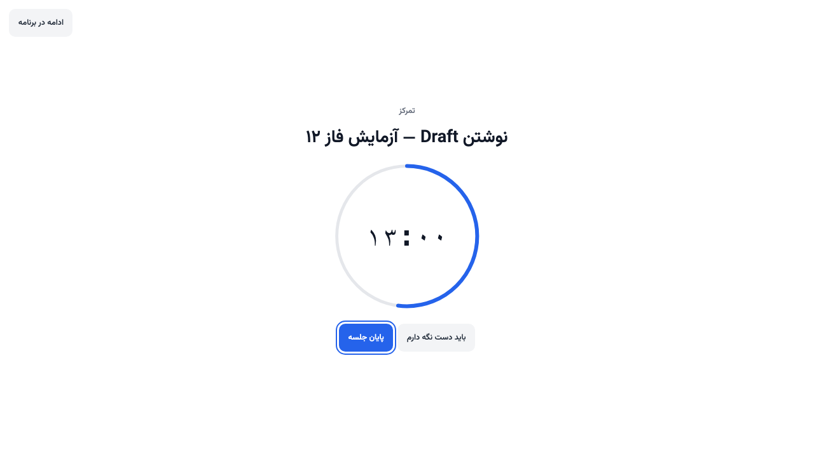
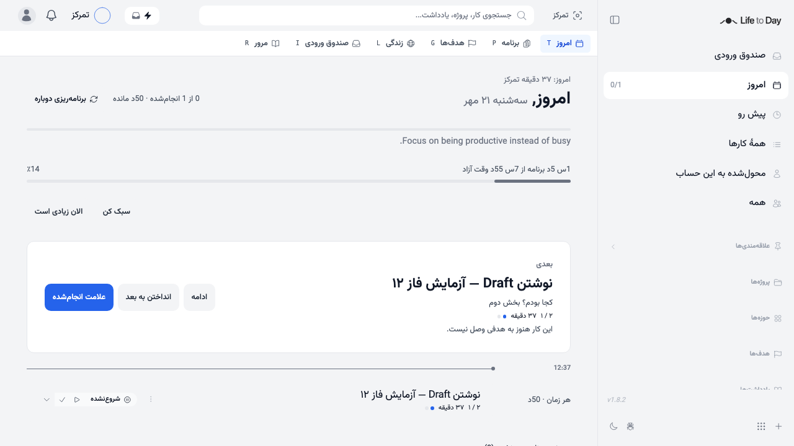

# Phase 12 — Task-bound Pomodoro

Base: `3967d5aeb27594d7434fb7b86372259a4af64db5` (Merge pull request #11), verified after fetching origin. Branch: `feat/T-1201-pomodoro`. Source: PRODUCT_BLUEPRINT 14.8, ADR-015, Phase 12 in section 24, T-1201–T-1203, F47 and the phase DoD.

## Delivered

| Task | Status | Result |
| --- | --- | --- |
| T-1201 | Complete | Additive `safeAddColumns` migration for nullable INTEGER `tasks.focus_minutes`; combined user/task index; validated 5–90 step 5; length resolves task → user → 25. The existing Focus service supplies start, end with optional timestamp, manual time, lifetime summary and today's totals. Per-user transactions prevent simultaneous starts and serialize manual overlap checks. Human-session writes only; no Journal |
| T-1202 | Complete | SVG ring on the same `pomodoroClock`; work empties, rest fills, continued work shows a full ring and +mm:ss. One 400 ms entry and one 600 ms bell pulse; 1 s linear progress only without reduced motion. Hidden tabs stop clock intervals; visibility recomputes timestamps. Bell leaves the session open; rest ends at the bell, continuing keeps it open, +15 asks, +120 closes at the bell. Local breaks never create sessions or auto-start work. Optional OscillatorNode tone, off by default |
| T-1203 | Complete | Server-session chip, 28 px ring, digits and task bdi; picker uses Now then today's plan. Old localStorage key removed, never migrated. Lifetime count/minutes on task rows and Now, up to eight direction-following dots, quiet over-estimate copy. Task estimate card edits length and count; count writes the same estimated_minutes as daily plan chips. Manual entry and user preferences are available. en/fa translations, English placeholders for the remaining locales. Core patches recorded in UPSTREAM.md |

## Decisions and fixes

- A completion dot requires ended, uninterrupted, and actual + 1 >= planned. Interrupted work retains its minutes and note. Open work and breaks contribute no minutes to summaries. Summaries use all completed sessions over the task's lifetime; today is the user's local start day.
- Starting while another session is open returns 409 rather than silently ending work. Resuming an open session returns that same session. An abandoned session is closed at the bell on current/start/end, so a reload cannot add unattended overtime.
- Normal end uses server now. Break end supplies started + planned, excluding time spent waiting on the bell screen. A session's planned_minutes stays unchanged after editing the task length.
- The estimate ceiling is 1080 minutes so the specified twelve-step count control can represent twelve 90-minute intervals. There is still only one estimate column. Target is not clamped to twelve; only the count editor display is capped.
- A browser test caught Navbar being remounted when Layout's initial loading state ended. The same SidebarProvider/UpgradeModal shell now exists in loading, error and loaded states, preserving the Focus host and its rest transition. The overlay is portaled to the document body to cover the entire viewport outside the transformed app canvas. The shared rendering clock has one interval for all subscribers and none while hidden.
- Dedicated Pomodoro preferences are preserved when a profile form saves. Estimate updates revalidate Focus summaries from the shared task service, including daily-plan chips. Account teardown clears the overlay and current-session cache.
- Manual time requires timezone-qualified timestamps, duration 1–240 minutes, start within seven days, no future end, and no overlap with any session belonging to that user. It is a human write, with no Journal or calendar export.

## Validation

- SQLite Phase 12: 15 tests passed (rules + API). Phase 5 Focus/capacity/recovery regression tests also passed in the earlier 24-test run. Added checks cover the 1080-minute estimate, API-token rejection and concurrent starts.
- PostgreSQL 18, separate temporary container: 27 tests passed (Phase 12, Phase 5 execution, pure rules). PostgreSQL migration + schema parity: 5 passed. Existing tasks remain NULL; up is idempotent, combined index exists and down refuses.
- Legacy SQLite upgrade + schema parity: 137 passed, four PostgreSQL-only checks skipped before the dedicated PostgreSQL run. Every old fixture retains NULL focus_minutes with no default or backfill.
- Full frontend: 141 suites, 980 tests passed. After the Layout/shared-service changes, the relevant UI regression suite was rerun: 69 passed. Fake-clock tests cover frozen tabs, bell waiting, continued overtime, short/long breaks, no automatic next interval, +15 and +120. Reduced motion is also checked against computed browser CSS.
- Full SQLite backend: 290 suites passed; 4248 tests passed, eight skipped, four environment-related failures (one local CalDAV connection reset and three SOCKS proxy/DNS expectation failures). Those four suites were rerun without proxy variables: all 45 tests passed. No unrelated implementation was changed.
- Chromium E2E `e2e/tests/ltd-pomodoro.spec.ts`: passed. Real HTTP/session writes against a dedicated SQLite fixture; only session start timestamps are backdated to avoid waiting. Task length 25, estimate 50: one complete interval and a 12-minute interruption show `۱ / ۲` and `۳۷ دقیقه` on Now and the task page. Rest adds no minutes and creates no next session. The old localStorage key stays absent. Clicking the chip opens the same session UID; the inactive picker starts that same task through POST. Changing length to 50 preserves estimated_minutes=50 and recalculates target to 1, then restoring 25 returns target to 2.
- The E2E reads progress transition duration as 1s, then 0s under reduce. No page exception or failed phase request. Existing pre-login `/api/profile` 401 and unconfigured `/api/billing` 404 responses are explicitly excluded from its phase-request assertion.
- Typecheck, lint (zero errors, 13 existing/test-style warnings), production build and diff whitespace checks passed. `graphify update .` refreshed the ignored local graph with AST extraction; it reports the existing unsupported EJS/no-symbol files. No dependency was added.

## Boundaries

The same ltd_focus_sessions and pomodoroClock remain. No second timer/table, pomodoro_count, statistics notebook, streak, music, confetti, site blocker, automatic next interval, MCP tool, calendar-session export or Journal. Capacity factor f is unchanged. Phase 10 was not started. No stash was popped; no .env, credentials, deploy/data or runtime database is staged. PR targets only DanialMasghati/life-to-day main; no force push and no merge before green CI.
